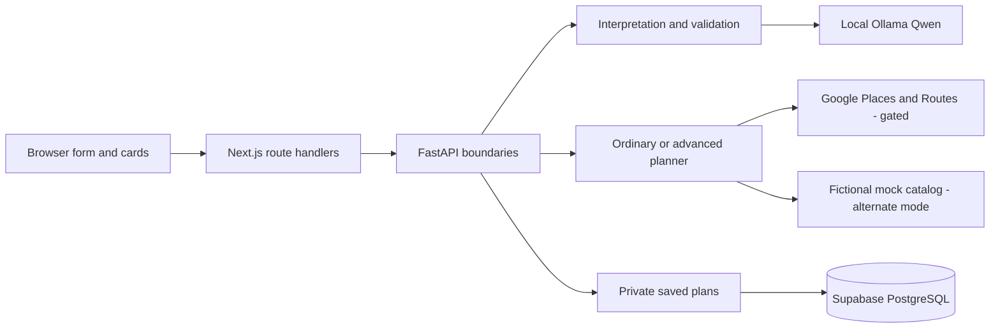

# 03 — Overall Application Architecture

[Course contents](README.md) · [Glossary](GLOSSARY.md)

## Architecture is responsibility placement

**Architecture** describes the parts of a system, how they communicate, and which part owns a decision. Developers separate responsibilities so interface changes do not require rewriting planning algorithms and private credentials do not enter browser code. Where To? needs this separation because language interpretation is uncertain, provider access can cost money, and saved links grant access to private data.



The browser owns interaction and presentation, Next.js owns same-origin proxy routes and response checks, and Python owns authoritative planning. Google supplies venue/routing evidence; the model supplies an extraction, not verified venue facts. PostgreSQL stores deliberately selected app-owned information and provider identifiers, rather than a permanent Google response archive.

## Trace one boundary in source

From [app/api/plans/generate/route.ts](../../app/api/plans/generate/route.ts):

```typescript
const base = process.env.BACKEND_URL ?? "http://127.0.0.1:8000";
const response = await fetch(`${base.replace(/\/$/, "")}/api/plans/generate`, {
  method: "POST", headers: { "Content-Type": "application/json", ...developmentOriginHeaders(request) }, body: JSON.stringify(payload),
  cache: "no-store", signal: AbortSignal.any([request.signal, AbortSignal.timeout(115000)]),
});
```

Line 1 selects a configured backend URL or the loopback default. Line 2 removes a trailing slash and appends the backend path, then waits for HTTP. Line 3 sends POST with JSON and locally relevant origin headers. Line 4 disables response caching and combines cancellation with a 115-second timeout. Line 5 closes the call. The input is parsed browser JSON, and the immediate output is a Response object, not yet a verified itinerary. The route subsequently parses JSON and calls `adaptRanking`; unavailable backends and invalid upstream replies become safe errors. The browser's `generateOuting` has its own request lifecycle, so this timeout is only one layer's limit.

A **proxy** forwards a request to another service. A **same-origin** route has the same scheme, host and port as the page, simplifying browser communication. The proxy is not a replacement for Python validation; users can modify requests.

## There are several kinds of boundary

A **trust boundary** is where data from a less trusted source is checked before it gains authority. The browser can propose preferences; Pydantic validates them. Qwen can propose JSON; strict decoding, source checks and deterministic dates validate it. Google can return data; normalization checks shape and provenance. A saved access token can identify a capability; database policies still check its scope and expiry.

A **pure function** depends on its supplied inputs rather than performing network or database work. [feasibility.py](../../backend/feasibility.py) evaluates supplied evidence without contacting Google. This makes tests reproducible. An **orchestrator** coordinates these functions with I/O: [real_planning.py](../../backend/real_planning.py) and [advanced_planning.py](../../backend/advanced_planning.py) hold that responsibility.

## Ordinary and advanced are different pipelines

The ordinary path generates a fixed-order list of one to four activities. The advanced path stores a backend-owned Journey with occurrence identities, optionality, order edges and endpoints, resolves venues, routes a bounded shortlist and evaluates complete-trip timing. See `validate_journey`, `Sessions.create` and `Session.run`. An advanced handoff can still need a date, origin, identity choice, departure or dwell answer. A token is not a promise that all requirements are feasible.

**Process-local** state lives in one Python process and disappears on restart. Current admission, sessions and provider budgets use this model alongside a protected local accounting ledger. Copying the backend to several machines would not create one shared authority. [admission.validate_environment](../../backend/admission.py) therefore refuses production/known hosting environments. Chapter 18 explains the proposed shared services; they do not appear as deployed components in this diagram.

A final habit: read historical architecture entries as history. The root architecture file's older “not implemented” extension heading is superseded by its later Task 50E implementation sections. This course follows the executable boundaries above.

## Task 52 packaging boundary

The application now has reviewed container recipes under `deployment/`, and `next.config.ts` emits a standalone Node server. This changes packaging, not planning. Backend assembly uses `deployment/backend-files.json`; scripts, local V5.1 fixtures and paid evaluation machinery are absent from the runtime payload. Existing hosted startup refusal remains authoritative. One frontend plus one backend service is still a proposal, not a deployed application. [Artifacts, shared-state blockers and verification](../task52-cloud-deployment-preparation.md).

## Five key takeaways

1. Each layer has a different responsibility.
2. Python owns planning decisions.
3. Proxies forward but do not establish trust.
4. Pure evaluators can run without providers.
5. Current local state cannot safely become a fleet by copying processes.

## Disposable local V5.1 application integration

`scripts/task52_v51_application_fixture.py` is an explicit test process. Normal Next/FastAPI startup does not import it. It temporarily supplies the existing generalized development interpreter at `backend.main.interpret_request`; the existing handler still owns admission, advanced-session creation and response DTOs. The frontend and planner are unchanged. This is a fixture boundary, not a production feature flag or a new HTTP interpretation mode.

Places/matrix evidence and saved storage are fictional. External transports, model creation and PostgreSQL connections are blocked. Loopback binding and request checks limit access to the local test workflow. [Exact flow and commands](../task52-v51-local-application-integration.md).

## Local manual/pending bridge

The explicit application fixture now calls `LocalContinuation` in `scripts/task52_v51_local_continuation.py`. It reuses the fresh-only generalized validator, then applies existing deterministic calendar, geography, mode and travel controls. A small bounded cache checks that a pending DTO was issued by this fixture and still belongs to the same raw source. This cache is provenance evidence, not a replacement session, admission receipt, login or durable service. Normal application startup still never imports it. [Current scope](../task52-v51-manual-pending.md).

## Check your understanding

03.Q1. Which layer renders cards?
03.Q2. Which layer validates model output?
03.Q3. What is a trust boundary?
03.Q4. Does a proxy make browser payloads trustworthy?
03.Q5. Why does production startup refuse?

## Code-reading exercise — 03.R

Read app/api/plans/generate/route.ts and backend/main.py. Find the two functions that receive the same path at different layers.

## Inactive shared-state reference

The inactive `experiments/shared_state/` reference separates durable SQL authority metadata from expiring private evidence. It does not replace the FastAPI session managers. Existing live sessions contain locks, callbacks and resolver objects that cannot be saved as JSON. Application integration still needs reviewed server-owned issuers and decomposed evidence DTOs. The ordinary, pending, advanced and saved DTO roundtrips tested here establish compatibility only at that boundary.

[Shared-state implementation and limits](../../docs/task52-shared-state-foundations.md)

## Practical exercise — 03.P

Draw the architecture on paper and mark each component as browser, local service, external service or proposed.

See [separate answers and guidance](EXERCISE_SOLUTIONS.md#chapter-03).

[Previous chapter](02-programming-and-web-development-fundamentals.md) · [Contents](README.md) · [Next chapter](04-frontend-react-next-js-typescript-and-tailwind.md)


## Inactive provider-action bridge

`experiments/shared_state/action_bridge.py` is a separately constructed local test composition. It calls the existing interpreter, ordinary/advanced planners and saved-refresh functions; it does not create a second planner. Normal FastAPI startup does not construct it. `backend/action_dispatch.py` has a ContextVar whose default is `None`; normal application calls therefore keep the existing credential/transport and admission behavior. A reviewed build and isolated fake services are prerequisites for the experiment, not production activation.

See [Task 52 action bridge](../task52-provider-action-bridge.md) for exact boundaries and verification.
