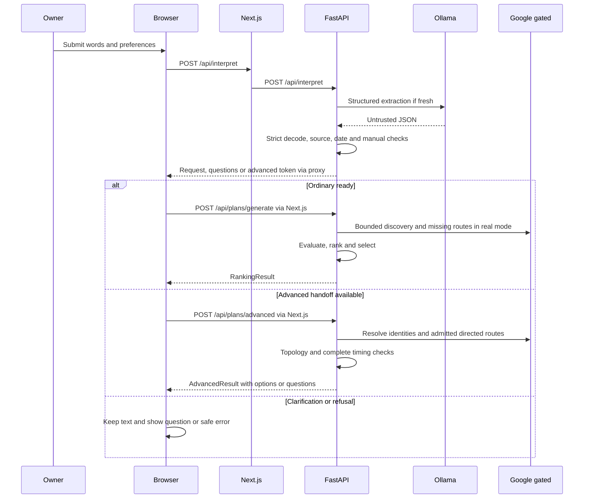

# 07 — Complete End to End Outing Request Lifecycle

[Course contents](README.md) · [Glossary](GLOSSARY.md)

## How to read these traces

A **lifecycle** is an operation's path from the user's action to completion, clarification, cancellation or failure. Each trace below is a source-grounded execution explanation, **not a newly executed model/Google/browser transcript**. Actual model JSON and real venues cannot be predicted. All durations and venue examples in worked lessons are fictional unless explicitly identified as recorded evidence.

The common entry is [app/page.tsx](../../app/page.tsx): `submit` → `runPlanning` → [generateOuting](../../lib/planning-client.ts). The page captures request text, explicit manual preferences, date/follow-up answers, travel settings and a chosen origin mode. `manualPreferences` separates actual edits from automatic display values. Origin controls acquire location only through the appropriate action, not when the page opens.

The diagram abbreviates both response hops for clarity. Direct browser requests normally target Next.js, which forwards to Python. Advanced creation occurs only when local gates and the interpretation's handoff conditions permit it. Missing provider gates never turn a mock catalog into real-city data.

## A — “Dinner and drinks in Sydney today.”

**First current calendar boundary:** `timezone_for("Sydney")` returns the fallback `UTC`, which represents an unknown destination calendar here. With no exact manual date, `resolve_datetime` produces `unsupported_date` for “today.” An offline pure-function check at a declared instant confirmed this. Therefore this exact fresh request normally needs an exact date or recognized destination-calendar context before ordinary generation; the following discovery/ranking stages are conditional on resolving that question. The app does not automatically know Sydney means Australia/Sydney.

1. **Capture and events.** `submit` calls `runPlanning`; the current controller owns the result. The text contains destination and relative date but does not identify the starting point. If a manual/device origin is selected, it must be confirmed; Surprise Me can start at the first activity if no origin-only requirement conflicts.
2. **Interpretation API.** `generateOuting` posts text/preferences to `/api/interpret`; Next's `POST` forwards to FastAPI `interpret_endpoint`, which runs `interpret_outing` through worker management. A fresh request calls Ollama once through the legacy validation wrapper. Expected intent is dinner plus drinks, Sydney and “today”; this is not an assertion that Qwen will return it correctly.
3. **Validation.** `parse_interpretation` checks strict structure. `interpret_request` checks activity grounding, source constraints and manual precedence; `date_resolution` resolves today against accepted destination-calendar context. A missing/uncertain timezone or expired date requires correction. Dinner maps to food and drinks to drinks; dinner stop metadata preserves meal timing. No party-size question or fabricated spending evidence is needed.
4. **Planning input.** A plain validated list usually yields an ordinary `PlanningRequest`. `prepareOrigin` obtains confirmed origin context or an acceptable Surprise Me choice; then `/api/plans/generate` reaches `generate_endpoint`/`generate_plan`. Calendar and beginning validity are checked again.
5. **Discovery and routing.** Real mode calls `real_plans`, with the website's location-first context. `sequential_discovery` builds bounded venue searches; Places normalization/quality/geography retain matching restaurant/bar evidence. Missing directional route evidence is admitted and obtained through `GoogleRouteCalculator`. Surprise Me has no origin-to-first leg; confirmed origin does.
6. **Evaluation and return.** Known violations are filtered; unknown real prices, hours, dwell or sessions remain unverified. `score_candidates` and selection rank supplied evidence, not imaginary prices. `RankingResult` goes through proxy validation and `adaptRanking` into shared cards. An unavailable backend/model, invalid extraction, unresolved origin, geography failure or no feasible checked combination produces its respective safe branch.

**Mock boundary:** Sydney has no fictional catalog coverage. The mock path cannot produce a valid Sydney outing. Choosing Baltimore merely to obtain cards would change this request and is not a successful execution of A.

## B — “Box cricket, dinner and movie in Hitech City tomorrow.”

**Separate current calendar boundary:** bare `Hitech City` also maps to fallback `UTC`; tomorrow raises `unsupported_date` without an exact manual date or recognized context. Including a recognized parent such as Hyderabad can provide Asia/Kolkata, but changes/clarifications must be explicit. The narrow Hitech/HITEC geography correction does not change `timezone_for`.

The same `submit` → `runPlanning` → `generateOuting` chain captures three source occurrences, destination and tomorrow. The interpretation request still goes to `/api/interpret`, not a special cricket endpoint. [activity_category](../../backend/interpretation.py) and source-intent handling preserve grounded activity phrases; movie is venue discovery, not a booked showtime. Manual mode still needs an independently confirmed origin. The source supplies no court availability, exact movie session or visit length.

If validation yields a ready ordinary list, `/api/plans/generate` reaches `real_plans`. Candidate searches must retain relevant box-cricket, restaurant and cinema venues; matching names alone do not establish the destination. [venue_geography.geographic_reason](../../backend/venue_geography.py) compares provider address components. The Hitech/HITEC equivalence is deliberately narrow: Hyderabad locality, Telangana state, and the neighborhood/sublocality component must support it. A business called “Hitech” elsewhere does not qualify. Candidate identity, activity matching and geography must pass before routing and ordinary evaluation/ranking.

Tomorrow resolves only with accepted calendar evidence; it is not hardcoded to the machine's date. The returned schedules remain provisional where hours, dwell and session availability are missing. If all venues fail destination verification, `real_plans` can return a destination-resolution failure with recovery guidance; it must not silently search a different area. If any required activity pool is empty, no partial two-activity itinerary replaces this three-stop request.

The [Hitech investigation](../../docs/hitec-destination-investigation.md) established a spelling defect with fictional fixtures and a narrow correction. It did **not** recover the original incident's full response or prove its precise cause. Its synthetic three-activity provisional result is not a real successful cricket/dinner/movie booking. Mock mode cannot serve this destination.

## C — “Coffee, museum, then coffee, return to the starting point within three hours.”

Capture keeps all three occurrences: coffee at source index 0, museum at 1, later coffee at 2. A list of three phrases is different from a set of two categories. `generateOuting` posts the original text; no deduplication may merge the two coffee visits. The request lacks a city and date, and the return needs a confirmed origin. Those absences matter before venue discovery.

The fresh extraction should preserve three required stops, origin endpoint and a 180-minute inclusive maximum for the whole trip. Current legacy validation normalizes and checks the extraction, while a known ordering safety gap remains: it has historically accepted an extra unsupported coffee0→museum1 edge when the quote also contained “then.” Under the frozen V4 source-first policy, the only explicit relationship is museum1→coffee2. V4 is default-OFF observation/offline research, **not an active fix**. The proposed owner V5 policy instead treats bounded lists as sequential by default; it would require 0→1→2 here. Neither policy should be silently substituted for the current runtime in this trace.

An accepted advanced request receives `advancedToken` only if `Sessions.create` can create the local session. The browser calls `prepareOrigin(requireOrigin=true)` and POSTs `/api/plans/advanced`; FastAPI calls `advanced_sessions.run` and `Session.run`. Missing date/destination may be answered in the main form or advanced questions. Explicit nearby-search consent can establish an area around a confirmed origin; a private origin is not automatically a destination city/timezone.

`StopResolver` keeps occurrence-specific candidate groups; repeated categories may reuse search evidence but require distinct venue identities in a route. `AdvancedRouter` applies the effective legacy order, required stops and return topology; admitted directed routes include origin→first, inter-activity and last→origin. `evaluate_advanced_timing` adds travel and dwell ranges. Three hours includes return; it is not “180 travel minutes between venues.” Unknown coffee/museum dwell cannot establish a finite upper bound. Departure/timezone answers may also be required for clock/hours checks. `AdvancedResult` returns questions, unverified options, no results or supported feasible options from the checked pool. `adaptAdvanced` renders shared cards. No success is promised for this incomplete source or for the known unsafe ordering branch.

## D — “Pharmacy before bank; coffee whenever convenient.”

The entry events and `/api/interpret` call are the same. Here **before** establishes pharmacy0→bank1, while “whenever convenient” makes coffee independent in order. It does **not** make coffee optional: all three visits are required. The source again lacks city, date, origin and visit lengths. A model that changes coffee to optional changes the request.

`validate_journey` sees a partial order rather than a complete adjacent chain and selects the advanced handoff when enabled. If extraction/source validation fails, the client shows clarification before planning. Otherwise `generateOuting` prepares the starting mode and calls `/api/plans/advanced`. `StopResolver` discovers the three activity groups after necessary geographic/date answers. `AdvancedRouter._ancestors` represents precedence; its shortlist can consider coffee–pharmacy–bank, pharmacy–coffee–bank, or pharmacy–bank–coffee, subject to actual candidates and constraints. Bank–pharmacy–coffee violates the required relation and is excluded.

Google supplies missing directed travel evidence for a bounded shortlist, not all possible city routes. Hours checks can eliminate known closures; unknown bank availability is not a verified appointment. Advanced route ranking prefers verified compliant evidence and shorter travel, with diversity among comparable options; session timing/selection also handles optional inclusion, though none of these stops is optional. The returned advanced response goes through Next.js and `adaptAdvanced`. Without dates/geography or sufficient evidence this example stops at questions or unverified/no-result states, not a fabricated completed outing.

## E — Sydney dinner/drinks with return: Surprise Me versus manual origin

The source is “Dinner and drinks in Sydney today and return to starting location.” Sydney’s unknown calendar mapping can still require the date clarification described in A. Independently, the return adds an origin endpoint; it changes the earlier ordinary example into an advanced journey when validated. There is no three-hour constraint in this wording, so none may be invented.

| Stage | Surprise Me selected | Confirmed manual origin |
|---|---|---|
| Frontend | `generateOuting` derives `requireOrigin` from origin/home endpoint | Same return requirement plus selected confirmed origin |
| Origin preparation | `location-controls.prepareSurprise` refuses: journey must return to a confirmed start | `context()` supplies explicit authorized origin and first/between preferences |
| Next planning request | No advanced routing request until origin conflict is resolved | POST `/api/plans/advanced` with session token/configuration |
| Backend | Interpretation may already have happened; no fictional first-venue return is substituted | `Session.run` → resolver/router/timing with confirmed start |
| Travel | No route is inferred to a guessed landmark or first activity | origin→dinner→drinks→origin, constrained by admitted evidence |
| Outcome | Choose current/manual confirmed start to continue | Options/questions/failure according to actual evidence |

Manual lookup itself may call `/api/starting-places` when the owner presses Find and confirms a result, subject to its local gate and budget. The origin's private coordinates stay transient. A manually typed label without confirmation is insufficient. The backend router independently refuses a return without an origin, so bypassing the interface does not authorize a guessed start.

In real mode candidate generation, routing, hours and ranking follow the advanced sequence described above. Date expiry, source errors, lookup failures, missing venue evidence or exhausted routing allowance can still stop it. In mock/default mode the Sydney and advanced real-flow requirements prevent the same result. This comparison is about the verified branch logic, not a fresh live Sydney test.

## Five key takeaways

1. Every trace starts with the same form and interpretation boundary.
2. Ordinary generation and advanced continuation use different endpoints.
3. Missing city, date or origin must remain missing until resolved.
4. Repeated phrases need distinct occurrence identities.
5. A source-based trace is not a live acceptance result.

## Walking through the local V5.1 fixture

Start only the explicit fixture and a separate local Next process using the commands in the [integration report](../task52-v51-local-application-integration.md). Enter an exact server-owned example such as “Buy groceries and maybe stop for coffee.” The existing form sends natural-language text; it never submits a trusted extraction or graph. A supplied fake response is checked against that source by `interpret_for_development`, then the existing interpretation endpoint creates its advanced session.

Choose a starting method and answer missing date/destination in the existing controls, one requested follow-up at a time. Commit a date typed in words by leaving its input, then submit. Synthetic venues and matrix evidence pass through the real advanced resolution, routing and timing contracts. View Plan and selected save/reopen use the same UI and API routes as ordinary startup. The generalized helper remains fresh-only; the later fixture bridge described below supports bounded manual controls and issued pending snapshots. Production retains its existing legacy path.

## Editing and answering in the local V5.1 workflow

The later fixture-only bridge supersedes the initial manual/pending refusal described above. Enter a supported fixture request, answer missing context in the existing controls, and regenerate. Date, area and mode remain explicit user controls; no model call reconstructs them. An issued pending snapshot can carry date/location answers, but the bridge independently re-proves the original server-owned raw extraction before returning a handoff.

Editing the textarea uses the existing `replaceRequest` flow: old cards, pending references and accumulated advanced answers are cleared. Deliberate manual preferences remain separate. “Coffee, then groceries.” must obtain a fresh extraction and map coffee as occurrence zero; it cannot reuse the groceries-first graph. Contradictory source directions still clarify until the original text is corrected. [Current acceptance and limits](../task52-v51-manual-pending.md).

## Check your understanding

07.Q1. Why can A fail in mock mode?
07.Q2. What is not established by a cinema venue?
07.Q3. Which edge does frozen V4 prove for C?
07.Q4. Is coffee optional in D?
07.Q5. Why does Surprise Me stop E?

## Code-reading exercise — 07.R

Follow requireOrigin from lib/planning-client.ts into components/location-controls.tsx, then find the backend no-origin return guard.

## Practical exercise — 07.P

For A–E draw a branch diagram and put a question mark at every fact the original sentence does not supply. Do not submit the examples.

See [separate answers and guidance](EXERCISE_SOLUTIONS.md#chapter-07).

[Previous chapter](06-apis-http-json-and-frontend-backend-communication.md) · [Contents](README.md) · [Next chapter](08-ai-interpretation-qwen-ollama-prompts-and-structured-json.md)

## Local source-to-provider proof

In the inactive Task 52 bridge, `Broker.interpret` retains owned copies of the original input, raw extraction and complete legacy result. `Broker.plan` consumes the existing ordinary/handoff receipt. An advanced handoff creates a Session but cannot search by itself; `Broker.advance` uses the actual Session continuation checks under a separate action. Pending answers go through the existing `validate_legacy` with the issued effective snapshot and a new revision, without pretending it is fresh model output. Source edits revoke the old handle. These are Python-only isolated tests, not new HTTP routes.

See [Task 52 action bridge](../task52-provider-action-bridge.md) for exact boundaries and verification.

## Inactive service-to-service continuation

In the [authenticated local fixture](../task52-service-isolation.md), a worker sends source text and existing typed controls to the trusted factory. The factory validates, obtains a separate fictional count, reserves protected spending, and asks the delivery-only dispatcher to execute exactly the approved synthetic payload. A dispatcher callback proves the factory still owns the active action. It then returns an owner-bound opaque native ticket. Another authenticated worker can continue it after SQL/Redis/witness checks; a ticket alone cannot spend. Pending answers do not repeat inference, initial request IDs and mutating revisions cannot be reused, selected receipts remain reusable, and refresh rechecks current access separately. These are private fixture interfaces, not activation of the production request lifecycle described earlier.

## Inactive user-owned continuation across services

In [the hosted-identity fixture](../task52-hosted-identity-contract.md), the frontend verifies an IAP assertion and creates a scoped user-forwarding proof. Backend and factory independently verify it before existing native ticket lookup/continuation. Backend A and B can continue the same tester's source; another tester cannot reuse that private planning ticket. Pending answers still avoid another inference charge. Native revision, fence, absolute expiry, encrypted evidence, root/outing and protected spending remain separate checks. Saved-document access continues to use its bearer/RLS/expiry/membership, not a newly invented account owner.

## Why authenticated liveness is not a hosted outing

The [new local composition](../task52-hosted-startup-integration.md) runs actual Next and two FastAPI processes for signed health requests. It does not run interpretation→plan through a hosted facade. Ordinary `InterpretationResult` has no durable outing handle; `PlannerInput` cannot prove which retained source/outing/revision owns a browser DTO. Selecting a user's latest request would mix concurrent tabs. Until a reviewed handle/session contract exists, all private business paths stop before provider work. Existing local/native workflows and anonymous saved capabilities retain their previous rules.
