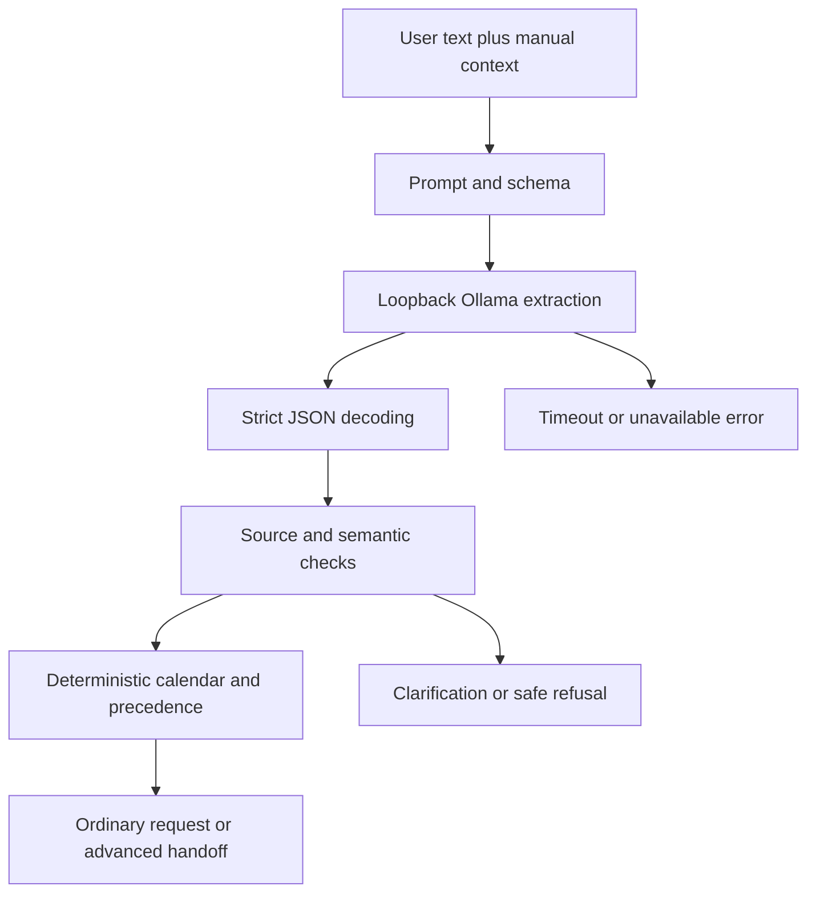

# 08 — AI Interpretation Qwen Ollama Prompts and Structured JSON

[Course contents](README.md) · [Glossary](GLOSSARY.md)

## Extraction is the model's job

**AI**, artificial intelligence, here means a language model extracting structured requirements from text. An **LLM**, large language model, predicts token sequences from a prompt. A **token** is a model's chunk of text, not necessarily a word; it is unrelated to the access tokens used for saved links. **Inference** means running an already trained model to produce an answer. Where To? does not train Qwen in this repository.

**Qwen3 4B** is the local model configured by default; “4B” denotes roughly four billion model parameters, learned numerical values. **Ollama** runs that model and provides a loopback HTTP API. [AISettings](../../backend/ai/__init__.py) defaults to `qwen3:4b`, `http://127.0.0.1:11434`, 60 seconds, and provider `ollama`. `create_provider` currently rejects other provider names; evaluation scripts do not automatically become production adapters.

Local Qwen was selected to provide a replaceable local interpretation service without recurring cloud inference charges, as recorded in [DECISIONS.md](../../DECISIONS.md)'s Task 30 entry. It still costs local compute/time and is not perfectly reliable. Cloud investigation asks whether another model can improve latency/correctness while meeting privacy, cost and safety requirements.

## Prompts and the contract

A **prompt** is the instructions and examples supplied to a model. A **system message** provides task rules; a **user message** contains the request; example assistant messages demonstrate desired structure. [ollama.py](../../backend/ai/ollama.py) contains `SYSTEM_PROMPT`, journey instructions, examples and `OllamaProvider._interpret`. These instruct extraction, not venue invention or route optimization. **Few-shot examples** are demonstrations inside the prompt, not changes to model weights.

Actual payload lines:

```python
schema = Interpretation.model_json_schema()
```

```python
"options": {"temperature": 0, "num_ctx": 8192, "num_predict": 1024},
```

The first line derives **JSON Schema**, a machine-readable contract, from the Python `Interpretation` model. It is used in the structured Ollama request. The second line sets low sampling variability (`temperature`), context capacity (`num_ctx`) and generated-output bound (`num_predict`). These are copied source excerpts, not a complete runnable payload. `temperature: 0` does not prove perfect semantic determinism or correctness. The full `_interpret` constructs the messages and POSTs `/api/chat` with structured format and nonstreaming response handling.

Input is bounded user text and fixed instructions/examples/schema. Output is proposed fields such as `activities`, `location`, `date_expressions` and `journey`. Unknown facts should remain null or absent according to the contract. An extraction saying “museum” is not evidence that a museum exists nearby or is open.



“Precedence” here includes manual-versus-inferred preference precedence; stop order is checked too. The model response is copied/validated before use. [parse_interpretation](../../backend/ai/__init__.py) rejects duplicate object keys; Pydantic rejects unknown fields and nonfinite values. A valid shape can still express the wrong meaning, which is why chapter 9 matters.

## Failure and latency

`OllamaProvider` validates a loopback base URL and wraps inference in local admission. Network/model-not-found, timeout, malformed response, refusal-like invalid output or validation errors become `AIError` categories. `main.interpret_outing` maps them to sanitized 503 responses. There is no retired-interpreter fallback that guesses an outing after validation fails.

A first model load may be slower than a ready model. **Warmup/readiness** is preparatory model work managed by [ai_readiness.py](../../backend/ai_readiness.py); it does not prove the next request's semantics. **Inference latency** measures the model operation; **end-to-end latency** includes browser/proxy/validation/discovery/routes/rendering. Comparing a model's two-second answer with a full itinerary's twenty seconds without naming scope is misleading. Checked-in Task 50E and 52 measurements must retain their original sample sizes and context.

Follow-up answers can reuse a `PendingClarification` extraction and apply deterministic rules without another model call. Changing arbitrary source text is different from answering a typed question; a stale or unrelated pending snapshot must not be treated as a trusted new plan. These distinctions explain why both user experience and safety depend on the request lifecycle.

## Five key takeaways

1. The model extracts requirements rather than verified venue facts.
2. Ollama is a local inference service.
3. JSON Schema constrains shape, not full meaning.
4. Temperature zero does not guarantee correctness.
5. Model latency is only part of outing latency.

## Check your understanding

08.Q1. What does inference mean?
08.Q2. Are prompt examples training?
08.Q3. What is num_predict bounding?
08.Q4. Why is JSON Schema insufficient?
08.Q5. Can clarification avoid another model call?

## Code-reading exercise — 08.R

Read AISettings.from_env and OllamaProvider._interpret. Identify provider URL, model, schema and output bound.

## Practical exercise — 08.P

Run rg -n "model:|base_url:|timeout_seconds:|num_predict" backend/ai/__init__.py backend/ai/ollama.py. Do not run a smoke or benchmark script.

See [separate answers and guidance](EXERCISE_SOLUTIONS.md#chapter-08).

[Previous chapter](07-complete-end-to-end-outing-request-lifecycle.md) · [Contents](README.md) · [Next chapter](09-validation-source-grounding-and-ordering-rules.md)
