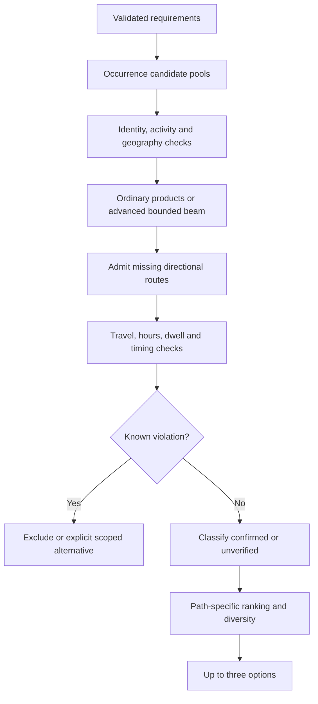

# 10 — Planning Algorithms Filtering Scheduling and Ranking

[Course contents](README.md) · [Glossary](GLOSSARY.md)

## Search is separate from judging a candidate

An **algorithm** is a repeatable procedure. A **candidate** is a possible venue assignment, not yet a valid recommendation. A **pool** is the available candidates for one requested occurrence. **Filtering** removes known violations; **scheduling** assigns compatible times; **ranking** orders remaining choices by preferences. Where To? separates these so a high rating never overrides a required stop or hard limit.

### Ordinary candidate generation

[planner._pools](../../backend/planner.py) loads fictional activity/date pools; `_walk` performs depth-first traversal in source order. From `_walk`:

```python
for venue in pools[index]:
    if not request.allowRevisits and venue.id in used:
        continue
    route.append(venue)
```

Line 1 tries each venue for this occurrence. Line 2 checks already-used record IDs unless revisits are explicitly allowed. Line 3 skips a duplicate. Line 4 extends the current partial route; the full function tests fixed-time compatibility, recurses and later removes the appended venue. Input is ordered pools plus request; output is yielded `CandidateItinerary` records. Empty pools or incompatible assignments yield no complete candidate. A repeated category is allowed; repeating a venue ID is separately controlled. Real outings currently reject `allowRevisits` and require distinct venues.

For fictional pools dinner `[D1,D2]` and drinks `[B1,B2]`, the product is four assignments. A hash of normalized request context and ordered venue IDs supplies a stable candidate identity; a hash is an identifier, not a feasibility certificate.

### Scheduling ordinary candidates

[ranking.evaluate_candidate](../../backend/ranking.py) collects prices/adjacent travel, checks caps and walks stops at their earliest feasible time. It intersects opening/availability windows, respects fixed events, advances through travel and dwell, and applies dinner's 17:00 lower bound. All times below are fictional teaching values:

| Step | Intermediate calculation | Result |
|---|---|---|
| Earliest request start | 16:30 = 990 minutes after midnight | 990 |
| Dinner floor | max(990, 1020) | 17:00 |
| Dinner 60-minute dwell | 1020 + 60 | 18:00 |
| Travel 12 minutes | 1080 + 12 | 18:12 |
| Drinks opening 18:30 | max(1092, 1110) | 18:30 |
| Drinks 45-minute dwell | 1110 + 45 | 19:15 |

A hard end of 19:00 fails. A fixed movie at 18:00 also fails after that dinner/travel. Waiting later cannot improve a later deadline in this fixed-order, known-duration/window model, which justifies earliest-finish scheduling within its assumptions. Unknown dwell or route time breaks exact projections. The evaluator uses conservative feasibility checks and marks uncertainty; it must not present placeholders as verified visit lengths. `None` opening windows mean unknown, while an empty known list means closed. Availability, opening hours and event sessions are different facts.

### Costs and hard scopes

Decimal arithmetic avoids binary floating-point surprises in inclusive money comparisons. Known cost lower bounds can prove a cap violation even if a total is incomplete. Unknown prices cannot prove budget compliance. Ordinary real prices are absent, numeric spending controls have been removed, and real scoring has no affordability weight. Advanced sessions explicitly block unsupported spending/accessibility/ticket/reservation requirements instead of dropping them. Group size is no longer a current capacity filter; historical capacity language is not a guarantee.

Travel caps have separate scopes: origin-to-first, each inter-stop leg, summed inter-stop travel, and advanced whole-trip duration. Strict preference uses the stated maximum; Flexible has the original preference and inclusive doubled effective maximum, subject to exclusivity rules. Explicit beyond-limit views preserve original requirements and label deviations; they do not silently change a hard limit. Geography/access incompatibility stays excluded.

## Ordinary scoring, with actual formulas

`score_candidates` only accepts candidates without known violations. Mock weights `(affordability, quality, convenience)` are budget `(0.75,0.10,0.15)`, balanced `(0.35,0.40,0.25)` and experience `(0.10,0.75,0.15)`. Mock components use eligible-pool normalization. Real weights are `(0,0.6,0.4)`.

For real rating `r` with review count `n`, quality contribution is `((r*n + 3.5*50)/(n+50) - 1)/4`. This is a **prior**: 50 hypothetical ratings at 3.5 reduce overconfidence in tiny samples. Missing rating evidence contributes zero when averaged across requested venues. Real convenience is `30/(30+travel_minutes)` and includes a supplied first leg. Unknown travel contributes zero, not an average guess.

| Fictional score inputs | Quality | Travel | Convenience | Real-weight score |
|---|---:|---:|---:|---:|
| Option X | 0.80 | 10 min | 0.75 | 0.78 |
| Option Y | 0.85 | 30 min | 0.50 | 0.71 |

These quality inputs are already-normalized illustrative values. X wins this score even though Y's quality is higher. Feasibility/classification grouping and diverse selection still apply. `_select` favors distinct options; fewer than three is legitimate.

## Ordinary real search and final display priority

The website's ordinary real path does **not** enumerate the full 100-per-activity Cartesian product. [spatial_beam.candidates](../../backend/spatial_beam.py) extends a route-evidence beam (default width 96), skips duplicate venue IDs and unreachable/missing connecting route records, and prioritizes constraint compliance, known routes, travel/quality heuristic and all-occurrence coverage. It reuses `_walk` on single-venue pools to construct consistent candidate records. [routing_shortlist.shortlist](../../backend/routing_shortlist.py) also uses forward/backward geographic path gaps when selecting finite discovery/routing frontiers; a geographically promising assignment still needs actual route evidence.

In `real_plans`, the weighted score is an intermediate value. After classification, permitted alternative grouping, modest Flexible/retail preference bonuses and seen-ID exclusion, the current real path computes `verifiedTravelSeconds` including the first leg and sorts matching evidence before nonmatching, then verified seconds, then score/identity. Ordinary real `travel_classification.select_diverse` selects within 60 seconds of the best remaining travel and favors new venue identities at every stop, then travel/score. Thus the score table explains the score, **not a guarantee that the highest weighted score appears first**. Mock `_select` instead uses diversity within 0.15 of the best remaining score.

Surprise Me uses [surprise.select](../../backend/surprise.py): quality-qualified weighted sampling within 0.15 of the best score, favoring unseen first venues and broader novelty. A supplied rating below 3 with at least 10 reviews fails its quality threshold; missing/low-count ratings cannot establish poor quality. `weighted` uses random keys `-log(U)/weight`, so repeated equivalent requests need not show the same first venue. None of this relaxes hard feasibility or turns a first activity into an authorized private return origin.

## Advanced topology and bounded routing

`StopResolver` distinguishes named identities from generic discovery and produces occurrence-specific candidate groups. `AdvancedRouter._ancestors` computes transitive precedence. `_shortlist` enumerates optional subsets, extends precedence-compatible partial paths, prevents duplicate venue IDs and applies same-mall evidence where required. With unspecified ordering it keeps source order; constrained or flexible journeys can consider permitted permutations.

Initial constants are four occurrences, four shortlisted candidates per occurrence, a beam width of 24 and at most 27 distinct directed pairs per computation. A **beam search** retains only a limited set of promising partial paths. Geographic straight-line gaps help prune the beam; they never prove route travel. Incremental work can consider broader retained pools while remaining bounded; `advance` and session guards limit accumulation (including 256 checked signatures). Directed pair keys deduplicate route needs across candidates.

For pharmacy P, bank B and coffee C with only P→B, valid orders are P-B-C, P-C-B and C-P-B. Directed seconds might differ in each direction; never infer B→P from P→B. The router constructs optional origin/return/final-destination legs, admits a finite union of missing pairs, and asks Google only for those admitted needs. Known beyond-limit candidates stay excluded unless explicit scoped permission applies.

Advanced route ranking is lexicographic, meaning compare the first criterion, then the next only on a tie: verification/beyond state, missing legs, preference deviations, total verified travel, rating tie-break and deterministic identity. Comparable candidates within 60 seconds diversify venue sets. Session timing selection prioritizes feasible, compliant options and optional inclusion within category before travel; it is not the ordinary weighted scoring formula.

## Whole-trip timing and limitations

[advanced_timing.py](../../backend/advanced_timing.py) adds elapsed travel and dwell **ranges**. Exact 20-minute dwell gives `[20,20]`; minimum 20 gives `[20,unknown upper]`; maximum 20 gives `[0,20]`; approximate is not an exact bound. A fictional route with travel 30 and dwell 20+60+20 totals 130 minutes; unknown museum upper dwell prevents proving a 180-minute maximum, while a known lower bound over 180 proves failure. Confirmed return travel participates in whole-trip timing.

Clock/deadline/hours checks require accepted date, explicit departure and appropriate destination timezone. UTC—Coordinated Universal Time—is used for elapsed arithmetic; local projections account for daylight saving transitions. Unknown hours and failed full-envelope containment do not universally prove a venue cannot fit; the evaluator distinguishes feasible, infeasible and unverified. Known failure wins over unrelated uncertainty.



## Complexity and finite coverage

If ordinary pools have sizes `p1...pk`, traversal can examine their product; with uniform size `p`, this is `O(p^k)` assignments and approximately `O(k)` evaluation per assignment ignoring window intersections. Lazy generation reduces construction memory, but ranking can materialize eligible candidates. Sorting `m` results costs roughly `O(m log m)`.

Unrestricted advanced permutations could grow factorially with stops. The actual beam, candidate limits, optional subsets and admitted pair caps deliberately avoid exhaustive city-wide search. For `o` optional stops there are up to `2^o` inclusion subsets, each expanded through bounded beam states. These are algorithmic explanations inferred from loops, not measured benchmarks. No optimality, city-wide exhaustion, future traffic guarantee, booking availability or arbitrary-language completeness follows. “No feasible checked itinerary” means exactly that.

Alternative generation retains inventory, directed evidence and seen full ordered signatures. Different options reuses discovery; explicit discovery admits bounded new searches. Individual venues may recur, while complete offered assignments do not repeat in the active continuation. Expiry, supply and limits can end further work; page arrows simply show retained pages.

## Five key takeaways

1. Generate candidates before calling them feasible.
2. Unknown evidence is not a passed constraint.
3. Ordinary weighted scoring and advanced lexicographic ranking differ.
4. Beam and provider caps make the search finite.
5. Repeated categories, venue identity and occurrence identity are separate.

## Check your understanding

10.Q1. How many products have pools of size 2 and 3?
10.Q2. Why is a straight-line gap not travel evidence?
10.Q3. Can a rating override a known hard violation?
10.Q4. What does unknown upper dwell imply for a whole-trip maximum?
10.Q5. Why is no result not proof of city-wide impossibility?

## Code-reading exercise — 10.R

Read score_candidates and AdvancedRouter._shortlist. Find one ranking formula and one branch limiting visit permutations.

## Practical exercise — 10.P

Using the fictional dinner/drinks timeline, move the end to 19:30, then change the travel cap to under 12 minutes. Explain each result without running providers.

See [separate answers and guidance](EXERCISE_SOLUTIONS.md#chapter-10).

[Previous chapter](09-validation-source-grounding-and-ordering-rules.md) · [Contents](README.md) · [Next chapter](11-google-places-and-routes-apis.md)
