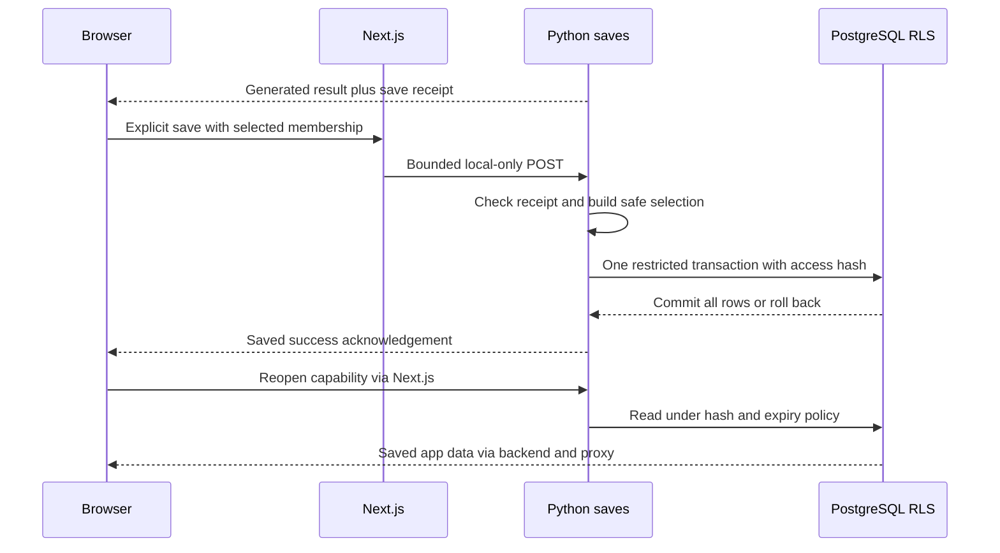

# 12 — PostgreSQL Supabase Sessions and Saved Plans

[Course contents](README.md) · [Glossary](GLOSSARY.md)

## Persistent data survives a process restart

A **database** organizes durable data. **PostgreSQL** is the database engine; **Supabase** hosts the project's PostgreSQL service. This application uses Python's `psycopg` driver and a restricted SQL login, rather than exposing a public Supabase client to the browser. **SQL**, Structured Query Language, expresses database reads and writes. A **table** groups rows with named columns; a **primary key** uniquely identifies a row; a **foreign key** links related rows.

The executable schema is in [0001_initial_planning.sql](../../backend/migrations/0001_initial_planning.sql) and [0002_private_saved_plans.sql](../../backend/migrations/0002_private_saved_plans.sql). A **migration** is a versioned schema change. Do not run migrations as a handbook exercise. [database_migrate.py](../../backend/database_migrate.py) uses locking/checksums/atomic application; administrator credentials must never become runtime credentials.

| Table | Relationship and purpose |
|---|---|
| `schema_migrations` | Migration identity and checksum history |
| `plans` | Saved plan root, mode/version, hashed access, expiry and selected position |
| `plan_constraints` | One row per plan; normalized date, activities, travel and preference requirements |
| `generated_itineraries` | Saved option membership and ordering under a plan |
| `itinerary_stops` | Ordered stops under one saved itinerary |
| `source_metadata` | Source/provider references, with identifier-only storage policy |

`jsonb` is PostgreSQL's structured JSON representation; it is used for bounded app-owned preferences and fictional snapshots, not as permission to retain entire real Google responses. The schema includes historical broader mode possibilities; current runtime only offers driving/walking. `original_request` is a schema column, but current save construction does not write a raw original request there. Inspect `write_document`, rather than inferring retention from a column's existence.

## A real database policy

From migration 0002:

```sql
CREATE POLICY private_plan ON whereto.plans TO whereto_plan_runtime
  USING (access_hash = current_setting('whereto.access_hash', true) AND access_expires_at > now())
  WITH CHECK (access_hash = current_setting('whereto.access_hash', true) AND access_expires_at > now());
```

Line 1 creates a policy for the restricted runtime role. Line 2 restricts visible existing rows to the transaction's configured access hash and unexpired plans. Line 3 applies equivalent checks to inserted rows. Input is a SQL operation under this role plus a transaction-local access setting; output is only allowed rows or a denied operation. Related-table policies follow parent visibility through foreign keys. This is **RLS**, Row Level Security: the database enforces row access independently of interface buttons. Administrative/BYPASSRLS authority is different and must stay outside runtime configuration.

## Save is a server-owned selection

`receipts.issue` builds a minimized safe document only from server-generated results. The browser submits `SaveRequest`: receipt, access token, candidate IDs and selected ID. The generated result already supplies the access token; successful `save` returns `{saved: true}`, and the browser can then expose the link. It does not send arbitrary replacement venue snapshots. `Receipts.select` checks membership, expiry and selection. `safe_document` retains real Google Place IDs and app-owned constraints, while excluding real provider metrics/content and private origins. Mock fictional snapshots stay labeled fictional. Advanced version 2 stores the selected advanced option with app-owned order, omission and requirement provenance; it does not persist the private route origin or Google travel metrics.



A **transaction** treats related writes as one unit: commit all or roll them all back. `database` sets transaction-local role/access/timeouts and uses one connection per action; `write_document` inserts the plan tree. The runtime connection semaphore allows four local concurrent connections; connection timeout is five seconds, statement timeout five seconds and lock timeout two seconds. A failure at any stop must not leave a partial saved plan. **Idempotency** means repeating an equivalent action does not create an unintended duplicate; token hash/fingerprint checks bind the saved selection.

## Private links and refresh

A **capability** is an unguessable bearer secret granting a specific operation. Saved access tokens are 43-character URL-safe values representing 32 random bytes; the database stores a SHA-256 digest, a one-way derived value, not the raw token. Anyone holding the link can read it within its 30-day lifetime. This is not an account/login system. Links currently cannot be revoked through an owner account; forgetting one on the device removes only that local copy.

Reopening reads saved app-owned structure. Real routes are unavailable in reopened saves because they were not retained as fresh travel evidence. Deliberately opening a saved real link may trigger bounded current Pro details under the approved local policy. Optional contacts/hours have explicit gates; replay metadata prevents automatic repeats of one refresh action. Database retrieval and paid refresh are different operations.

`PersistenceError` distinguishes not configured, wrong role, connection/authentication/access, transaction, stale receipt and unavailable link failures. The interface keeps current cards if saving fails and must never create a success link for a failed transaction. No hosted database operation was run for this course.

## Container persistence is not shared session authority

Container images contain neither `.env.persistence` nor administrator credentials. A future approved backend needs a restricted runtime login, verified TLS CA mount and secret injection; a missing configuration must refuse saving. Native assembled-payload tests verify that refusal. They also demonstrate that a receipt issued before a backend restart is rejected afterward. Existing saved SQL rows and process-local capability/session state have different lifetimes. The proposed durable operational SQL ledger and ephemeral Redis evidence are not implemented by adding a Dockerfile.

## Five key takeaways

1. PostgreSQL stores durable relational data.
2. Supabase hosting does not mean a public browser database client.
3. Transactions keep saved plan trees atomic.
4. RLS checks hash-scoped access and expiry.
5. Private links are bearer capabilities rather than accounts.

## What the local V5.1 save fixture proves

`MemoryDocuments` in `scripts/task52_v51_application_fixture.py` is a disposable store used only by an explicitly started test process. The existing save service validates the receipt, access-token binding, candidate IDs and selected itinerary before this store receives a document. Reopening validates the existing `SavedDocument` shape and returns that one selection, including occurrence indexes and optional-stop relationships. Current timing remains unverified.

No PostgreSQL connection, persistent user document or migration is involved. This workflow proves selection, serialization and UI reopening; it does not reproduce SQL transactions, RLS or durable expiry. Existing persistence/security tests remain necessary. Stopping the fixture loses its test saves. Never treat a synthetic private link as a durable saved outing.

## Saved revisions after edits

The local manual/pending tests reuse the real receipt selection boundary. Mixing a previous receipt with a new revision's access token or candidates refuses; saving the selected current option retains its new source occurrence order and required/optional metadata. Expired receipts refuse before the memory store is called. The saved view already distinguishes required and optional visits; included optional visits still lack an active-card badge, since no fixture-only presentation hook exists.

A textarea edit does not revoke every previously issued bearer capability on the server. Existing old tokens remain bound to their old session until their ordinary expiry. The frontend drops them when replacing the request; a production-wide revision/revocation protocol remains separate work. No real PostgreSQL writes are part of this fixture.

## Check your understanding

12.Q1. What connects stops to itineraries?
12.Q2. What does rollback do?
12.Q3. Are raw saved access tokens stored in SQL?
12.Q4. Does forgetting a link revoke shared copies?
12.Q5. Do saved real plans retain fresh route metrics?

## Code-reading exercise — 12.R

Read database, write_document and read_document in saved_plans.py, then locate the matching RLS policy.

## Inactive shared-state and financial authority

The inactive V3 financial front door is in `experiments/shared_state/financial_routines.sql`. The runtime can execute that routine but cannot directly change pricing, scopes, plans, ledger rows or the private core. A separate non-login issuer enrolls a validated session into a persistent budget root and outing, then approves the request kind, dimensions, variant and digest. PostgreSQL calculates the price; the worker never supplies a charge. For example, a 2×3 Driving matrix reserves six `matrix_pro_element` units at the checked-in integer rate. All request lines and the consumed capability commit together. The schema is a disposable local fixture, not a Supabase migration. Bootstrap/routine ownership remains privileged and separately controlled.

[Financial policy audit, tests and limitations](../task52-financial-authority.md)

## Practical exercise — 12.P

Draw one plan with two option rows and their stops. Mark which rows must commit together; do not connect to Supabase.

See [separate answers and guidance](EXERCISE_SOLUTIONS.md#chapter-12).

[Previous chapter](11-google-places-and-routes-apis.md) · [Contents](README.md) · [Next chapter](13-state-management-caching-and-request-lifecycles.md)


## Purpose-specific refresh authority

Saved documents intentionally omit original interpretation evidence. The owner approved a fresh, narrow refresh purpose: reopen using current access/RLS/expiry checks, bind the selected saved itinerary and allowed IDs, and allow only the existing Details refresh operations. `Broker.refresh` rechecks the exact document before each reservation/send. Its stable-key replay identity is claimed in SQL with the first charged request for the existing 1800-second replay window. Viewing a plan needs no provider grant. Tests fake saved access; they do not write owner data, add a migration or prove hosted RLS integration.

See [Task 52 action bridge](../task52-provider-action-bridge.md) for exact boundaries and verification.
