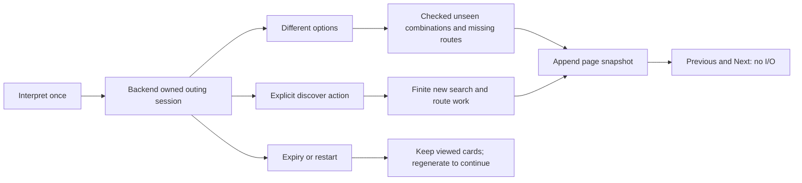

# 13 — State Management Caching and Request Lifecycles

[Course contents](README.md) · [Glossary](GLOSSARY.md)

## State is remembered context

**State management** means deciding which information is remembered, who owns it and when it expires. A **cache** reuses previously computed evidence instead of repeating work. Where To? needs both to keep the form responsive and avoid duplicate model or Maps calls, but a cached result must remain bound to its original request/mode and freshness.

The browser holds text, explicit preferences, clarification, current result and page history. Python holds transient option/advanced sessions and scoped memberships. PostgreSQL holds deliberate saved selections. The local cost ledger holds counters. These are four different lifetimes; browser reload, backend restart and saved-link expiry affect different things.

## One current request per page

From [PlanningSession](../../lib/planning-session.ts):

```typescript
begin(): AbortController | null {
  if (this.active) return null;
  this.active = new AbortController();
  return this.active;
}
```

Line 1 describes either a new controller or no admission. Line 2 refuses a second active submission. Line 3 creates a controller for cancellation and identity. Line 4 returns it. Line 5 closes the method. Input is the current internal session state; output is ownership of a new submission or null. `current(controller)` lets callbacks ignore late responses; `finish` releases only the current owner; `cancel` aborts and clears ownership. This prevents an earlier response from overwriting a newer request. It does not refund server-side provider reservations.

**Immutable snapshots** are retained values not changed in place. `ItineraryPages.append` clones accepted pages and tracks signatures; `navigate` returns another clone. Previous/Next makes no network request. A signature uses ordered activity/provider IDs, so a full assignment is distinguishable from a single repeated venue. Page history is in-memory and resets on edits/reload; it is not the database.

## Explicit preferences versus displayed inference

[preferences.ts](../../lib/preferences.ts) distinguishes user edits from displayed interpretation. A field filled for display should not silently become a future explicit override. `manualPreferences`, `displayInterpretedPreferences` and `editPreference` preserve that distinction. Accepted date/follow-up data can be reused on regeneration without reinterpreting the words, while transport changes invalidate incompatible route evidence.

A **stale response** belongs to an older operation. A **stale route** may belong to the current request but be too old or have the wrong mode. Both need rejection for different reasons. Calendar expiry, route freshness and capability timeout are independent checks.

| State | Owner | Bound/lifetime | What happens when lost/expired |
|---|---|---|---|
| Current submission | Browser PlanningSession | One active controller | Late updates ignored |
| Browsed pages | Browser ItineraryPages | Current tab's request history | Regenerate/rebrowse; no durable recovery |
| Pending interpretation | Browser temporary continuation, revalidated in Python | Matching source/context | Revalidate; never trust client snapshot as a plan |
| Ordinary option session | Python OptionSessions | 50 retained entries; 600 seconds | Safe expiry; viewed cards can remain |
| Advanced session | Python Sessions | 50 entries; 600-second absolute expiry | `advanced_session_expired`, regenerate |
| Route observations | Active compatible computation | Mode-specific; age less than 300 seconds | Refresh through admitted work or report expiry |
| Save receipt | Python Receipts | 100 retained; 600 seconds | Save reference unavailable/expired |
| Saved read capability | PostgreSQL | 30 days | Generic unavailable link |
| Saved refresh replay metadata | Python RefreshSessions | Bounded metadata, 1800 seconds | Not a permanent provider-content cache |

Bounds derive from [option_sessions.py](../../backend/option_sessions.py), [advanced_planning.py](../../backend/advanced_planning.py), [saved_plans.py](../../backend/saved_plans.py), [saved_refresh.py](../../backend/saved_refresh.py) and [routes.py](../../backend/routes.py). Eviction for capacity can remove a session before its maximum lifetime. TTL means **time to live**; it is a retention/admission bound, not a promise that all state survives that long.



## Continuation and locks

A session token identifies server-held context; it does not let the browser replace facts or extend provider budgets. Per-session locks refuse overlapping work on one outing. Different options uses already discovered venues and may acquire missing routes. Discover explicitly adds bounded searches. Advanced continuation uses its own `action` and trusted resolver/router state rather than ordinary options handlers.

`continuation_status` and `continuation.ts` distinguish exhausted combinations, more discovery, temporary admission pauses and expiry. An **exhausted checked pool** is not city-wide exhaustion. Editing invalidates dependent pages/receipts rather than silently presenting old limits as current. A backend restart removes active sessions; a deliberate regenerate can restore permitted work from validated preferences, but it must not be described as reviving lost no-repeat history.

## Five key takeaways

1. State has an owner and lifetime.
2. Browser cancellation and server work are different lifecycles.
3. Page arrows read snapshots without provider calls.
4. Route freshness is shorter than session lifetime.
5. Explicit edits must remain distinct from automatic display values.

## Local continuation ownership after editing

In `app/page.tsx`, `replaceRequest` clears advanced continuation and remembered advanced answers; `manualPreferences` preserves deliberate controls independently. `invalidateResults` clears incompatible cards when preferences change. The fixture bridge now supports that existing re-entry path without changing the frontend.

`LocalContinuation.issued` is at most 50 digest/deadline/raw-hash entries protected by a lock. A valid answer inherits the original ten-minute monotonic deadline; it cannot renew that deadline. Expiry, modified source, changed raw identity or process restart causes refusal. This cache verifies provenance only. The existing advanced session token still controls planning, and no new public receipt or request flag is introduced.

## Check your understanding

13.Q1. What prevents a second page submission?
13.Q2. Does Previous perform a Places search?
13.Q3. Can a 10-minute token certify a 9-minute-old route?
13.Q4. What survives a backend restart?
13.Q5. Does session eviction mean the outing date expired?

## Code-reading exercise — 13.R

Read PlanningSession.cancel, ItineraryPages.navigate and OptionSessions.get. Compare their failure behavior.

## Inactive shared-state and financial authority

V3 distinguishes an evidence session from a budget root. A new frontend request or restarted Python process must not get a new financial allowance automatically. Only the protected issuer can bind new evidence to its original logical root/outing; revisions preserve the binding. SQL totals come from immutable admitted lines, including failed or unsent work. An operation retains its original calendar day even if dispatch happens after midnight. Rolling windows use trusted database time and an explicit protected timezone, so a caller cannot choose yesterday or a new window. Uncertainty and crash-retained admission references are not automatically released. Real root lifecycle and recovery procedures remain staging blockers.

[Financial policy audit, tests and limitations](../task52-financial-authority.md)

## Practical exercise — 13.P

Draw three independent timelines: selected calendar date, 600-second session, 300-second route evidence. Mark where a continuation can fail.

See [separate answers and guidance](EXERCISE_SOLUTIONS.md#chapter-13).

[Previous chapter](12-postgresql-supabase-sessions-and-saved-plans.md) · [Contents](README.md) · [Next chapter](14-security-rate-limits-accounting-and-reliability.md)


## Action ownership versus provider payloads

`Source` in the local bridge is a deep-copied integrity-sealed record with a 600-second lifetime and a revision. A matching request digest alone is not permission: source ownership, native session/capability checks, current action admission and SQL authority must all agree. A ContextVar identifies the active fake-dispatch owner, and a nonblocking action lock prevents overlapping batches. PostgreSQL retains charges/replay/fences after a worker dies; local source/session maps are lost and fail closed. This is not a completed Redis or hosted session implementation.

See [Task 52 action bridge](../task52-provider-action-bridge.md) for exact boundaries and verification.


## Preflight: private evidence is not financial authority

The next adapter is planned, not integrated: encrypted expiring session evidence in private Redis, with the existing application expiry and revision rules. Do not serialize process locks or treat an old browser card as fresh evidence. Redis loss must expire/refuse continuation; it must not reconstruct a request or retry a paid call. Durable SQL retains charges and replay consumption. A short TTL and encryption also do not by themselves grant permission to cache Google content; each field needs an allowed purpose and retention rule.

See the [Task 52 preflight](../task52-private-staging-preflight.md) and [implementation gates](../task52-staging/IMPLEMENTATION.md). No production behavior changed in this documentation checkpoint.


## What actually survives a local worker restart

`evidence_models.pack` serializes only an explicit set of typed DTOs into bounded JSON. `RedisEvidence` encrypts them; reads never renew expiry. `CheckpointIssuer.capture` creates a separate source checkpoint, so finishing/revoking the original action does not delete that checkpoint. `restore_interpretation` rebuilds the existing validator using recorded raw evidence or separately tagged effective pending state, without another model request. It does not restore old admission authority. Advanced live resolvers, locks, arbitrary pagination contexts and receipt registries are still not automatically reconstructed. Lost evidence refuses rather than buying fresh provider data.

See [implemented evidence boundary and limitations](../task52-shared-evidence.md). Production behavior is unchanged.


## Grant lifetime is longer than a session

In the inactive `GrantStore` composition, a fresh worker/session/root cannot renew the application grant. An initial inference admission binds source, root and outing in SQL; subsequent planning actions use that same scope. Redis still supplies private, expiring evidence rather than balances or replay authority. A pending deterministic answer reuses its source and does not purchase another inference.

Every financial operation verifies the separately supplied witness epoch and current encrypted evidence. A missing Redis record refuses before a new reservation; losing it after reservation never refunds a charge. Rotating the external epoch invalidates old sessions/grants. Advanced resolver/history and native receipt reconstruction remain integration gaps; this prototype does not make every application session restartable. See [boundaries and recovery](../task52-application-financial-authority.md).

## Native objects after a worker restart — inactive local profile

`experiments/shared_state/native_graph.py` represents reviewed typed data, tuple keys, sets and shared references explicitly. This matters because the resolver, router and budget must still refer to the **same** restored outing; creating unrelated counters would lose ownership. A fixed factory list constructs native classes. Callbacks, clients, locks, active operations and exploration ledgers are not serialized. New locks protect local memory but never grant spending authority.

`Session.resume` checks SQL/witness ownership and the encrypted record, reruns actual validation using the recorded raw response and fixed reference clock, replays typed clarification answers and verifies the complete result. It makes no model or Maps call. Options history, Details attempted IDs and advanced candidates survive. Absolute deadlines are converted back to local monotonic times without extending them. Expired route evidence blocks active continuation rather than triggering a hidden refresh.

A durable BEGIN marks each continuation. If a worker dies, the turn remains blocked; a new worker cannot automatically replay it. Unknown build/schema/key or missing Redis data also refuses. Changed request text revokes the checkpoint and needs new source validation. This internal profile is not connected to normal FastAPI startup; browser flows retain existing production behavior. [Supported/unsupported paths](../task52-native-session-reconstruction.md).

## Inactive cross-service session ownership

In [Factory](../../experiments/service_isolation/factory.py), a typed request goes to trusted native factories rather than allowing a worker to send serialized Python state. A Redis locator is AES-GCM encrypted with owner/build/epoch/revision as associated data. SQL retains its exact ciphertext commitment and original absolute expiry. Worker B can continue worker A's owned ticket; another enrolled owner or old revision cannot. `Session.resume` recreates permitted native dependencies without new provider calls.

A lost initial response does not make repeating inference safe. The new profile consumes an owner/request UUID before inference and refuses reuse. Mutating turns are also consumed before continuation. Unknown results and missing Redis evidence therefore require recovery, not automatic retries or refreshed expiry. Reusable selected receipts and purpose-specific refresh preserve their distinct existing semantics. The fixed fictional worker-to-owner enrollment tests ownership checks; hosted end-user/IAP authentication remains unimplemented.

## Stable user identity is not a reusable action grant

The new inactive adapter derives planning ownership from verified IAP issuer/audience/subject, never email or workload identity. A frontend-owned proof scopes that assertion to one path/body/build/epoch and expires within 60 seconds. Backend/factory consume it independently; reusable Google/IAP tokens do not make a consumed request reusable. Fresh identity credentials do not renew the original native session or route expiry. Other testers with the correct saved bearer retain the existing separate saved-access semantics.

## Two different caches and absolute authority

The server identity port caches verified workload tokens, not application authorization. It uses single-flight acquisition, expiry headroom and a failure cooldown. A fresh ID token does not renew an outing, restore missing Redis evidence, reset nonce history or replenish SQL exposure. Request/user proofs are short-lived and single-use at the receiver. The current profile shares only authenticated liveness across backend processes; public planning-session reconstruction is still blocked pending the source-ticket bridge. Loss of its witness causes refusal with no in-memory fallback.


## Tab-safe handles and explicit source changes

There is no latest-session-per-user lookup. Each outing carries its own unpredictable locator. Changing source/preferences under a handle revokes that source and requires a new interpretation; a request with no prior handle is an independent outing, not an inferred edit to another tab. The full browser edit/recovery UX still needs a separate checkpoint. Lost responses and interrupted turns do not make planning retryable. The new stable session adapter preserves the authenticated original integer creation timestamp instead of resampling wall/monotonic clocks on each publication. See [Task 52 ordinary integration](../task52-ordinary-hosted-integration.md).


## Inactive ordinary private browser checkpoint

Each tab has an independent controller/handle. No raw interpretation, graph, source, handle or itinerary enters browser storage. Refresh and persisted back navigation clear memory. A generation counter rejects late responses after discard. Absolute expiry is not renewed; cards never authorize another provider operation. See the [UI/recovery report](../task52-ordinary-private-ui.md).


### Network cancellation and uncertain results

The new Node HTTPS channel rejects a request explicitly before destroying a timed-out/oversized socket. This avoids an unhandled socket error discovered by an adversarial response-size test. No fallback send is made. Python closes its connection and releases the bounded slot in `finally`; incomplete declared responses refuse even if their initial bytes look like valid JSON.

Transport rejection is not proof that a provider did no work. Existing committed reservation/intent exposure and one-use dispatch facts remain authoritative. Lost results never become automatically retryable or refundable. Reconstructing a native session, refreshing a browser or starting a new worker cannot recreate financial permission. The ordinary UI retains its discard-only navigation policy.

### Task 52 private role continuation (inactive candidate)

`redis_port.py` supplies a TLS/AUTH lifecycle port to existing evidence CAS and encryption. Original absolute expiry remains authoritative. Derived AAD must be canonical bytes: decode inherited canonical metadata, add deployment/build binding, then encode it again. Never merge a bytes value as a dictionary. Live callback objects stay in their exact factory process; draining/replacement cannot reconstruct lost admission evidence.

See [continuation evidence and limitations](../task52-private-role-continuation.md). Normal application behavior remains unchanged.
