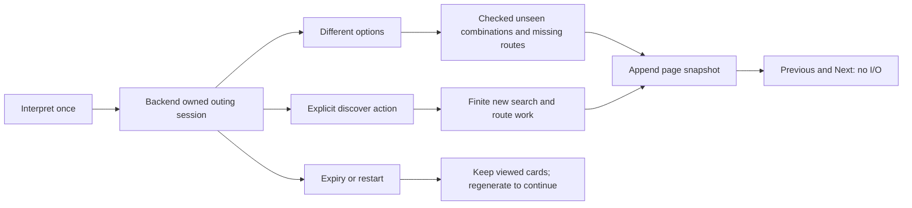

# 13 — State Management Caching and Request Lifecycles

[Course contents](README.md) · [Glossary](GLOSSARY.md)

## State is remembered context

**State management** means deciding which information is remembered, who owns it and when it expires. A **cache** reuses previously computed evidence instead of repeating work. Where To? needs both to keep the form responsive and avoid duplicate model or Maps calls, but a cached result must remain bound to its original request/mode and freshness.

The browser holds text, explicit preferences, clarification, current result and page history. Python holds transient option/advanced sessions and scoped memberships. PostgreSQL holds deliberate saved selections. The local cost ledger holds counters. These are four different lifetimes; browser reload, backend restart and saved-link expiry affect different things.

## One current request per page

From [PlanningSession](../../lib/planning-session.ts):

```typescript
begin(): AbortController | null {
  if (this.active) return null;
  this.active = new AbortController();
  return this.active;
}
```

Line 1 describes either a new controller or no admission. Line 2 refuses a second active submission. Line 3 creates a controller for cancellation and identity. Line 4 returns it. Line 5 closes the method. Input is the current internal session state; output is ownership of a new submission or null. `current(controller)` lets callbacks ignore late responses; `finish` releases only the current owner; `cancel` aborts and clears ownership. This prevents an earlier response from overwriting a newer request. It does not refund server-side provider reservations.

**Immutable snapshots** are retained values not changed in place. `ItineraryPages.append` clones accepted pages and tracks signatures; `navigate` returns another clone. Previous/Next makes no network request. A signature uses ordered activity/provider IDs, so a full assignment is distinguishable from a single repeated venue. Page history is in-memory and resets on edits/reload; it is not the database.

## Explicit preferences versus displayed inference

[preferences.ts](../../lib/preferences.ts) distinguishes user edits from displayed interpretation. A field filled for display should not silently become a future explicit override. `manualPreferences`, `displayInterpretedPreferences` and `editPreference` preserve that distinction. Accepted date/follow-up data can be reused on regeneration without reinterpreting the words, while transport changes invalidate incompatible route evidence.

A **stale response** belongs to an older operation. A **stale route** may belong to the current request but be too old or have the wrong mode. Both need rejection for different reasons. Calendar expiry, route freshness and capability timeout are independent checks.

| State | Owner | Bound/lifetime | What happens when lost/expired |
|---|---|---|---|
| Current submission | Browser PlanningSession | One active controller | Late updates ignored |
| Browsed pages | Browser ItineraryPages | Current tab's request history | Regenerate/rebrowse; no durable recovery |
| Pending interpretation | Browser temporary continuation, revalidated in Python | Matching source/context | Revalidate; never trust client snapshot as a plan |
| Ordinary option session | Python OptionSessions | 50 retained entries; 600 seconds | Safe expiry; viewed cards can remain |
| Advanced session | Python Sessions | 50 entries; 600-second absolute expiry | `advanced_session_expired`, regenerate |
| Route observations | Active compatible computation | Mode-specific; age less than 300 seconds | Refresh through admitted work or report expiry |
| Save receipt | Python Receipts | 100 retained; 600 seconds | Save reference unavailable/expired |
| Saved read capability | PostgreSQL | 30 days | Generic unavailable link |
| Saved refresh replay metadata | Python RefreshSessions | Bounded metadata, 1800 seconds | Not a permanent provider-content cache |

Bounds derive from [option_sessions.py](../../backend/option_sessions.py), [advanced_planning.py](../../backend/advanced_planning.py), [saved_plans.py](../../backend/saved_plans.py), [saved_refresh.py](../../backend/saved_refresh.py) and [routes.py](../../backend/routes.py). Eviction for capacity can remove a session before its maximum lifetime. TTL means **time to live**; it is a retention/admission bound, not a promise that all state survives that long.



## Continuation and locks

A session token identifies server-held context; it does not let the browser replace facts or extend provider budgets. Per-session locks refuse overlapping work on one outing. Different options uses already discovered venues and may acquire missing routes. Discover explicitly adds bounded searches. Advanced continuation uses its own `action` and trusted resolver/router state rather than ordinary options handlers.

`continuation_status` and `continuation.ts` distinguish exhausted combinations, more discovery, temporary admission pauses and expiry. An **exhausted checked pool** is not city-wide exhaustion. Editing invalidates dependent pages/receipts rather than silently presenting old limits as current. A backend restart removes active sessions; a deliberate regenerate can restore permitted work from validated preferences, but it must not be described as reviving lost no-repeat history.

## Five key takeaways

1. State has an owner and lifetime.
2. Browser cancellation and server work are different lifecycles.
3. Page arrows read snapshots without provider calls.
4. Route freshness is shorter than session lifetime.
5. Explicit edits must remain distinct from automatic display values.

## Check your understanding

13.Q1. What prevents a second page submission?
13.Q2. Does Previous perform a Places search?
13.Q3. Can a 10-minute token certify a 9-minute-old route?
13.Q4. What survives a backend restart?
13.Q5. Does session eviction mean the outing date expired?

## Code-reading exercise — 13.R

Read PlanningSession.cancel, ItineraryPages.navigate and OptionSessions.get. Compare their failure behavior.

## Practical exercise — 13.P

Draw three independent timelines: selected calendar date, 600-second session, 300-second route evidence. Mark where a continuation can fail.

See [separate answers and guidance](EXERCISE_SOLUTIONS.md#chapter-13).

[Previous chapter](12-postgresql-supabase-sessions-and-saved-plans.md) · [Contents](README.md) · [Next chapter](14-security-rate-limits-accounting-and-reliability.md)
