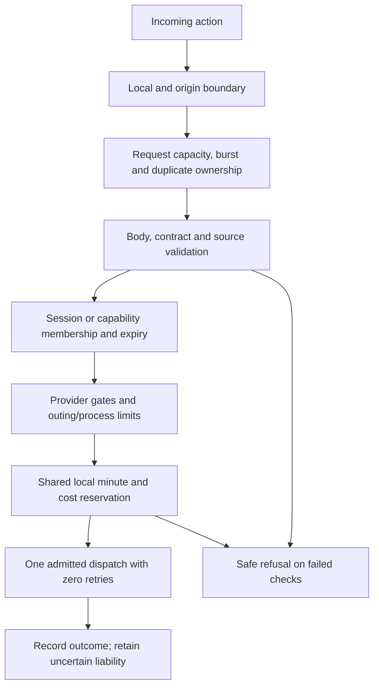

# 14 — Security Rate Limits Accounting and Reliability

[Course contents](README.md) · [Glossary](GLOSSARY.md)

## Safety is a collection of independent gates

**Security** limits who may do what with which data. **Reliability** preserves correct behavior during failures, delays and overlap. A **rate limit** bounds work within a time interval; a **quota** bounds an allowed quantity. **Accounting** records attempted/billable work. Where To? needs all four because duplicate clicks, canceled workers, concurrent provider calls and private links create different risks.

A **middleware** wraps requests before or after endpoint code. [RequestManagement](../../backend/request_middleware.py) admits capacity before reading bodies, bounds size/read time, canonicalizes request fingerprints and reports sanitized outcomes. [main.py](../../backend/main.py) adds private/local boundaries, strict JSON handling for protected actions and safe failure conversion. Next proxies independently bound/validate relevant operations. These are defenses in layers, not a claim of completed public security review.

## Local admission in real code

From [admission.LocalAdmission.acquire](../../backend/admission.py):

```python
reason = ('duplicate' if key in self.active else
          'capacity' if len(self.active) >= self.capacity else
          'burst' if len(self.recent) >= self.burst else None)
```

Line 1 checks existing operation ownership. Line 2 refuses if concurrent capacity is full. Line 3 refuses if the rolling burst allowance is used, otherwise allowing the operation. This executes while holding a lock; the function then either raises `AdmissionError` or records active ownership and returns a lease. Input is an internal fingerprint and operation name. Output is a releasable ownership handle or safe refusal. The fingerprint is an HMAC—Hash-based Message Authentication Code—using a random process secret; it is not logged request text.

Default request capacity is 16 and burst 240 in 10 seconds. Inference admission has capacity one with no waiting queue. Duplicate work maps to 409, burst to 429 and busy capacity to 503. Body reads are bounded to five seconds; most managed bodies allow 65536 bytes, protected advanced/save/reopen/refresh paths 4096. Private JSON parsing also rejects duplicate keys/nonfinite constants. These numbers are code defaults, not hosting capacity evidence or a per-user daily itinerary allowance.

A **lease** records temporary ownership. Workers retain their own reference after HTTP cancellation so the slot is not freed while paid work still runs. A **race condition** occurs when overlapping operations make an incorrect decision from stale shared state. Locks and retained ownership prevent specific races; they do not implement distributed consensus.

## Provider and cost limits

[ProviderSettings](../../backend/provider_budget.py) supplies ordinary local maxima: 10 searches, 100 retained candidates/activity, 300 matrix elements and 30 total attempts per outing, with Details sublimits. Process defaults include 50 attempts and 1500 matrix elements; the rolling minute guard includes 150 elements. Selected environment overrides can lower maxima. Authorized exploration changes selected fixed ceilings but retains finite per-action work, accounting, local gates and external quotas. Never describe normal maxima as universal exploration caps.

Before dispatch, [development_cost.py](../../backend/development_cost.py) reserves estimated gross cost under a protected local file lock. It tracks integer microdollars, one millionth of a US dollar, rather than floating-point invoices. Existing rate constants include 10000 microdollars per traffic-aware driving element and 5000 for walking/legacy Essentials. These are the source's historical accounting assumptions, not freshly checked provider pricing. Failed/uncertain attempts retain conservative exposure. Corrupt/unreadable accounting refuses work; never delete/reset it to “fix” a quota failure.

The owner's exploration warning threshold is nonblocking, not a hard monthly spending cap. Google quotas and the account alert budget are separate; alerts can lag and do not stop spending. This course does not touch either ledger, billing, credentials or quotas.



Some gates apply only to relevant operations: SQL reopen does not perform a Google reservation; local inference has separate admission. The diagram shows the provider-work path, not an assertion that every request passes through every gate.

## Privacy and capabilities

**Least privilege** grants only the permissions needed. Database runtime has SELECT/INSERT and RLS, not administrator power. Google credentials remain backend-only. [next.config.ts](../../next.config.ts) refuses database-like `NEXT_PUBLIC_*` variables before Next can expose them. TLS—Transport Layer Security—encrypts configured database connections. Private access tokens, raw source text and origin coordinates are not operational log labels.

**CSRF**, Cross-Site Request Forgery, is a browser being induced to submit an unwanted request from another site. Local host/origin/forwarding checks and protected proxy boundaries reduce that risk in the local design. **XSS**, Cross-Site Scripting, is malicious script execution in a page and can threaten bearer capabilities. Random tokens do not make stolen links harmless; anyone holding a valid saved link can read it until expiry. Public cloud/session protection is still proposed, not certified here.

## Four different receipts/permissions

A save receipt authorizes selecting server-generated membership. A planning admission receipt binds internal validated scope/revision/purpose and is not a public arbitrary-JSON badge. Google OAuth authenticates a backend identity but does not authorize unlimited spending. Task 52's proposed signed grants concern offline evaluation authority and are not runtime planning or paid activation. Confusing these would bypass a necessary gate.

**Durable** means surviving process failure. **Fail closed** means uncertain safety state refuses work. Q4C's signed fictional protocol explores durable attempt/review facts, but its real paid path refuses; production distributed authority remains unimplemented. `validate_environment` rejects hosted/production startup rather than trusting a flag saying imagined shared services exist.

Operational logs use a fixed vocabulary and correlation IDs. A **correlation ID** groups observations for one operation without recording its private body. [operations.py](../../backend/operations.py), [performance.py](../../backend/performance.py) and protected diagnostics provide bounded evidence. A log category “other” cannot reconstruct missing original provider JSON; report that limit honestly.

## Packaging safeguards and remaining cloud risk

Both Docker recipes specify non-root runtime users and digest-pinned bases; the backend has a Linux wheel hash lock. The default-deny `.dockerignore` keeps private evaluation records, Git and credentials out of the build context. Actual Linux amd64 execution has now passed locally; image scans reveal unresolved dependency/base-package findings, documented in the [local verification](../task52-local-container-verification.md). A working image is not a security approval. Max instances one is a capacity cap, not shared financial protection: independent processes can both admit work, and rollout/restart can lose local authority. The existing hosted refusal must remain until shared reservations, replay state and fencing are verified. No development flag is accepted by the packaging launchers. After actual scan evidence, final runtime stages remove inherited npm/yarn/corepack and pip installers; build stages still install the same locked dependencies. Base layers retain public installer bytes, while merged runtime commands are absent. That installer-removal checkpoint left OS and pyasn1 findings unresolved. The later deployment profile below patches pyasn1; OS findings remain open. Removal of build-only tools does not make deployment safe.

## Severity, reachability and advisory-database drift

A high/critical match identifies an installed package/advisory association. It does not by itself prove that an HTTP request reaches the vulnerable function. Conversely, no-DSA/won’t-fix or an unknown severity is not permission to dismiss a library defect. The [complete triage](../task52-container-security-triage.json) links every original high/critical finding and fresh-database high additions to source-specific assessments. The new deployment patch fixes four pyasn1 decoder advisories; OS findings remain unresolved. Setuid helpers remain, constrained in tested containers by non-root/no-new-privileges, no capabilities and no host mounts. Those controls must survive future orchestration; they are mitigations, not package patches.

## Five key takeaways

1. Admission, provider quotas and financial accounting solve different problems.
2. Worker ownership survives browser cancellation when work remains.
3. A capability grants a scope, not unlimited paid work.
4. Corrupt accounting must fail closed.
5. Current local safeguards do not establish multi-instance production safety.

## Check your understanding

14.Q1. What is middleware?
14.Q2. Why keep a worker lease after browser cancellation?
14.Q3. Are cost alerts hard spending stops?
14.Q4. Can a saved token certify a new ordering graph?
14.Q5. Why avoid raw request text in logs?

## Code-reading exercise — 14.R

Read RequestManagement and provider_work.run_work. Find where HTTP ownership and worker ownership differ.

## Inactive shared-state and financial authority

The inactive `FinancialPostgres.reserve(lease, capability, operation_id)` accepts no financial quote or unit override. SQL prices the issuer-approved plan from protected rates and enforces outing/search/detail/matrix counts, logical-session limits, minute windows, daily exposure where enabled, replay and concurrency. A single-use dispatch ordinal prevents extra or repeated sends; no transport exists in this module. Preserve the actual source distinction: bounded planning currently has no dollar ledger, exploration records costs with the dollar ceiling disabled, and standalone `DevelopmentCost()` defaults to a configurable $10/day guard. V3 tests these configurations separately; it does not activate a new allowance. There is no invented monthly/lifetime app budget and the halted AI experiment is separate.

[Financial policy audit, tests and limitations](../task52-financial-authority.md)

## Practical exercise — 14.P

Draw a duplicate-click race and insert the active fingerprint lock. Use fictional requests and do not modify real quotas.

See [separate answers and guidance](EXERCISE_SOLUTIONS.md#chapter-14).

[Previous chapter](13-state-management-caching-and-request-lifecycles.md) · [Contents](README.md) · [Next chapter](15-testing-mocks-debugging-and-error-handling.md)


## Registered actions and constrained issuer authority

`bridge.sql` adds immutable action bindings and refresh claims. Only the separate NOLOGIN issuer can register actions or approve request plans; the worker can execute only `bridge_protocol`. It cannot call the private arbitrary-charge core or change rates/history. SQL requires active HTTP ownership, revision/fence, intact evidence and once-only dispatch ordinals. Charges still come from protected V3 unit policies. A worker crash or uncertain fake send retains committed exposure without retries/refunds. The trusted issuer and same-process Python remain privileged; private attributes are not a hostile-code sandbox. Protected workload enrollment, shared evidence and hosted spending approval remain future requirements.

See [Task 52 action bridge](../task52-provider-action-bridge.md) for exact boundaries and verification.


## Preflight: separate prices, limits and permission

A published provider price is not a spending grant. Current local SQL prices synthetic Maps requests; hosted LLM input/output token pricing and an application-wide gross-dollar grant remain unimplemented. The fake inference admission lease limits capacity but does not reserve LLM dollars. Future roots must survive worker restart and cannot be reset by a browser or midnight. Proposed staging dollar/timezone limits are owner decisions, not active controls. A separate authority service is proposed because an issuer factory in the same Python process does not isolate a malicious worker.

See the [Task 52 preflight](../task52-private-staging-preflight.md) and [implementation gates](../task52-staging/IMPLEMENTATION.md). No production behavior changed in this documentation checkpoint.


## Authenticated evidence and conservative failure

AES-GCM encrypts private evidence and authenticates its source/session/epoch metadata. The key ring is injected separately and never stored in Redis or SQL. Changing the active key requires an explicit CAS rewrite with the original deadline; removing an old read key refuses old ciphertext. Redis has no financial authority. If Redis publication succeeds but SQL commitment fails, the mismatched record blocks use. Unknown sends keep their existing SQL charge. Synthetic issuer callbacks are not real workload authentication or a sandbox against malicious Python code.

See [implemented evidence boundary and limitations](../task52-shared-evidence.md). Production behavior is unchanged.


## Conservative aggregate grants and fictional token accounting

A spending grant is permission to consume a finite amount, not a provider price list. `grant_rules.sql` keeps operator-approved total/provider/day/outing limits separate from protected versioned prices. It computes exact integer micro-USD charges before a fake call. Midnight changes only the day bucket; total exposure does not reset. Existing request/unit/admission limits still apply. No real application spending grant is approved.

`FakeInference` binds the source, canonical schema/prompt/model, active inference admission, maximum output allowance and payload digest. A separate SQL counter counts complete UTF-8 bytes under a fictional billing profile. These are **not real model token counts**. Caching, reasoning, tools and unknown prices refuse. A valid later usage report records a reported amount but releases zero conservative exposure. Unknown reports/sends stop the grant; they cannot be retried or refunded automatically.

The witness commits delivery intent before fake I/O. Only the current call stack can send; a restart cannot regenerate that authority. Runtime table writes and privilege escalation are denied. A privileged issuer is still trusted for semantic correctness, and the two local databases share an administrator/host. Hosted isolation, independent epoch/backups and reviewed operator reconciliation remain required. SQL caps do not control cloud infrastructure bills. [Full audit and limitations](../task52-application-financial-authority.md).

## Reconstruction is not spending permission

The inactive native-session profile preserves original source, revision, worker fence, expiry and budget identities. It does not restore an HTTP admission or provider send permission from serialized data. Each new action still needs current validation/admission, decrypted evidence, an exact protected financial reservation, canonical payload and once-only dispatch. Failed or uncertain sends keep their charges. Native leased revise/revoke transitions refuse stale workers; runtime cannot write checkpoint history directly.

Nonfinancial state also affects safety: reset attempted IDs or option history could invite repeated work. New checkpoint commitments therefore join the external witness prefix. Torn cross-store publication and older-prefix restoration stop rather than guess. Both local authorities share a test host/admin, so correlated rollback, privileged compromise and unmirrored witness revocation rollback remain outside this prototype. Separate hosted identities/backup ownership and operator reconciliation are still required. [Trust limits](../task52-native-session-reconstruction.md).

## Inactive service identity is separate from operation authority

[auth.py](../../experiments/service_isolation/auth.py) implements synthetic per-workload signatures over certificate-verified TLS. A caller signs the exact service audience, POST path and body digest, profile, environment, epoch, nonce and at-most60-second lifetime. The verifier checks the enrolled public key/role and a fixed method allowlist, then consumes a durable SQL nonce. A valid signature cannot replace source validation, current session/fence, admission, encrypted evidence, protected financial reservation or exact once-only dispatch.

Credentials now live in separate restricted containers: factory/validated-action issuer, counter, dispatcher and recovery. Workers have only their own synthetic workload key and public trust. The factory combines source validation with issuance so a worker cannot simply claim validation occurred. Dispatcher SQL permits delivery only, including a fresh admission check; recovery can stop/rotate but not refund/reactivate. No real providers or credentials are present. Host administrators and compromised trusted validation code remain outside specific guarantees; local Ed25519 tokens are not Google Cloud Run ID tokens.

Loopback networking alone is not authentication. The earlier trusted fixture used PostgreSQL localhost `trust`; a worker sharing that network could otherwise impersonate a database administrator without knowing a password. The new isolated profile initializes both disposable databases with TCP SCRAM-SHA-256 authentication and tests actual wrong-password admin/issuer/counter access and anonymous Redis refusal. Unix-socket administration is confined to the database container filesystem. This is not a migration or password change on any real database.

## Hosted versus fixture trust roots

[Token verification](../../experiments/hosted_identity/tokens.py) uses PyJWT with fixed Google HTTPS JWKS origins, allowed algorithms, issuer/audience/time/subject checks and bounded expiring caches. Caller allowlists additionally check the immutable service-account subject and verified email. Direct IAP uses its own ES256 keys/issuer/resource audience. Locally generated Google-shaped keys are fixture-only; production constructors reject them and offline entry points refuse hosted environments. The proof-key used to bind HTTP bodies is not a service-account JSON key.

A valid signed IAP assertion is still a bearer credential. The frontend must also be protected by direct IAP on all ingress and IAP-agent-only Invoker permissions. The fixture models that platform gate with a private synthetic ingress identity; it does not prove real IAM. Hosted enrollment, revocation/rotation and independent recovery ownership remain blockers. Authentication never bypasses protected provider reservations, canonical payload, evidence, fence or epoch checks.
