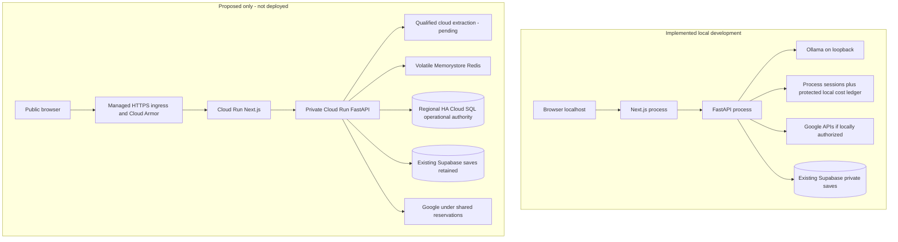

# 18 — Cloud Hosting Deployment and Scalability

## Backup destination enrollment is separate from application hosting

The [GCS proposal](../task53-b1-gcs-backups.md) reuses B1 ciphertext and leaves all six application identities/images untouched. `deployment.b1_gcs` only validates policy/receipts and constructs fixed commands; it cannot apply cloud changes or load credentials. G1 is now fully verified and must not be repeated. The original G2 renderer requires all three named operators; a separate [G2-W writer-only profile](../task53-b1-writer-tools-key.md) now prepares four commands without inventing recovery/deletion identities. It source-pins the old helper/G1 evidence and checks exactly the original bucket convenience bindings plus the writer objectCreator binding, the token-only custom role and the operator binding on that SA. Recovery/deletion remain unassigned and real enrollment remains unapproved. A separate writer SA uses create-only objects and an access-token-only custom minter, never static keys or bucket administration. Retention is unlocked7days plus7day soft delete; project administration remains a trust boundary. Read-only recovery cannot restore soft-deleted objects; exceptional create/restore needs another approval. No automatic deletion or GCS byte-cost hard cap is claimed. Key/receipt/verified ciphertext custody outside the project remains required.


## Existing-subnet IPv6 amendment remains inactive

Fresh read-only observations confirm N1's custom subnet remains IPv4-only. The [inactive amendment](../../deployment/cloud-run/dual-stack-amendment-PROPOSED-v1.json) proposes updating that same subnet to external dual stack; Google assigns the /64. Never invent a range, replay N1 or infer permission to run N2. Cloud Run documents a broad publicIpAdmin role for its service agent when using external IPv6; granting it is a separate security/IAM decision, not an implicit part of a network update. Observe actual source addresses before approving Supabase CIDR restrictions. IPv4 Redis still requires separately authorized NAT/static egress. [Exact commands and owner scopes](../task53-free-preflight-backup.md). No network mutation or Run deployment occurred.

## Demo-first storage qualification

A zero-cost operational database is a candidate, not a capacity guarantee. The test-only [IPv6 probe](../../experiments/hosted_ports/run_demo_ipv6.py) runs actual restricted PostgreSQL/independent-witness algorithms over local verified-TLS IPv6 without changing production ports or source pins. Cloud Run documents dual-stack support, but the existing N1 subnet remains IPv4-only: external IPv6 permissions/routes/allowlists need separate review and cloud verification. Redis still needs IPv4 NAT for its source allowlist. Supavisor ignores most startup options, including our deadline options; session affinity does not justify removing the pooler ban. Redis Free has no TLS and only30MB; the actual noHA/noPersistence250MB quote is$6 beforetax. Manual backups, independent witness control and real Nano capacity remain gates. [Exact scope, limitations and costs](../task53-demo-storage-compatibility.md).

## Observed N1 enrollment, November 23

The owner-authorized custom VPC and `us-east4` subnet `10.92.0.0/26` now exist, with Private Google Access enabled. Two commands ran once and independent reads verified only the expected network/subnet/default-route/system-route additions. No NAT/public IP or Cloud Run service exists; previous resources and IAM remain intact. N1 must not be replayed. [Sanitized actual result](../../deployment/cloud-run/network-N1-enrollment-complete-v1.json). Subsequent storage/N2/runtime approvals remain separate; expected empty-network fixed charges are $0, not a verified posted invoice. No application/provider/financial authority was activated.


## Current network/storage enrollment boundary

The foundation and six private registry images already exist. `deployment/network_storage.py` uses their actual identities through the existing owner-enrolled compiler. N1 creates only a custom VPC/subnet; N2 separately reserves a billed static IPv4 and router/manualNAT. Rendered commands and hashes are review material, never owner authorization; fresh cloud conflict checks remain mandatory. Existing default network/resources must remain intact.

Operational/witness connections require direct TLS PostgreSQL and restricted session-affine users, not the older saved-plan pooler. Selected pool maximum 2 across four operational and five witness logins requires 18/22 clients including revision overlap and operator allowance; reserve additional platform/existing-app headroom and measure CPU under unchanged deadlines. A second database does not establish independent restore authority: administrator and backup owner must differ. Redis requires paid TLS, separate ACLs, exact Lua/CAS, absolute expiry and noeviction; loss of volatile evidence refuses continuation. Its actual GCPus-east4 noHA/noPersistence250MB quote has now been observed at$6/month beforetax; actual hosted TLS/ACL/noeviction enrollment remains unverified. [Exact executable proposals and owner actions](../task53-network-storage-enrollment.md). Older architecture/cost examples below are historical proposals, not current provisioning instructions.


[Course contents](README.md) · [Glossary](GLOSSARY.md)


## Real six-role local application boundary

The source-selected real Ports/constructor and signed Next bootstrap now work in local fixture composition; they remain default-closed. The old role projector still requires a real entry/profile and dependency/source projection, and the real frontend now refuses its old synthetic cohort. No six final images were built or scanned in this checkpoint. Local TLS/fixture success does not establish Cloud Run IAM/IAP, model qualification, Google content rights, paid enrollment or vulnerability acceptance. [Implementation and exact limits](../task52-real-six-role-browser.md).

## Reproducible OS candidate without deployment selection

`deployment.prepare_trixie_candidate` builds on the existing projectors and emits isolated role/Next contexts with pinned official Debian 13 Python 3.12 and Node 24 references. [Candidate manifests](../../deployment/candidates/trixie-v1/README.md) preserve the original Bookworm/default inputs and mark promotion false. Source code is byte-identical; the base-bound cohort changes intentionally, so real enrollment/old-session compatibility must be reviewed separately without resetting financial history. Local ABI/TLS/browser success and zero scanned critical findings do not establish Cloud Run IAM/kernel enforcement, backup recovery, qualified LLM or security acceptance. No synthetic provider was deployed as a product and no cloud resource was created.


## A rebuilt image is not an approved deployment

The [current bounded checkpoint](../task52-security-and-google-data.md) builds all six amd64 roles from unchanged base/dependency locks and changed source cohort, checks non-root/read-only runtime and refusal without enrollment, then scans baseline/candidate with the same Grype database. No C/H advisories disappeared. Current Python Bookworm base is unchanged; the available Node patch was already tried without security improvement. Current maintained Distroless uses Debian 13; silently adopting deprecated Debian 12 or switching OS major would bypass compatibility review. A separate approved Debian 13 candidate or supported vendor backport is concrete follow-up, not completed security remediation.

Only Place IDs have a narrow optional shared cache; full real results still cannot be safely reconstructed from permitted fields. Existing real provider/model/financial/credential/retention and cloud enrollment gates remain mandatory. No synthetic staging deployment is represented as the final product. No cloud resource, grant or public traffic was activated by these builds.

## Deployment means running beyond the owner's computer

**Hosting** provides machines/services that run the application. **Deployment** installs a reviewed version there. **Scalability** is handling more work while preserving correctness and cost controls. Where To? cannot safely scale by launching independent copies of local sessions and budgets: two processes might each believe the same allowance is unused, or a continuation might land on a server without its session.

The repository contains a [Task 52A proposal](../../docs/task52-cloud-architecture-evaluation.md) and [implementation sequence](../../docs/task52-production-implementation-plan.md), not a provisioned cloud stack. This chapter teaches that checked-in proposal; its historical quotes/prices/model candidates are not freshly verified current purchasing advice.

## The implemented startup refusal

From [admission.validate_environment](../../backend/admission.py):

```python
if environment == 'production' or os.environ.get('NODE_ENV') == 'production' or hosted:
    raise RuntimeError('Production requires verified shared admission, provider accounting, ephemeral sessions and cloud inference. Activation is deferred to Task 52.')
```

Line 1 checks declared production and known host indicators. Line 2 refuses startup with missing architectural requirements. Inputs are process environment and hosted indicators; output is refusal rather than an unsafe active service. This runs at import and lifespan validation. Setting an invented “ready” flag cannot create shared services. A successful Next frontend production build does not bypass this backend boundary.

## Local and proposed cloud paths



**Cloud Run** is a managed service for containerized processes. A **container** packages an application and runtime dependencies. An **image** is the packaged template; an **instance/replica** is a running copy. A **region** is a geographic service area. Colocation can reduce round-trip latency but does not prove the proposed performance target.

A **load balancer** directs requests across service instances. **Ingress** is incoming traffic; **egress** is outgoing traffic to providers. A **CDN**, Content Delivery Network, distributes cacheable static content. Private planning responses still need no-store and controlled access. **Cloud Armor** supplies proposed edge protection; it does not replace application ownership/validation.

## Why Redis and SQL have different proposed jobs

**Redis** is fast key-value storage proposed for expiring source/venue/origin/session evidence. The proposal is volatile: no durable archive/backups of raw private/provider evidence. **HA**, High Availability, adds redundancy, but failover may still lose recent cache writes. Therefore Redis-only locks/counters must not restore already-spent capacity after failover.

Cloud SQL PostgreSQL is proposed for durable operational authority: reservations, intent/outcome classification, current revisions and fences. This is separate from the existing Supabase saved-plan schema. “Same database technology” does not mean the same data purpose or approved migration. Opaque hashes/metadata still need privacy and retention controls.

A **distributed transaction** attempts consistency across components. SQL and external HTTP cannot simply roll back together: once Google receives a request, undoing a local SQL transaction cannot unsend it. The design reserves durably before dispatch and treats uncertain sends conservatively. **Exactly once** should not be claimed merely because one database write is atomic. A stale worker must be fenced before publication or further provider work.

## Capacity, connections and latency

Each replica's database connections multiply across the fleet. The proposal suggests bounded pools and maximum replicas after measuring capacity; those design values are not current runtime cloud settings. A **connection pool** reuses a finite set of database connections; a **session pooler** mediates database sessions. Current saved operations open bounded restricted connections locally and use transaction-local access settings.

**p95 latency** means 95 percent of observations in a named sample completed at or below that duration. It is not the slowest run and cannot be inferred from a handful of mixed successful/failed calls. End-to-end latency includes admission, model, validation, searches, routes, SQL where applicable, proxy and rendering. The proposed five-second p95 remains unproven.

Scaling can increase provider concurrency/cost as well as throughput. Shared minute/day/account budgets, bounded work, retries zero, privacy-safe metrics and outage refusal must work across replicas before public activation. **Observability** means enough logs/metrics to understand operations; it should not become a raw request archive.

## What remains

A qualified cloud extraction adapter, shared state/authority implementations, privacy/provider-term approval, exact financial and infrastructure approval, dependency/base-image security remediation, security/HTTPS setup and hosted end-to-end/phone acceptance remain future work. Task 52's original hosting objective is broader than its current model-evaluation phase; Tasks 53–55 have their separate roadmap responsibilities. No resources were provisioned and no Task 53 work was started for this handbook.

## Implemented packaging checkpoint — hosting still blocked

The frontend/backend Docker recipes, strict launchers, Linux hash lock, explicit runtime file manifest and placeholder private Cloud Run templates now exist in `deployment/`. See the [deployment checkpoint](../task52-cloud-deployment-preparation.md) and [environment contract](../../deployment/environment-contract.md). The first checkpoint had no container engine. Owner-approved Colima/Rosetta now runs the actual pinned Linux amd64 builds and smoke successfully; [current container/security results](../task52-local-container-verification.md) remain distinct from native smoke. Backend production/hosted startup deliberately refuses. Local Ollama, process-local receipts/sessions/replay, the file cost ledger, loopback-only security policies and missing Cloud Run IAM transport still prevent functional cloud deployment. Min-zero/max-one/concurrency-one templates are review artifacts, not substitutes for shared authority. No services, credentials, migrations or cloud inference were added. Costs in the checkpoint are assumption-based estimates with explicit unquoted categories, not an approved bill.

## Local engine is not cloud deployment

Colima profile `whereto-task52` uses 2 CPUs, 4 GiB RAM and a 40 GiB container-data disk, plus Colima’s standard separate sparse root disk. Apple VZ runs the native arm64 Linux VM; Rosetta executes the reviewed amd64 application images. Host mounts and SSH forwarding/config changes are disabled. Profile auto-activation is disabled, so use its explicit Docker context rather than change global configuration. No Docker Desktop or paid service is needed for this verified workflow. Stop the dedicated profile after tests to release RAM; restarting it does not authorize providers or hosted startup. Shared-state and hosted-inference blockers remain unchanged.

## Compatible security changes before any hosting

The official Node 24/Python 3.12 Bookworm tags still resolve to the existing pinned digests. Current Debian tracker data has no configured Bookworm fix for retained high/critical OS findings. Switching the Debian release, mixing newer-release libraries or compiling custom system libraries requires a separate compatibility/security proposal. This checkpoint therefore patches only the compatible Python deployment dependency and retains explicit blockers. No cloud activation, new infrastructure, provider call, cost redesign or model change is implied. [Current remediation and owner decisions](../task52-container-security-remediation.md).

## Five key takeaways

1. Deployment is beyond local startup.
2. Independent local budgets cannot become a shared fleet.
3. Redis evidence and durable SQL authority have different roles.
4. External HTTP cannot be rolled back by SQL.
5. The cloud diagram is proposed, not deployed.

## Check your understanding

18.Q1. What is a replica?
18.Q2. Why is Redis alone insufficient for spending authority?
18.Q3. What does HA stand for?
18.Q4. Does a frontend build activate the backend?
18.Q5. What does p95 describe?

## Code-reading exercise — 18.R

Read validate_environment and the proposal shared-session contract. Find one state currently tied to monotonic process time that needs a shared representation.

## Inactive shared-state and financial authority

Protected local unit pricing is implemented, but no financial or shared-state adapter is active in the app. A real staging configuration still needs approved billing timezone, persistent budget-root ownership, a deliberate dollar policy, current price verification and an issuer/transport bridge that binds the exact canonical provider payload to its approved SKU and units. Advanced handoff and saved viewing remain non-provider permissions. Next, integrate actual server-owned ordinary/advanced/options/refresh action issuers using fake transport and existing session/validation contracts. Then perform private-staging infrastructure/security/capacity/cost preflight. Paid services require approval and public launch remains a separate owner decision after staging acceptance.

[Financial policy audit, tests and limitations](../task52-financial-authority.md)

## Practical exercise — 18.P

On paper route a continuation to a second replica. List the state it would need and which proposed store owns each item.

See [separate answers and guidance](EXERCISE_SOLUTIONS.md#chapter-18).

[Previous chapter](17-task-52b-cloud-ai-evaluation-and-ordering-research.md) · [Contents](README.md) · [Next chapter](19-how-to-read-debug-and-modify-this-codebase-yourself.md)


## Bridge readiness is not hosted authority

The Task 52 action bridge is an inactive local composition, with no startup switch, real issuer enrollment or live dispatch. The completed preflight below separates verified capacity/pricing facts from remaining account checks. Supabase operational-role implementation, private expiring shared evidence, Cloud Run authentication, hosted inference qualification and spending approval remain deployment gates. Existing V3 rates are historical gross estimates, not current price certification or a new dollar allowance. The deployed application must ultimately run with the owner’s Mac off. Paid recurring resources and public launch still require their separate owner approvals.

See [Task 52 action bridge](../task52-provider-action-bridge.md) for exact boundaries and verification.


## Private-staging preflight: concrete target, remaining work

The read-only preflight verified existing Google billing linkage/Maps quotas and Supabase catalog capacity, but not current Supabase subscription/backups or regional Redis pricing. The proposed target is three Cloud Run services: frontend, backend and separate authority. Owner-only frontend IAP, internal service IAM, VPC routing, private Redis, managed secrets and remote CI are not yet configured. Existing templates and containers are packaging evidence, not a functional hosted application: local Ollama, process-local state and startup guards remain. No model is independently qualified. Use the ordered checklist before provisioning, and keep resource approval separate from permission to launch.

See the [Task 52 preflight](../task52-private-staging-preflight.md) and [implementation gates](../task52-staging/IMPLEMENTATION.md). No production behavior changed in this documentation checkpoint.


## Redis foundation implemented, hosted adapter still absent

The new inactive local evidence layer implements encryption, fixed TTLs, bounded pooling/CAS and SQL attestation integration. Its constructor accepts only isolated synthetic resources; it cannot be enabled for Memorystore with a flag. Local TLS/AUTH tests establish client verification behavior, not managed-network/failover readiness. A real deployment still requires private connectivity, authenticated issuer separation, cloud key/epoch ownership, financial recovery, current prices/approval and complete native session adapters. The Mac-off staging acceptance gate remains open.

See [implemented evidence boundary and limitations](../task52-shared-evidence.md). Production behavior is unchanged.


## Local financial recovery prototype is not hosted enrollment

The inactive application-grant prototype uses an independent PostgreSQL witness volume to retain spending/delivery evidence across an operational database restore. Local service/operator/reader/issuer/counter roles are separate, but one test host administrator controls both databases. Correlated rollback or privileged compromise is outside this prototype's guarantee. A hosted design must independently control witness credentials, epoch changes, backups and reconciliation, and must authenticate the issuer/counter/dispatcher separately from workers.

No hosted model, real grant, cloud database, Redis resource or startup activation is introduced. The proposed staging dollar figures remain unapproved. Complete native session rehydration, real-provider count/pricing policies, account capacity, container-advisory decisions and private deployment/recovery tests remain gates before Mac-independent staging. [Implementation and next bounded step](../task52-application-financial-authority.md).

## Native continuity before hosted enrollment

The inactive local native-session checkpoint reconstructs actual application objects and their original authority across independent worker processes. Redis stores bounded authenticated-encrypted evidence; operational SQL retains source/revision/fence/root/outing/turn/financial facts; the independent witness retains mirrored checkpoint and spending history. Recreated locks/clients are dependencies, never authority. Expiry, build compatibility and freshness still apply after a restart.

This closes part of local P2 evidence continuity, not hosted integration. Normal endpoints still need reviewed server-owned ticket routing and workload-authenticated isolated factory/issuer/counter/dispatch services. Hosted enrollment, Google retention approval, TLS/pooling/backups, key rotation and independent epoch reconciliation remain gates. No new cloud resource, startup profile, spending grant or production model is enabled. Local full-prefix verification is slow and does not establish the five-second latency goal. [Remaining boundaries](../task52-native-session-reconstruction.md).

## Local authenticated service boundary, not a Cloud Run deployment

The [service-isolation checkpoint](../task52-service-isolation.md) implements four separately credentialed trusted processes: native factory/validated-action issuer, token counter, canonical dispatcher and independent recovery. Ordinary workers cannot read their keys or SQL/Redis logins. This is a deliberate bounded topology rather than a second planner: existing native validators/planners and constrained financial algorithms remain authoritative inside the trusted factory.

Local TLS/Ed25519 identities, loopback-only networking and disposable SQL roles demonstrate authentication and credential separation. Hosting still needs distinct workload service accounts, verified Google OIDC audience/issuer/principal, Invoker permissions, private ingress/networking, independently verified end-user forwarding, managed secrets/rotation and independent recovery/backup ownership. The local synthetic verifier must not be used as a hosted identity provider. Neither successful local service tests nor existing containers authorize production startup, spending, hosted inference or public launch.

## Enrollment is not provisioning or activation

[The inert hosted enrollment matrix](../task52-staging/hosted-enrollment-v1.json) specifies distinct service accounts, resource-scoped Invoker and Secret Manager access, exact run.app audiences, direct-IAP tester access, private authority routing, restricted SQL/Redis and independent recovery custody. Real project numbers/URLs/testers and resource approvals remain unresolved. No Owner/Editor runtime roles, SA JSON keys or public backend are allowed. The verified local contract does not deploy it: real Next server identity acquisition, current image/role/secret/network review and private staging quality/cost/recovery checks remain required. Public launch remains a separate owner decision.

## Private startup is deliberately not launchable yet

The normal pinned, non-root Docker artifacts remain the ordinary application. The frontend lock adds exact jose6.2.17 for server-side identity verification; no fixture or key is bundled. Real private bootstrap must explicitly package/trace identity acquisition and verify enrolled dependencies. Installed Next docs warn that a custom server is not traced by standalone output: the local test driver is not a production recipe. Do not replace the working entry with it or use test mode to evade backend refusal.

The [startup contract](../../deployment/private-startup-v1.json) and [route matrix](../task52-staging/route-integration-v1.json) record blocked public/native mapping, real IAM/IAP/secret/network enrollment, SQL/Redis/recovery migration, qualified LLM/pricing/grants and private staging acceptance. No cloud resource is provisioned. Public launch remains separately approved.

The frontend build also emits a small `/app/private-runtime/` component using the existing TypeScript compiler. Only the Google-root identity factory is exported; fixture injection is not a shipped export. Exact jose files are copied separately because an unused Next module may not be traced. The normal entry still imports only its generated Next server; packaging a component does not install a private profile or satisfy readiness.


## Local ordinary functionality is not hosted startup

The private ordinary API flow is now locally functional with fake services. The normal Docker entries and production refusal remain unchanged, and experimental Python services/custom Next driver stay excluded from deployment images. Planning-mode readiness, browser UI, advanced/persistence mappings, real IAM/IAP/secret/SQL/Redis/recovery enrollment, qualified hosted inference, real tokenization/pricing and explicit finite grants remain gates. Do not deploy the local fixture, use test mode to bypass startup, or treat health as financial readiness. See [Task 52 ordinary integration](../task52-ordinary-hosted-integration.md).


## Inactive ordinary private browser checkpoint

A locally working ordinary synthetic UI is not a hosted startup approval. Existing production refusal remains. Docker images exclude experimental services and temporary identity roots. Real IAM/IAP, managed stores/recovery, qualified model/tokenization/pricing, finite grants, security and private staging acceptance remain required. See the [UI/recovery report](../task52-ordinary-private-ui.md).


### Closed frontend artifact; hosted authority still blocked

`deployment/Dockerfile.frontend-network` retains the reviewed pinned amd64 Node build and non-root runtime. `deployment/prepare_network_context.py` creates a new isolated context containing explicit application/config files, excluding tests, experiments, private evidence and environment secrets. `build-network-port.mjs` creates closed identity/HTTPS SDK modules plus exact artifact hashes. The actual standalone image runs without Docker, owner files or test signers. Its default command remains the existing startup entry; no environment variable turns incomplete authority into hosted readiness.

`deployment/private-network-v1.json` records roles/dependencies but is intentionally not a launcher. Real restricted SQL/Redis/witness lifecycle factories, callback routing/draining, independent recovery, approved content retention, qualified LLM/counter/rates/grants and IAM/IAP enrollment must precede private hosting. No cloud resources, real requests or public traffic were enabled by local container success. [Concrete next checkpoint and limitations](../task52-production-service-packaging.md#remaining-deployment-work-and-concrete-next-checkpoint).

### Task 52 private role continuation (inactive candidate)

`deployment/prepare_private_services.py` projects reviewed source into separately pinned role contexts; `Dockerfile.private-service` builds backend/factory/counter/dispatcher/recovery images. Runtime uses non-root, root-owned read-only source and injected role secrets; production entry has no fixture trust or local bootstrap switch. The inert `private-services-v1.json` remains non-launchable. Future deployment needs direct/session-affine witness SQL, exact factory revision routing/draining, hosted enrollment and combined acceptance. A separate same-major Node base candidate does not replace reviewed pins automatically.

See [continuation evidence and limitations](../task52-private-role-continuation.md). Normal application behavior remains unchanged.


### Task 52 closed frontend and immutable recovery checks

The separately selected `deployment/Dockerfile.frontend-private` packages the actual standalone Next server plus a fixed closed bootstrap. `deployment/private-frontend-v1.json` records exact image/build identities and remains launchable:false. Runtime configuration and configuration-hash enrollment arrive independently at fixed `/run/secrets` paths; no host mount, external preload or Docker administration is needed by the frontend. A separate synthetic local image has a different pin and refuses hosted context. Real Google IAM/IAP, revision routing, managed storage, vulnerability disposition, tokenization/model quality and financial approval remain unverified deployment prerequisites. See [verification report](../task52-closed-frontend-verification.md).

## Managed-service features must match the implemented port

The [conditional private staging purchase](../task52-staging-purchase-decision-v1.md) refines earlier hosting proposals without provisioning them. `private_runtime/redis_port.py` requires named users, verified TLS and the existing Lua evidence CAS; Memorystore Basic's single AUTH credential does not supply the intended publisher/reader ACL separation. Paid Redis Cloud Essentials is a proposed fit using a TLS endpoint restricted to dedicated NAT egress; it needs explicit network approval and a regional quote. It is not a private-IP service. The application still encrypts evidence, bounds capacity, keeps absolute expiry and refuses after evidence loss.

`private_runtime/connections.py` currently accepts direct SQL connections only and rejects pooler hosts. The proposed witness therefore uses a separate directly reachable Supabase project with its own restore administrator, outside the operational organization. Separate passwords inside one commonly restored database do not establish independent recovery. Both provider configuration and administrative ownership must be verified before enrollment; proposed subscription costs are not financial permission. The historical topology diagrams above remain proposals, not a claim of deployed resources.


## Preparing a promotion without deploying it

`deployment/candidates/trixie-zlib-v2/` holds exact candidate image IDs, source cohort, security archive metadata and two shadow manifests. `promotion-PROPOSED.json` guards both old and proposed bytes and keeps all approvals false; no code automatically applies it. Local OCI IDs must later be tied to verified registry manifest digests after separate publication authorization. Never deploy the different fixture frontend. Drain exact factory owners, fence workers and revoke old-build outings; incompatible native evidence must refuse instead of migrating or repeating paid work. Roll back code only, retaining financial/replay/witness history and current independently verified epoch. Separate security disposition and cloud enrollment remain required; this packet is not CloudRun readiness.

## Task53 preparation: executable six-role configuration

The [Cloud Run compiler and commands](../../deployment/cloud-run/README.md) target project where-to-512422/us-east4, using actual observed project number895186533714. It executes no resource creation. Unknown URLs, storage identities, secret versions, testers and approvals remain absent; fixed source pins reject an incompatible cohort. Registry manifest digests must be verified against exact local config digests and Linux/amd64, never guessed from a Docker image ID.

Direct VPC/PGA/static NAT and private invoker IAM are proposed; direct frontend IAP has a separate signed-header audience. A first --no-traffic deployment is not by itself an access-control guarantee. Do not admit testers before all gates. Factory needs HTTP concurrency8 for nested dispatcher callbacks; this preserves its native admission rather than raising spending limits. Hosted overlapping-owner routing and CPU-throttled SQL capacity still need actual tests.

The present candidates remain synthetic-only. Real provider adapters exist but are not selected by their counter/SQL/dispatcher/frontend startup, so these deployment files cannot produce the owner's genuine-provider demo yet. No environment flag or metadata approval enables it. Separate model/financial/content/security enrollment and a reviewed real source cohort remain mandatory. Preserve current independent epoch and all financial history through deployment/rollback; incompatible sessions refuse. [Finite costs and first artifact-only approval](../../deployment/cloud-run/README.md) replace no account quote or purchasing decision. Task52 remains unfinished; Task53 preparation is now authorized but not accepted.

### Real financial profile before six-role enrollment

The inactive `private_runtime/real_finance` module accepts the existing restricted SQL/TLS and Redis ports and measures new-schema contracts; it creates no new service or credential discovery. Separate owner-controlled rate/grant/epoch enrollment, count-only witness credentials and exact billed provider accounts are mandatory. It is not yet selected by the six-role startup or current candidate images. Next work is the native real-inference/source/usage bridge and transient Google lifecycle, followed by closed role composition and image/browser verification. No environment switch can turn the fixture policies into real spending. [Financial boundary and remaining gates](../task52-real-financial-authority.md).

### Native functional slice before role publication

A source-pinned real-native backend slice exists, with strict action gates, no direct provider/Ollama fallback and no global Google continuation retention. Its manifest is explicitly release-ineligible. Current role startup still selects the old factory/counter/delivery contracts; an environment switch cannot turn it into the real demo. Complete the source-only owned ticket/terminal lifecycle and real role bindings before building/publishing six images. Existing rollback image identities, vulnerability findings and infrastructure approvals are unchanged. [Precise missing code connection](../task52-real-native-application.md).

### Source-only handoff before real role enrollment

An inactive source-only ticket adapter now reuses native SQL/witness turns and encrypted Redis, preserving original clock/expiry/root/outing and completed inference. It never uses graph Session capture/resume/persist or stores terminal Google results. The public outing mapping and actual real counter/delivery role adapters remain missing, so closed startup and final six-image inclusion are not claimed complete. Existing rollback candidates/security findings remain unchanged; no new image cohort is eligible merely because source reconstruction works. [Current implementation boundary](../task52-real-source-ticket.md).

### Real factory/RPC bindings before final startup selection

The inactive v3 real cohort now has public source-ticket and count/delivery role adapters, while production entry/Ports/projection still select the earlier profile. Role dependencies must be constructed from reviewed hosted identity, restricted SQL/witness, Redis and approved provider enrollment, then connected to a real frontend/device-origin profile. Current manual-coordinate/synthetic-labelled UI cannot be silently represented as confirmed device provenance or a real demo. Complete actual Next.js plus all-six-role acceptance before projecting/building/scanning final images. Release eligibility remains false; rollback candidates and vulnerability findings are unchanged. [Exact implementation and verification](../task52-real-factory-rpc.md).

## Real-role packaging checkpoint — November19,2026

The real-native Linux amd64 candidate cohort is built/scanned and recorded separately from old images. Use deployment.cloud_run_real for its offline exact-image plan; it reuses the reviewed compiler, adds counter→dispatcher invocation and requires matching actual registry/config bytes before deployment argv. No commands execute automatically. Local Docker image/index IDs, OCI config hashes and future registry leaf manifests are distinct. Frontend NULL trust requires genuine public-key enrollment and source-bound rebuild. Security/model/grant/content/storage/IAM/cost decisions remain external gates. No cloud resources or registry publication were performed. [Implementation and exact results](../task52-real-role-packaging.md).

## Owner artifact enrollment checkpoint — November19,2026

The owner can now perform a source-bound public-key selection, frontend-only rebuild/scan and protected configuration-signature workflow. Exact signed image selections feed a six-push artifact-only batch and the existing compiler; no command applies resources automatically. Google documents deterministic short-name service URLs before creation, but predictions are explicitly not observations. Model/rate/grant/credential enrollment must precede healthy startup; do not use a synthetic or unsigned bootstrap. Redis us-east4 availability is documented; exact regional quote, SQL capacity, independent witness ownership and finite spending decisions remain external. [Exact workflow and decisions](../task52-owner-enrollment-handoff.md).

## Published images to private hosting — November20,2026

Artifact publication is now complete; local config digests and actual platform manifest digests remain distinct. `deployment/hosting_batch.py` reuses `publication_batch.enrolled_plan` and raw receipts, fills only six proven amd64 digests, and renders APIs/workload identities/empty role-owned secret containers separately from service startup. It never applies resources or reads secret values. `published-staging-v1.json` retains null observed subjects, storage targets, secret versions and approval evidence; all six deployment commands stay absent. The old compiler's registry creation/publication sections are historical and must not be executed again. The signed source/compiler files and runtime images are unchanged.

The owner can authorize the empty foundation before provider activation; a real URL still requires actual independent witness control, regional Redis quote, SQL capacity, OAuth/IAP bootstrap, sealed secret versions and separate runtime/model/content/financial decisions. This no-organization project may require first IAP setup in the owner's Cloud Console. No unsigned metadata hash or foundation approval replaces signed runtime authority. [Exact proposed batch and bounded current-cost decision](../task53-private-hosting-approval.md). No cloud or browser verification was performed for this offline configuration change.

## Foundation continuation after default-account remediation — November20

API initialization automatically added dependency APIs, service-agent grants and the default VPC/subnets/firewalls; those actual effects were separately acknowledged by the owner. The exact default Compute Editor membership was then removed using an etag-protected policy update, preserving all other permissions/resources. The original22-command batch must not run again. `deployment/cloud-run/private-hosting-foundation-remaining-PROPOSED-v1.sh` contains only the original commands2–22, unchanged, and still requires separate owner execution authorization. It neither deploys the application nor authorizes real providers; all signed runtime/model/financial/storage gates remain. [Actual result and unchanged boundaries](../../deployment/cloud-run/editor-remediation-result-v1.json).

## Local deployment-tool failure before cloud mutation — November20

The owner-authorized remaining batch stopped at its first `gcloud beta` command. Beta source files were present but the installed component was missing; noninteractive CLI handling auto-installed it and invoked Homebrew/Python updates. Homebrew removed the Python3.13 path needed by the command restart. Do not treat `CLOUDSDK_COMPONENT_MANAGER_DISABLE_UPDATE_CHECK` as an installer prohibition, or the presence of SDK source files as installed-component proof. The attempt is consumed; no automatic repair/retry/resume. Read-only cloud verification worked with the pre-existing frameworkPython3.12 via a process-only interpreter override, and showed no cloud changes. Before a separately authorized new attempt, review the recorded local impacts and verify installed component/interpreter readiness offline. This does not authorize changing runtime images, application dependencies, credentials or cloud resources. [Actual failed attempt and verification](../../deployment/cloud-run/foundation-remainder-execution-v1.json).

## Partial foundation enrollment and IAM propagation — November21UTC

Original commands2–4 succeeded: Google Run/IAP identities were initialized and the frontend workload account was created. An immediate `describe` returned NOT_FOUND; strict stop rules prevented command5 and all later mutations. A different final read-only inventory confirmed the account. Google documents eventual consistency and60seconds-or-more visibility delays; the observed pattern is consistent with that behavior, while the exact server-internal cause is unavailable. Do not retry the old scope, recreate the frontend account or mark the whole batch passed. Remaining original5–22 need separate review/authorization, including a first-read verification plan that accounts for propagation without retrying provider operations or changing protected SQL deadlines. [Actual result](../../deployment/cloud-run/foundation-remainder-partial-result-v2.json).

## Foundation enrollment verified — November21UTC

All six dedicated workload accounts now exist with recorded immutable numeric subjects. The six role-owned us-east4Secret Manager containers have zero versions and only their corresponding workload's explicit accessor binding; inherited human/operator authority was not changed. The Run service agent has the reviewed Reader binding on the existing private registry. The final18commands ran once; only read-only account visibility checks were repeated within the owner-authorized150-second bound. Independent fresh reads verified every account, empty container/policy and preservation of existing resources. No application, tester, provider credential, financial grant or runtime risk acceptance followed. The original batch and all consumed continuations are historical evidence and must not be rerun. [Exact actual enrollment and remaining closed runtime boundary](../../deployment/cloud-run/foundation-enrollment-complete-v1.json).
