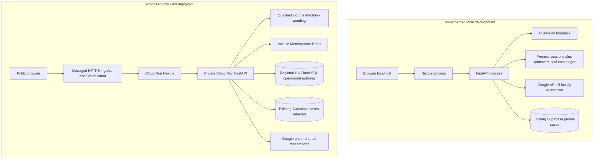

# 18 — Cloud Hosting Deployment and Scalability

[Course contents](README.md) · [Glossary](GLOSSARY.md)

## Deployment means running beyond the owner's computer

**Hosting** provides machines/services that run the application. **Deployment** installs a reviewed version there. **Scalability** is handling more work while preserving correctness and cost controls. Where To? cannot safely scale by launching independent copies of local sessions and budgets: two processes might each believe the same allowance is unused, or a continuation might land on a server without its session.

The repository contains a [Task 52A proposal](../../docs/task52-cloud-architecture-evaluation.md) and [implementation sequence](../../docs/task52-production-implementation-plan.md), not a provisioned cloud stack. This chapter teaches that checked-in proposal; its historical quotes/prices/model candidates are not freshly verified current purchasing advice.

## The implemented startup refusal

From [admission.validate_environment](../../backend/admission.py):

```python
if environment == 'production' or os.environ.get('NODE_ENV') == 'production' or hosted:
    raise RuntimeError('Production requires verified shared admission, provider accounting, ephemeral sessions and cloud inference. Activation is deferred to Task 52.')
```

Line 1 checks declared production and known host indicators. Line 2 refuses startup with missing architectural requirements. Inputs are process environment and hosted indicators; output is refusal rather than an unsafe active service. This runs at import and lifespan validation. Setting an invented “ready” flag cannot create shared services. A successful Next frontend production build does not bypass this backend boundary.

## Local and proposed cloud paths



**Cloud Run** is a managed service for containerized processes. A **container** packages an application and runtime dependencies. An **image** is the packaged template; an **instance/replica** is a running copy. A **region** is a geographic service area. Colocation can reduce round-trip latency but does not prove the proposed performance target.

A **load balancer** directs requests across service instances. **Ingress** is incoming traffic; **egress** is outgoing traffic to providers. A **CDN**, Content Delivery Network, distributes cacheable static content. Private planning responses still need no-store and controlled access. **Cloud Armor** supplies proposed edge protection; it does not replace application ownership/validation.

## Why Redis and SQL have different proposed jobs

**Redis** is fast key-value storage proposed for expiring source/venue/origin/session evidence. The proposal is volatile: no durable archive/backups of raw private/provider evidence. **HA**, High Availability, adds redundancy, but failover may still lose recent cache writes. Therefore Redis-only locks/counters must not restore already-spent capacity after failover.

Cloud SQL PostgreSQL is proposed for durable operational authority: reservations, intent/outcome classification, current revisions and fences. This is separate from the existing Supabase saved-plan schema. “Same database technology” does not mean the same data purpose or approved migration. Opaque hashes/metadata still need privacy and retention controls.

A **distributed transaction** attempts consistency across components. SQL and external HTTP cannot simply roll back together: once Google receives a request, undoing a local SQL transaction cannot unsend it. The design reserves durably before dispatch and treats uncertain sends conservatively. **Exactly once** should not be claimed merely because one database write is atomic. A stale worker must be fenced before publication or further provider work.

## Capacity, connections and latency

Each replica's database connections multiply across the fleet. The proposal suggests bounded pools and maximum replicas after measuring capacity; those design values are not current runtime cloud settings. A **connection pool** reuses a finite set of database connections; a **session pooler** mediates database sessions. Current saved operations open bounded restricted connections locally and use transaction-local access settings.

**p95 latency** means 95 percent of observations in a named sample completed at or below that duration. It is not the slowest run and cannot be inferred from a handful of mixed successful/failed calls. End-to-end latency includes admission, model, validation, searches, routes, SQL where applicable, proxy and rendering. The proposed five-second p95 remains unproven.

Scaling can increase provider concurrency/cost as well as throughput. Shared minute/day/account budgets, bounded work, retries zero, privacy-safe metrics and outage refusal must work across replicas before public activation. **Observability** means enough logs/metrics to understand operations; it should not become a raw request archive.

## What remains

A qualified cloud extraction adapter, shared state/authority implementations, privacy/provider-term approval, exact financial and infrastructure approval, dependency/base-image security remediation, security/HTTPS setup and hosted end-to-end/phone acceptance remain future work. Task 52's original hosting objective is broader than its current model-evaluation phase; Tasks 53–55 have their separate roadmap responsibilities. No resources were provisioned and no Task 53 work was started for this handbook.

## Implemented packaging checkpoint — hosting still blocked

The frontend/backend Docker recipes, strict launchers, Linux hash lock, explicit runtime file manifest and placeholder private Cloud Run templates now exist in `deployment/`. See the [deployment checkpoint](../task52-cloud-deployment-preparation.md) and [environment contract](../../deployment/environment-contract.md). The first checkpoint had no container engine. Owner-approved Colima/Rosetta now runs the actual pinned Linux amd64 builds and smoke successfully; [current container/security results](../task52-local-container-verification.md) remain distinct from native smoke. Backend production/hosted startup deliberately refuses. Local Ollama, process-local receipts/sessions/replay, the file cost ledger, loopback-only security policies and missing Cloud Run IAM transport still prevent functional cloud deployment. Min-zero/max-one/concurrency-one templates are review artifacts, not substitutes for shared authority. No services, credentials, migrations or cloud inference were added. Costs in the checkpoint are assumption-based estimates with explicit unquoted categories, not an approved bill.

## Local engine is not cloud deployment

Colima profile `whereto-task52` uses 2 CPUs, 4 GiB RAM and a 40 GiB container-data disk, plus Colima’s standard separate sparse root disk. Apple VZ runs the native arm64 Linux VM; Rosetta executes the reviewed amd64 application images. Host mounts and SSH forwarding/config changes are disabled. Profile auto-activation is disabled, so use its explicit Docker context rather than change global configuration. No Docker Desktop or paid service is needed for this verified workflow. Stop the dedicated profile after tests to release RAM; restarting it does not authorize providers or hosted startup. Shared-state and hosted-inference blockers remain unchanged.

## Compatible security changes before any hosting

The official Node 24/Python 3.12 Bookworm tags still resolve to the existing pinned digests. Current Debian tracker data has no configured Bookworm fix for retained high/critical OS findings. Switching the Debian release, mixing newer-release libraries or compiling custom system libraries requires a separate compatibility/security proposal. This checkpoint therefore patches only the compatible Python deployment dependency and retains explicit blockers. No cloud activation, new infrastructure, provider call, cost redesign or model change is implied. [Current remediation and owner decisions](../task52-container-security-remediation.md).

## Five key takeaways

1. Deployment is beyond local startup.
2. Independent local budgets cannot become a shared fleet.
3. Redis evidence and durable SQL authority have different roles.
4. External HTTP cannot be rolled back by SQL.
5. The cloud diagram is proposed, not deployed.

## Check your understanding

18.Q1. What is a replica?
18.Q2. Why is Redis alone insufficient for spending authority?
18.Q3. What does HA stand for?
18.Q4. Does a frontend build activate the backend?
18.Q5. What does p95 describe?

## Code-reading exercise — 18.R

Read validate_environment and the proposal shared-session contract. Find one state currently tied to monotonic process time that needs a shared representation.

## Inactive shared-state and financial authority

Protected local unit pricing is implemented, but no financial or shared-state adapter is active in the app. A real staging configuration still needs approved billing timezone, persistent budget-root ownership, a deliberate dollar policy, current price verification and an issuer/transport bridge that binds the exact canonical provider payload to its approved SKU and units. Advanced handoff and saved viewing remain non-provider permissions. Next, integrate actual server-owned ordinary/advanced/options/refresh action issuers using fake transport and existing session/validation contracts. Then perform private-staging infrastructure/security/capacity/cost preflight. Paid services require approval and public launch remains a separate owner decision after staging acceptance.

[Financial policy audit, tests and limitations](../task52-financial-authority.md)

## Practical exercise — 18.P

On paper route a continuation to a second replica. List the state it would need and which proposed store owns each item.

See [separate answers and guidance](EXERCISE_SOLUTIONS.md#chapter-18).

[Previous chapter](17-task-52b-cloud-ai-evaluation-and-ordering-research.md) · [Contents](README.md) · [Next chapter](19-how-to-read-debug-and-modify-this-codebase-yourself.md)


## Bridge readiness is not hosted authority

The Task 52 action bridge is an inactive local composition, with no startup switch, real issuer enrollment or live dispatch. The completed preflight below separates verified capacity/pricing facts from remaining account checks. Supabase operational-role implementation, private expiring shared evidence, Cloud Run authentication, hosted inference qualification and spending approval remain deployment gates. Existing V3 rates are historical gross estimates, not current price certification or a new dollar allowance. The deployed application must ultimately run with the owner’s Mac off. Paid recurring resources and public launch still require their separate owner approvals.

See [Task 52 action bridge](../task52-provider-action-bridge.md) for exact boundaries and verification.


## Private-staging preflight: concrete target, remaining work

The read-only preflight verified existing Google billing linkage/Maps quotas and Supabase catalog capacity, but not current Supabase subscription/backups or regional Redis pricing. The proposed target is three Cloud Run services: frontend, backend and separate authority. Owner-only frontend IAP, internal service IAM, VPC routing, private Redis, managed secrets and remote CI are not yet configured. Existing templates and containers are packaging evidence, not a functional hosted application: local Ollama, process-local state and startup guards remain. No model is independently qualified. Use the ordered checklist before provisioning, and keep resource approval separate from permission to launch.

See the [Task 52 preflight](../task52-private-staging-preflight.md) and [implementation gates](../task52-staging/IMPLEMENTATION.md). No production behavior changed in this documentation checkpoint.


## Redis foundation implemented, hosted adapter still absent

The new inactive local evidence layer implements encryption, fixed TTLs, bounded pooling/CAS and SQL attestation integration. Its constructor accepts only isolated synthetic resources; it cannot be enabled for Memorystore with a flag. Local TLS/AUTH tests establish client verification behavior, not managed-network/failover readiness. A real deployment still requires private connectivity, authenticated issuer separation, cloud key/epoch ownership, financial recovery, current prices/approval and complete native session adapters. The Mac-off staging acceptance gate remains open.

See [implemented evidence boundary and limitations](../task52-shared-evidence.md). Production behavior is unchanged.


## Local financial recovery prototype is not hosted enrollment

The inactive application-grant prototype uses an independent PostgreSQL witness volume to retain spending/delivery evidence across an operational database restore. Local service/operator/reader/issuer/counter roles are separate, but one test host administrator controls both databases. Correlated rollback or privileged compromise is outside this prototype's guarantee. A hosted design must independently control witness credentials, epoch changes, backups and reconciliation, and must authenticate the issuer/counter/dispatcher separately from workers.

No hosted model, real grant, cloud database, Redis resource or startup activation is introduced. The proposed staging dollar figures remain unapproved. Complete native session rehydration, real-provider count/pricing policies, account capacity, container-advisory decisions and private deployment/recovery tests remain gates before Mac-independent staging. [Implementation and next bounded step](../task52-application-financial-authority.md).

## Native continuity before hosted enrollment

The inactive local native-session checkpoint reconstructs actual application objects and their original authority across independent worker processes. Redis stores bounded authenticated-encrypted evidence; operational SQL retains source/revision/fence/root/outing/turn/financial facts; the independent witness retains mirrored checkpoint and spending history. Recreated locks/clients are dependencies, never authority. Expiry, build compatibility and freshness still apply after a restart.

This closes part of local P2 evidence continuity, not hosted integration. Normal endpoints still need reviewed server-owned ticket routing and workload-authenticated isolated factory/issuer/counter/dispatch services. Hosted enrollment, Google retention approval, TLS/pooling/backups, key rotation and independent epoch reconciliation remain gates. No new cloud resource, startup profile, spending grant or production model is enabled. Local full-prefix verification is slow and does not establish the five-second latency goal. [Remaining boundaries](../task52-native-session-reconstruction.md).

## Local authenticated service boundary, not a Cloud Run deployment

The [service-isolation checkpoint](../task52-service-isolation.md) implements four separately credentialed trusted processes: native factory/validated-action issuer, token counter, canonical dispatcher and independent recovery. Ordinary workers cannot read their keys or SQL/Redis logins. This is a deliberate bounded topology rather than a second planner: existing native validators/planners and constrained financial algorithms remain authoritative inside the trusted factory.

Local TLS/Ed25519 identities, loopback-only networking and disposable SQL roles demonstrate authentication and credential separation. Hosting still needs distinct workload service accounts, verified Google OIDC audience/issuer/principal, Invoker permissions, private ingress/networking, independently verified end-user forwarding, managed secrets/rotation and independent recovery/backup ownership. The local synthetic verifier must not be used as a hosted identity provider. Neither successful local service tests nor existing containers authorize production startup, spending, hosted inference or public launch.

## Enrollment is not provisioning or activation

[The inert hosted enrollment matrix](../task52-staging/hosted-enrollment-v1.json) specifies distinct service accounts, resource-scoped Invoker and Secret Manager access, exact run.app audiences, direct-IAP tester access, private authority routing, restricted SQL/Redis and independent recovery custody. Real project numbers/URLs/testers and resource approvals remain unresolved. No Owner/Editor runtime roles, SA JSON keys or public backend are allowed. The verified local contract does not deploy it: real Next server identity acquisition, current image/role/secret/network review and private staging quality/cost/recovery checks remain required. Public launch remains a separate owner decision.

## Private startup is deliberately not launchable yet

The normal pinned, non-root Docker artifacts remain the ordinary application. The frontend lock adds exact jose6.2.17 for server-side identity verification; no fixture or key is bundled. Real private bootstrap must explicitly package/trace identity acquisition and verify enrolled dependencies. Installed Next docs warn that a custom server is not traced by standalone output: the local test driver is not a production recipe. Do not replace the working entry with it or use test mode to evade backend refusal.

The [startup contract](../../deployment/private-startup-v1.json) and [route matrix](../task52-staging/route-integration-v1.json) record blocked public/native mapping, real IAM/IAP/secret/network enrollment, SQL/Redis/recovery migration, qualified LLM/pricing/grants and private staging acceptance. No cloud resource is provisioned. Public launch remains separately approved.

The frontend build also emits a small `/app/private-runtime/` component using the existing TypeScript compiler. Only the Google-root identity factory is exported; fixture injection is not a shipped export. Exact jose files are copied separately because an unused Next module may not be traced. The normal entry still imports only its generated Next server; packaging a component does not install a private profile or satisfy readiness.


## Local ordinary functionality is not hosted startup

The private ordinary API flow is now locally functional with fake services. The normal Docker entries and production refusal remain unchanged, and experimental Python services/custom Next driver stay excluded from deployment images. Planning-mode readiness, browser UI, advanced/persistence mappings, real IAM/IAP/secret/SQL/Redis/recovery enrollment, qualified hosted inference, real tokenization/pricing and explicit finite grants remain gates. Do not deploy the local fixture, use test mode to bypass startup, or treat health as financial readiness. See [Task 52 ordinary integration](../task52-ordinary-hosted-integration.md).


## Inactive ordinary private browser checkpoint

A locally working ordinary synthetic UI is not a hosted startup approval. Existing production refusal remains. Docker images exclude experimental services and temporary identity roots. Real IAM/IAP, managed stores/recovery, qualified model/tokenization/pricing, finite grants, security and private staging acceptance remain required. See the [UI/recovery report](../task52-ordinary-private-ui.md).
