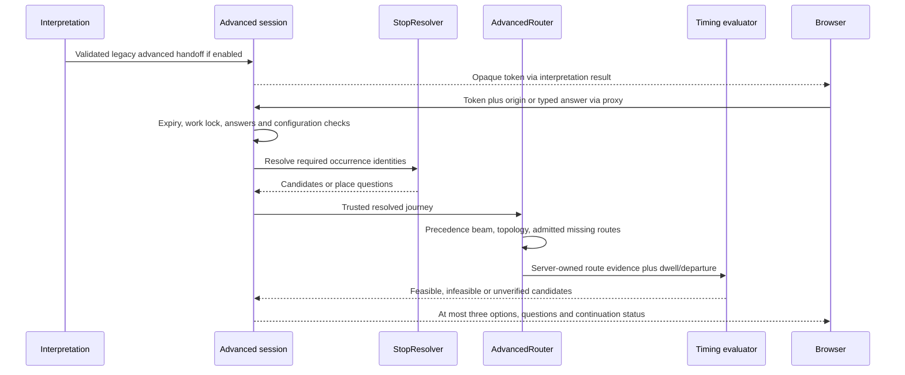

# Data-flow reference

Read [chapter 7](07-complete-end-to-end-outing-request-lifecycle.md) for full A–E traces. This is a lookup reference for the actual value transformations. “Trusted” is always scoped; no value certifies every later operation.

## Source words to ordinary cards

| Value / transition | Owner and source | Input → output | Check / failure boundary |
|---|---|---|---|
| Form intent | [Home](../../app/page.tsx) `submit`, `runPlanning` | Text, manual edits, origin mode → current submission | PlanningSession prevents overlap; current checks ignore late replies |
| Explicit preferences | [preferences.ts](../../lib/preferences.ts) | Display/manual state → manualPreferences | Inferred display is not silently promoted to override |
| HTTP interpretation | [generateOuting](../../lib/planning-client.ts), [proxy](../../app/api/interpret/route.ts) | JSON body → Python InterpretationInput | JSON/body/proxy errors distinct from domain clarification |
| Raw extraction | [OllamaProvider](../../backend/ai/ollama.py) | Prompt/schema/text → Interpretation | Loopback, timeout, strict decoder, bounded fields |
| Effective meaning | [interpret_request](../../backend/interpretation.py), [journey](../../backend/journey.py) | Copied extraction + source/manual/answers → request/context/questions | Grounding, duration/order/endpoint, scalar/date checks; known legacy ordering gaps remain |
| Calendar | [date_resolution](../../backend/date_resolution.py), [location_context](../../backend/location_context.py) | Raw date wording + accepted timezone/reference → date/window or question | Missing year, ambiguity, timezone, past/expired date |
| Beginning | [location-controls](../../components/location-controls.tsx), [starting_places](../../backend/starting_places.py) | Explicit permission/lookup/selection → origin config or Surprise Me | Confirm manual/device point; return cannot use Surprise Me |
| Public generation | [generate_endpoint](../../backend/main.py) | PlannerInput → generate_plan | Recheck date and beginning; disabled real mode refuses |
| Candidates | [real_planning](../../backend/real_planning.py), [sequential_discovery](../../backend/sequential_discovery.py) | Activity/destination pools → assignments | Identity/activity/geography/known closure, distinct venue IDs |
| Routes | [routes](../../backend/routes.py), [transport](../../backend/routes_transport.py) | Admitted directional needs → RouteLeg evidence | Mode/freshness, matrix cell budget, accounting before send, zero retries |
| Evaluation | [ranking](../../backend/ranking.py), [feasibility](../../backend/feasibility.py) | Candidate + supplied evidence → issues/classification/score | Known violation excluded, unknown remains provisional |
| Presentation | [adaptRanking](../../lib/planning-client.ts), [PlanCard](../../components/plan-card.tsx) | RankingResult → browser Plan/card | Reject malformed/mixed-mode or inconsistent responses |

Mock generation uses [planner](../../backend/planner.py) and fictional supplied travel/prices; it never establishes real-city feasibility. Source words are not sent directly to Google as an arbitrary validated itinerary.

## Advanced handoff and continuation

- `Journey` owns source-order occurrence IDs. Visit order can change only within effective constraints; repeated category labels never merge occurrences.
- `StopResolver` owns verified identities, discovery state and chosen candidates. A browser `choice` selects allowed membership, not a replacement provider record.
- `AdvancedRouter` owns directed evidence, checked assignments and topology. Client route metrics are not accepted as evidence.
- `Session` owns original requirements, accepted edits, route evidence reuse, closure offers/permissions, seen/current options and timing answers. Changing date/mode/origin can invalidate dependent state.
- `evaluate_advanced_timing` reads trusted routes, explicit bounds and calendar; it does not call the model or Google.
- Advanced `action=different/discover/beyond` is distinct from ordinary `/api/plans/options`. Cached page arrows use neither endpoint.

An explicit Python-only V5.1 test can supply an extraction to the development adapter. The adapter checks the raw graph against the source, compares it with the legacy result, and returns the existing advanced handoff type. Tests can then pass that result to an isolated `Sessions` instance. This experimental route does not appear in the browser sequence above. [Development data flow](../task52-v51-ordering-preservation-generalization.md)

## Data ownership and retention

| Data | Browser / transient backend | Durable allowed purpose | Do not infer |
|---|---|---|---|
| Raw request/extraction/source quotes | Active form/continuation/session as implemented | Minimized app-owned advanced requirement provenance where safe; no automatic raw request archive | That logs or original_request column contain all requests |
| Exact confirmed origin | Explicit transient routing context | Excluded/redacted from saved documents | Destination equals device origin or home |
| Google name/address/ratings/hours/route metrics | Scoped active evidence/current detail rendering | Real saves retain permitted identifiers and app-owned requirements, not cached provider content | That reopening gives fresh routes |
| Place ID | Scoped memberships and candidates | Source metadata identifier | That possession permits arbitrary fresh paid work |
| Private capability | Browser private link/explicit storage behavior; scoped backend membership | Database access hash, not raw token | Account authentication or revocation support |
| Costs and usage | Protected local counter/attempt accounting | Ledger metadata under its own safeguards | Accurate posted invoice from an estimated rate |
| Evaluation raw response | Private historical evidence with immutable hashes | Original evaluation journal/evidence policy | Permission to rewrite after scorer/policy change |
| Operational diagnostics | Bounded content-free events and aggregates | Declared sanitized log output | Full prior body reconstruction |

## Independent clocks and units

Calendar dates use destination context; elapsed arithmetic uses aware instants/UTC; session expiry uses monotonic process time; routes use observation instants and under-300-second freshness; account periods use their billing clock. A fixed calendar fixture does not freeze any of the other clocks. Ordinary times are often local minutes after midnight; advanced legs retain seconds/meters. Whole-trip budgets include applicable start/return/dwell; inter-stop-only caps do not.

## Error propagation

Provider exception → provider_code/provider_status → main.failure with correlation ID and sanitized message → Next proxy classification → client failure/adapters → kept request/cards plus recovery. Some no-result/clarification outcomes are successful HTTP domain responses, not exceptions. No fallback silently drops required stops or substitutes fictional evidence for failed real service work.

[API contracts](API_REFERENCE.md) · [Debugging](DEBUGGING_PLAYBOOK.md) · [Security lesson](14-security-rate-limits-accounting-and-reliability.md)
