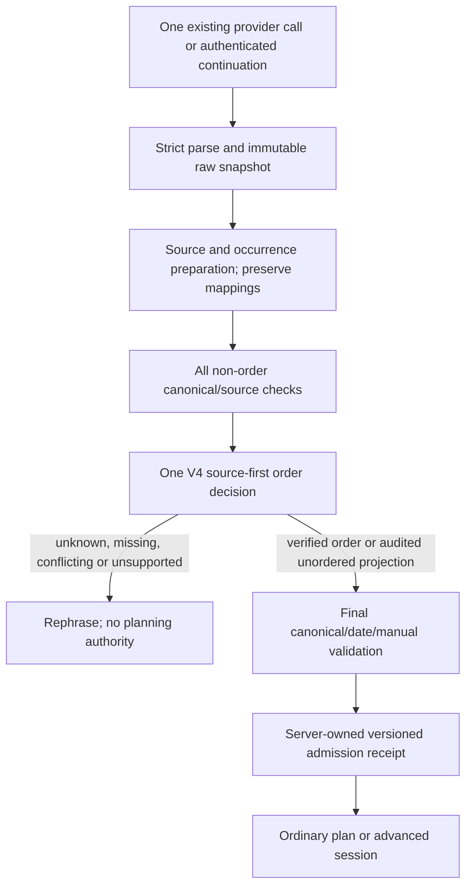

# Ordering V4 enforcement design and approval review

Status: **proposal only; no enforcement prototype, runtime changes or activation**. Design version `52b-order-enforcement-design-v1`, reviewed against clean `4c3767afddc051079a83be0043b7d9740f3ffe5f`. The requested `05cfcbd` is its ancestor; the later parent-verified Hitech/HITEC spelling fix and its nine tests are preserved. Current baseline evidence is 1,106 backend passes/37 opt-in skips and 285 frontend passes, rather than the earlier 1,097/37. Task 52 remains in progress.

Acceptance for this checkpoint: reproduce the frozen ordering baseline, identify all graph-changing boundaries, specify one future authority plus admission/session provenance, characterize current behavior with fake providers, preserve every runtime/prompt/corpus/paid byte, and deliver a reviewable patch/test plan. Passing this checkpoint does not authorize the patch or qualify a production model.

[Fresh offline evidence and verification](task52-ordering-enforcement-verification.json), [existing frozen policy](task52-ordering-policy-v4.md), [new characterization tests](../backend/test_ordering_enforcement_design.py).

## 1. Current pipeline and exact conflict

| Boundary | Actual code and behavior |
|---|---|
| Main form | `app/page.tsx` retains text/manual preferences and pending/advanced continuations. `lib/planning-client.generateOuting` posts to `/api/interpret`, then prepares the origin and posts a returned ordinary request to `/api/plans/generate`, or uses an advanced token. |
| Admission/inference | Existing request/inference admission and provider factory stay in control. `backend.main.interpret_endpoint`/`interpret_outing` calls `ordering_shadow.interpret_observed`. OFF delegates unchanged; explicit local-test ON decorates one provider call and only observes a copy. |
| Strict parsing | `backend.ai.parse_interpretation` rejects duplicate/unknown JSON fields; `Interpretation.model_validate` revalidates nested instances. The provider interface returns a strict parsed extraction, not routing authority. |
| Source/manual preparation | `backend.interpretation.interpret_request` copies the raw parsed result; manual inputs and source location/activity/mode checks run. A matching browser `PendingClarification` instead supplies its previous interpretation and reference time; no new inference is made. |
| Journey | `backend.journey.validate_journey` masks travel scopes, calls `normalize_extracted_references` and `normalize_explicit_durations`, then performs legacy graph normalization, provenance/occurrence/identity/optional/time/endpoint checks, cue checks and ordinary/advanced classification. It mutates its working copy. |
| Legacy graph deletion | The no-cue block in `validate_journey` (currently lines 295–306) drops forward source-bound model edges if a finite legacy cue vocabulary is absent. `start`/`finish` are absent, so legitimate global first/last edges can disappear. |
| Legacy false acceptance | The edge loop (currently lines 418–430) checks a real quotation, both labels, a cue and a few reverse patterns. It does not prove cue attachment/occurrence ownership. `Coffee, museum, then` can therefore admit coffee0→museum1 although the trailing cue belongs to museum1→coffee2. A cycle-free graph is insufficient. |
| Endpoint overlap | The omission checks (currently lines 438–439) treat every `finish at` as requiring a separate endpoint. V4's proven final **visit** can consequently be blocked even if its graph survived. This check must be scoped, not indiscriminately removed. |
| Handoff | `interpret_outing` always calls `advanced_planning.Sessions.create`; that method creates state only for enabled `advanced_unavailable` results with a journey/context. Ordinary results are returned as `PlanningRequest`; ambiguous results publish no planning request. |
| Planning | `real_planning.real_plans`, sequential discovery and route calculations consume admitted request/session state. `advanced_routing._ancestors` enforces transitive predecessors, so an invented edge becomes a real route restriction. |
| Save/continuation | `OptionSessions`, advanced `Sessions` and save `Receipts` have independent bounded capability lifetimes. `AdvancedSaved.coverage` verifies occurrences/requiredness/order against the supplied effective journey, not original language completeness. |

`PendingClarification` is currently browser-supplied, structurally revalidated data, **not an authenticated expiring server capability**. It has `text`, `interpretation`, `answers` and an aware `referenceTime`, without a policy receipt. Do not describe it as already satisfying future ordering-confirmation security. Its reference time is a calendar anchor, not a capability TTL. Activity followups can deliberately rebuild a sequential journey from the separate answer text; that path needs its own ordering-source ownership in an enforced profile.

## 2. Proposed single authority and explicit phase split

Future server-selected profile names: `legacy` and `v4-enforced-v1`. These names are design identifiers, **not implemented options**. No client property, frontend preference or environment variable selects enforcement in this checkpoint. The current code remains legacy/default-OFF shadow.



Implementation sequence, without calling legacy and V4 as sequential authorities:

1. Preserve the provider's original strict extraction plus source in bounded transient request memory before any normalizer. Preserve explicit-field metadata and, if collected at the decoder, bounded original response bytes there; invalid payloads fail parsing rather than becoming audit-approved data. No raw bodies/text/stable text hashes in operational logs. Approved synthetic benchmark responses remain in their existing immutable store.
2. Split `validate_journey` into named preparation, non-order validation, legacy ordering, and execution-classification stages. Keep the exact old call sequence behind the legacy entry point and prove response equivalence. No generic `skip_validation=True` or caller-supplied `validated` boolean.
3. Reference/duration normalization stays source-bound on a working copy. Preserve a raw→effective occurrence mapping and a normalization record. Same-index verbatim punctuation/generic-reference repairs may precede proof after source verification. Removing/reclassifying a final home stop or remapping any graph is **not** a harmless spelling repair: initially clarify unless a separately tested endpoint/occurrence proof establishes that transformation and all affected edges. Do not silently prune an unverified edge before auditing it.
4. Run all non-order checks: source spans/occurrences/completeness, exact identities, requiredness/optionality, travel scopes, mode, durations and relations, deadlines, endpoints, shared-place and scalar constraints. Scope-dependent endpoint omission is deferred until step 8, using verified clause ownership; independent endpoint provenance/identity checks still apply. Keep structural graph bounds, self-edge/cycle/conflict checks. Keep edge source existence even when an unordered projection is considered. Some date/manual checks currently occur later; a positive ordering decision cannot bypass them.
5. Invoke the frozen V4 semantics on the verified working occurrences and original source. Independently derive source intent; do not use proposed edges as proof that order was requested. Every mandatory relation requires owned stops, directional cue scope and sufficient edge evidence. Compare transitive closure, not merely adjacency arrays; accept redundant supported transitive edges only when their own quote proves the path.
6. On an independently proven unordered list, permit only the existing reviewed forward/source-bound/nonconflicting projection. Preserve the raw graph/error; effective order becomes unspecified/flexible as independently proved. Do not silently repair a reversed, cyclic, ungrounded or potentially mandatory graph. On explicit/partial sources, reject unsupported edges and missing required reachability; do not insert a missing model edge in the initial profile.
7. **Retire for the enforced profile only:** the legacy no-cue deletion block; cue-word-only acceptance/reverse special cases; overlapping order-omission/arrow inference; legacy activity-answer chain generation. Keep contradiction safety through the source-first decision and canonical structural validation. The same graph must never pass through the old order normalizer afterward.
8. Replace the blanket `finish at` omission rule with occurrence-owned scope: a proven global final visit is a visit; a distinct final-destination clause still requires a validated endpoint. An unowned/ambiguous clause clarifies. Preserve all return/home identity and timing protections. This is not permission to delete general endpoint checks.
9. Complete date/timezone/expiry/manual precedence validation and classify execution. Only now may a trusted admission receipt or advanced session be issued. Every failure clears downstream planning authority without losing text/preferences.

### Proposed internal interfaces (not implemented)

```python
# Server-owned types; none is a request-controlled validation bypass.
prepare_source(raw: RawExtraction) -> PreparedSource | Clarify
validate_nonorder(prepared: PreparedSource, overrides: UserOverrides) -> NonOrderChecked | Clarify
prove_order(checked: NonOrderChecked) -> VerifiedOrder | AuditedUnordered | Clarify
finalize(checked: NonOrderChecked, order: VerifiedOrder | AuditedUnordered,
         reference_time: AwareDatetime) -> ValidatedOrdinary | ValidatedAdvanced | Clarify
issue_admission(validated: ValidatedOrdinary | ValidatedAdvanced) -> OpaqueReceipt
admit(receipt: OpaqueReceipt, requested_revision: int,
      submitted_effective_fields: dict) -> ServerOwnedPlanningContext
```

The preparation record carries the raw immutable extraction, effective copy, source-owner map and reviewed normalization trace. `NonOrderChecked` carries every independent source-check result, not a caller assertion. `VerifiedOrder` and `AuditedUnordered` are distinct internal result types; the latter always retains `raw_model_ordering_correct=False` when an edge was projected away. Constructors are confined to validation modules. Finalization is the only place that issues planning-ready state; `admit` retrieves that state and compares submissions, never reconstructs proof from a client flag or opaque token's format alone. A blocked result has neither constructor nor receipt.

### Ordinary compatibility and missing contracts

A `journey=None` ordinary legacy extraction currently works; V4 alone returns `bounded_input_or_missing_contract`. Initial enforcement cannot silently declare all such requests valid or turn every ordinary request into a question.

The reviewed implementation proposal must add a finite ordinary binding path using already source-validated activity phrases: construct ephemeral occurrence bindings on a copy solely to test a **complete unordered-list absence proof**. Do not invent optionality, venue identity, timing, stops or mandatory edges. If explicit ordering/advanced semantics are present but missing from the extraction, clarify rather than manufacture a graph. If this adapter cannot preserve the reviewed ordinary fixtures, stop the rollout. It is a future acceptance requirement, not implemented or measured compatibility in this checkpoint.

Ordinary planning may still choose a feasible source-order itinerary on an unordered request; that chosen itinerary order must not be represented as a mandatory user restriction. A simple full proven chain can retain the ordinary path only when every dependency is entailed by that path. Partial, reverse, global-first/last, optional/repeated or endpoint-dependent cases use the existing advanced graph path unless equivalence to ordinary planning is explicitly tested. Never infer an additional chain from a list.

## 3. Decision and audit contract

| Classification | Raw correctness | Effective behavior |
|---|---|---|
| Correct raw explicit/partial graph | Ordering-correct only; other checks still required | Retain exact supported graph/occurrence IDs. |
| Correct empty graph on proven unordered source | Ordering-correct only | Retain unordered/flexible semantics. |
| Model edge on completely proven unordered list | Raw model error | Audited empty projection only under the reviewed narrow gate; not a successful raw extraction. |
| Unsupported/reversed/borrowed-cue relationship | Incorrect or unresolved | Block; never delete a potentially real requirement as a repair. |
| Missing proven mandatory relationship | Incomplete model extraction | Block/rephrase; do not guess/fill it. |
| Ambiguous, negative, conditional or contradictory source | No safe mandatory graph proved | Explain/rephrase; preserve source and all other requirements. |

Proposed internal decision record: application profile, policy/schema/preparation versions and hashes; request revision; origin of evidence (`raw_model`, `user_structured`, `legacy_effective`); raw/effective extraction identities; original/proven/effective graphs; occurrence and cue spans; supported reachability; normalization reason; raw ordering correctness; all non-order/date validation dispositions. Recompute/bind decisions to their source/extraction; stale decisions fail. Internal source hashes stay transient and never become public telemetry. Keep original evidence distinct from generated receipts and user-answer provenance.

## 4. Admission proof: prevent a second bypass

A guard inside `/api/interpret` alone is not sufficient. The browser separately posts ordinary request bodies, and existing request models have no V4 admission proof. A caller can bypass interpretation entirely; client-supplied profile/graph/"verified" fields cannot become authority.

Future `OrderingAdmissionRegistry` proposal: process-local, locked, maximum 50 active entries, opaque `secrets.token_urlsafe(32)` capability, strict 600-second monotonic expiry, no sliding refresh. Bind to source/request revision, server-selected profile/policy/schema hashes, verified occurrence map/graph, effective planning constraints, manual-answer provenance and validation status. Raw sensitive data stays bounded/transient (source≤4,000 chars, ≤32 stops/64 edges, ≤32KiB serialized extraction), not an operational log or database migration. Oversize/worker timeout/error/import failure in enforcement **blocks**; shadow's fail-open behavior cannot be reused as admission.

The server owns the effective request. `/api/plans/generate`, advanced creation/run, options/discovery and saved refresh must consume matching server-owned authority, verify current profile and request binding, and recheck expiry/provider admission before I/O. No receipt on clarification/failure. No direct public constructor of a `VerifiedJourney`. A changed request/date/activity/order requires deterministic revalidation and a new bound revision; origin confirmation may attach a separately validated authorized origin without altering semantic order/return meaning. Preferences that affect feasibility also revalidate; no new AI is required for a supported explicit manual edit.

Pure manual planning is a distinct existing supported source, not a claim of AI/V4 validation. A future enforced deployment needs an explicit structured-manual admission path using user-authored occurrence/order choices. It cannot silently grandfather arbitrary text-derived request bodies under a manual label. During limited rollout, separate server-controlled entry points/cohorts and reject missing/mismatched authority at enforced boundaries. Retry/continuation may reuse the same authorized context only under existing duplicate/work locks and provider budgets; never issue fresh allowance or replay a consumed confirmation.

This new registry is a proposal for semantic admission, **not** reuse of save receipts, advanced tokens or the paid experiment journal. Shared-state/cloud migration remains outside this task.

## 5. Clarification and future typed confirmation

### Initial enforcement: existing rephrase UI

Return `request=None`, `executionStatus=clarification_required`, an actionable `issues` message, no advanced token and no planning authority. The existing client stops at its issues branch and retains the textbox/preferences. No new ordering question field is needed initially. Example: “Please state which stop must come before which, using ‘A before B’. Your other outing details are kept.” Where uniquely identified, display the user's own occurrence labels, such as “first coffee” and “second coffee”; never infer the intended direction. Conditions/contradictions ask the user to restate or choose a requirement rather than silently discarding one. No routing/search/session creation on this branch.

### Future structured answer: design only

Add a dedicated typed answer, never `answers.activities`, `endpoint`, or free-form schema injection. Proposed fields: opaque pending capability, source revision, server-owned occurrence IDs, question revision/nonce and one of `before`, `after`, `no_mandatory_relation`, `cannot_determine`. Occurrence IDs identify distinct source spans within one revision, not just labels. UI displays stop numbers and source snippets to disambiguate repeated coffee/named places.

Server procedure under one lock: validate capability/expiry/profile, compare source/question revision, validate both occurrence IDs and pending-question membership, check nonce unused, apply only the selected user-authored relation to a copy, check self-edge/cycle/conflicts and independently proven mandatory requirements, run all canonical/calendar/expiry checks, commit a new answer revision and consume/rotate the question capability atomically. A concurrent/replayed/stale/tampered submission fails without provider work. A rejected attempt must not erase unrelated requirements; an explicitly retriable validation error retains the same bounded expiry and never restores a consumed nonce.

`no_mandatory_relation` means no additional user relation for that question. It cannot remove an independently established mandatory path, including a transitive one; require an explicit request-edit/retraction revision for that. `cannot_determine` remains blocked. Changing ordering never changes optionality, named identity, endpoint, timing or date. User answer text/IDs are separate source authority, not forged original-model evidence. This app has bearer capability possession, not authenticated user accounts; do not claim stronger ownership guarantees. Retain existing local-host/origin and capability protections. One-use confirmation does not mean every ordinary options read consumes a new semantic capability.

## 6. Sessions, saved state and rollback

| State | Proposed enforced handling |
|---|---|
| Legacy browser pending/effective snapshot | Cannot recover erased raw edges. Fail closed at enforced entry; retain view/text/preferences and ask for explicit regeneration or source restatement. No automatic AI call. Legacy profile remains current until separately approved. |
| New pending with retained raw/provenance receipt | Same authority boundary on every answer; no model rerun for validated structured followups. Calendar reference is preserved separately from monotonic capability expiry; outing freshness is rechecked. |
| Active legacy ordinary/options/advanced session | Never relabel V4. At cohort transition, either remain in an explicitly isolated legacy cohort or expire new-work admission. Initial safety rollout should disable new provider work for legacy sessions entering enforced scope; viewed pages remain available. Do not grandfather known unsafe graphs. |
| New advanced/options state | Carries admission profile, receipt/revision and verified graph internally; every edit/continuation verifies them. Existing locks/600s TTLs/quotas remain. No private text in diagnostics. |
| Saved itineraries | Continue authorized view/reopen using existing database ownership, private-link and expiry rules. A saved effective graph is not new raw proof. Saving an existing viewed page does not retroactively certify it. |
| Refresh/replan/discover from old saved graph | Preserve view but block new provider work under enforced scope until explicit requalification. Redacted saved source may be insufficient to reconstruct proof; request user restatement, never fetch/guess private data or auto-infer a replacement. |

No eager database rewrite or migration is proposed. Preserve stored documents and labels as historical. Future version metadata can live in transient admission state and optional versioned application DTOs only after separately reviewed compatibility tests; it must not weaken existing saved-document parsing. Unknown/corrupt versions fail closed for new work, not private-link authorization or view semantics.

Rollback after an enforced rollout is a **stop-new-admissions kill switch**, not automatic fallback to permissive legacy validation. Stop new provider work for the affected enforced receipt/session versions, invalidate their transient authority, preserve saved viewing and diagnostic categories, retain text/preferences, then deploy a reviewed repair. Never reaccept the known coffee0→museum1 edge because enforcement is unavailable. Legacy users remain unchanged only while explicitly outside an activated enforcement cohort; a failed enforced request cannot silently switch cohorts.

## 7. Precise future patch scope and review order

| File/function (proposed additions explicitly named) | Required change and acceptance |
|---|---|
| New `backend/ordering_policy.py` and bounded primitives | Port reviewed V4 core without importing paid/evaluation runners. Keep frozen V1–V4 scripts intact; trace hashes/dependencies and run fixture equivalence. |
| `backend/journey.py`: `validate_journey`, `normalize_extracted_references`, execution classification | Split stages while preserving legacy entry behavior byte-for-byte in outcomes. Retire only overlapping order logic in the enforced profile; track index changes and scope finish-visit versus endpoint correctly. |
| `backend/interpretation.py`: `interpret_request`, pending/result DTOs | Select only a server-owned profile; retain raw and answer-source revisions; require all gates before result publication. Handle no-journey ordinary inputs explicitly. No prompt change. |
| New `backend/ordering_admission.py`; `backend/main.py`: `interpret_outing`, generation/advanced/options endpoints | Bounded registry and receipt verification, atomic revision/expiry checks, no authority on blocked results and no interpretation bypass. Keep request/inference/provider admission intact. |
| `backend/advanced_planning.py`: `Sessions.create/run`; `option_sessions.py` callers | Internal provenance/version binding and continuation/edit revalidation; never ingest a client graph as proof. |
| `backend/saved_refresh.py`, `saved_advanced.py`, `saved_plans.py` call boundaries | View compatibility remains; enforced new-work gate requires current proof without overwriting historical documents. Preserve ownership/access expiry. |
| `lib/planning-client.ts`, `app/page.tsx`, advanced continuation DTOs | Carry opaque future receipt/revision; invalidate stale authority on edits, retain input, stop on clarification/expiry. No user-controlled profile toggle. Initial rephrase uses current UI; typed confirmation is a later task. |
| Existing source-pinned evaluation tooling | Runtime journey/interpreter edits would intentionally violate the current two-file corpus pins. Do not alter gold/corpus/hash checks to make them pass. Require a separately reviewed new application/evaluation compatibility manifest before new qualification. Keep old profiles/history reproducible from verified Git code in isolated read-only replay, using the original journal read-only; never copy/reset/migrate it. No automatic paid-config transition. |

Implementation should be split into reviewable changes: **(1)** behavior-preserving validation-phase extraction with complete legacy equivalence, **(2)** test-only enforced profile plus admission/pending/session gates and the full matrix below, **(3)** separately approved limited activation. Do not ship only the helper hook as enforcement. If phase extraction cannot preserve non-order behavior, stop and narrow the patch rather than bypass validation.

## 8. Test evidence and remaining acceptance matrix

This checkpoint adds seven **characterization** tests of the real legacy interpreter plus separately frozen V4, not a new enforcement prototype. They show:

- Global binary/three-stop proof survives in the offline decision, but active legacy removes the edges and asks clarification; endpoint omission is a second conflict.
- A real-quote unsupported repeated edge can still yield an ordinary request in legacy; V4 rejects it while preserving the legitimate later relation in its proof.
- Audited unordered projection changes only ordering fields, preserves the raw error, and rejects stale source/extraction decisions.
- V4 ordering acceptance cannot validate an invented endpoint; canonical validation still rejects it.
- Ordinary `journey=None` is a concrete adapter gap, not assumed covered by 18/18 Qwen metrics.
- Partial/repeated occurrence ancestor closure remains scoped; global first/last has its true transitive consequences.
- Legacy pending supports no-extra-AI followup but is not an authenticated reference-time/ordering receipt. Current DTOs reject arbitrary ordering/profile fields; no hidden activation exists.

Fresh replay reproduces **all** frozen summary/row/case/probe/journal results, not just aggregate counts: Qwen 18/18 correct raw graphs compatible, seven audited projections, two incorrect repeated graphs rejected across 27 outputs; OpenAI five correct compatible/two incorrect rejected across seven outputs. Five other Qwen identity/return/time blocks remain canonical failures. No historical score, raw response, prompt, schema or reservation is rewritten. 20/20 declarations and 10/10 separated holdouts match; 0/15 clear-source ordering false clarifications, 0/15 negative-source acceptances and 0/180 retained unsupported probe edges. These are same-agent reviewed finite fixtures, **not independent human signoff, whole-request accuracy or a production qualification**.

| Future enforced test group | Required measurable gate before activation |
|---|---|
| Exact college→coffee; binary/three-stop start/finish; ordinals/arrows | Every expected occurrence/edge retained through the actual HTTP result and session; no legacy deletion or spurious endpoint question. |
| Partial pharmacy→bank with independent required/optional coffee | Correct closure and requiredness; no complete-chain invention; no changed endpoint/time constraints. |
| Repeated coffee/museum sources, similar exact names, borrowed quotes | Correct source occurrence ownership; known wrong edge blocked; no merge, swap or unsupported extra edge. |
| Unordered ordinary/no-journey/explicit answers | Existing reviewed ordinary fixtures stay usable through the finite absence adapter; raw errors remain labeled errors. Activity answers cannot invent ordering. |
| Missing/reversed/conditional/contradictory/unfamiliar scope | No receipt, planning session, search/route call or fallback. Specific rephrase outcome. |
| Return, distinct endpoint, total/deadline relations, date/timezone/DST | Original non-order regression suites remain green; missing/changed requirement blocks even if ordering passes. |
| Receipts/pending/confirmations | Tamper, stale source/schema/profile, expiry at 600s, foreign occurrence, consumed nonce, replay and simultaneous submit all reject with zero new provider work; valid answer uses zero AI. |
| Direct generation, manual entry, advanced/options/saved refresh | No enforcement bypass; owned contexts and manual semantics explicitly distinguished. Rollback never falls back to known unsafe admission. |
| Shadow/legacy isolation, observer faults and limits | Current OFF/ON bodies/status/session/admission equivalence stays; enforcement errors/oversize/timeouts block rather than inherit observer fail-open. |

The future gates are specified, **not reported passed for an unimplemented profile**. Relevant existing parser/journey/calendar/session/advanced/observer/audit regression results are listed separately in the machine report. An initial verification command named a nonexistent reconciliation module; this was a loader error, corrected to the actual audit module and rerun. A new characterization assertion initially expected advanced handoff, but the unsupported complete chain takes the ordinary branch; the corrected assertion now checks that actual published ordinary result. No production assertion was weakened.

## 9. Rollout gates and performance

| Stage | Activation/control | Gate and rollback |
|---|---|---|
| Current legacy/default OFF | Existing startup only; unchanged | Preserve current behavior; historical known risk is disclosed, not called safe enforcement. |
| Local shadow | Explicit `capture_local_test()` context | Observer cannot authorize planning; all equivalence/error/bounded-work tests pass. Leaving context disables it. Not public monitoring. |
| Future test-only enforced profile | Explicit trusted Python test factory only; no frontend/request/env activation | Full effective outcomes plus receipt/session matrix, all Qwen/OpenAI replays and full application verification. No network. Failure stops this profile; no legacy fallback. |
| Separately approved limited rollout | Owner-approved immutable server configuration/cohort and version manifest | Zero accepted unsupported critical constraints on an independently reviewed finite set, no substantive correct-case regressions, all security/direct-admission tests green, bounded latency/memory and an accepted false-clarification scope. Any critical failure closes new-work admission. |
| Full rollout | Separate approval after independent semantic qualification and regression acceptance | Retire overlapping legacy authority in that scope; validate manual/saved/continuation compatibility and rollback drills. This task supplies no population accuracy or cloud-model selection. |

Proposed execution is synchronous bounded proof inside the existing admitted request worker, not the shadow observer's optional daemon/timeout path. Retain the 256-operation occurrence-binding limit, 4k source/32-stop/64-edge bounds and check cancellation/deadline before and after validation. A late/cancelled result cannot issue authority. These bounds do not promise hard CPU preemption; pathological-input and regex-work tests plus measured request-worker overhead are rollout gates.

No enforcement prototype was built, so **no enforcement-overhead measurement is claimed**. The fresh existing offline policy/shadow baseline measured 1,000 policy-only checks and 100 OFF/100 ON fake-provider interpretation calls; timing values are in the machine report. Future enforcement must retain source≤4k/32 stops/64 edges and the bounded occurrence-binding work, avoid a queue/general parser, and benchmark the full phase split including snapshots/receipts. Unknown/limit cases must be bounded and safely rejected. Do not use shadow's optional timeout policy as an enforcement decision. Offline timings exclude model/network/provider/routing/browser work and establish neither production p95 nor five-second end-to-end planning.

## 10. Security, paid boundaries and next approval

All active runtime files, Qwen settings/prompt, cloud prompts/schemas/scorers, authoritative 66-case corpus and frozen policies remain byte-identical to this task's baseline. No startup or production behavior changes. No private text logs, new persistent user state or database migration. This is a design plus test/evidence checkpoint; typed confirmation and enforcement remain unimplemented.

The original journal/root/ten rows/corrections, 324 private files and V4 halt remain byte-identical: OpenAI 7, Google 2, Anthropic 1; total 10/594; $0.047366625 accounted/$11.952633375 remaining. Original $12/594/198, 12k input/2k output, sequential one and zero retry limits stay unchanged. No new paid approval, slot reservation, journal, refund, inference/counting/Maps request, credit purchase, credentials/billing/provider configuration, infrastructure or Task 53 work.

Gemini retains two historical Developer API HTTP 400 failures and its independent IP restriction; next is separate offline request/schema review and owner IP readiness, not speculative retries or managed-platform substitution. Anthropic retains its grammar-compilation failure; next is a separately reviewed lossless schema-complexity proposal and static required/null/negative tests, not a model substitution or call.

Recommended next approval: a narrowly scoped **behavior-preserving phase-extraction and admission-contract implementation**, default legacy and no activation, with the new compatibility/admission matrix. Review that before a test-only enforced profile or any limited rollout. A larger paid corpus batch, production model selection or cloud deployment is not the next step.
