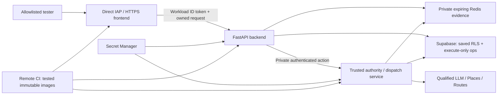

# Task 52 private-staging infrastructure preflight

**Identity:** `52-private-staging-preflight-v1`. **As of:** November 11, 2026 UTC. **Clean baseline:** `3f50032e3f55bf72fe0ca914bbca0bad7d00b8c6`.

**Decision:** proceed with local implementation and the owner decisions below; **do not provision or deploy yet**. Recommend existing Supabase operational isolation, private regional Memorystore, Cloud Run frontend/backend plus a separately authenticated authority service, and remote CI. No hosted LLM is qualified. The entire eventual runtime/build/deployment workflow must work with the owner's Mac switched off.

[Machine-readable observations, costs and decisions](task52-staging/readiness-v1.json) · [Dependency-ordered implementation gates](task52-staging/IMPLEMENTATION.md) · [Exact owner approvals](task52-staging/OWNER_APPROVALS.md). These are proposals, not active infrastructure, migrations, spending grants or launch approval. Historical documents retain their original dates; this report supersedes their **estimates**, not their evidence.

## 1. Verified existing resources and explicit unknowns

Read-only Google CLI/Cloud Billing/Service Usage metadata and PostgreSQL catalog inspection used existing access. No cloud resource/API/IAM/quota/billing configuration was changed; no saved user rows were read. Credentials, personal principals, billing account identifiers and Supabase project references are omitted or hashed in the machine record; the non-secret Google project ID is retained for actionable owner instructions. Local CLI credential-cache access required sandbox permission; it was not a new account login. No Supabase management token or new credentials were requested.

| Component | Current evidence | Consequence / remaining check |
|---|---|---|
| Google project | `where-to-512422`, ACTIVE; no organization parent observed; no configured default hosting region | Reuse this project conditionally; proposed region is `us-east4`, not an already provisioned regional environment. |
| Billing | Billing linked; billing account reports open | **Does not prove** Free Trial versus paid status, current credits, payment configuration, balance or remaining allowance. Owner checks Billing Overview/Credits before any resource purchase. |
| Enabled APIs | Places, Routes, IAM/IAM Credentials, Service Usage, Logging/Monitoring and other existing APIs listed in JSON | Run, Compute, Redis, SQL Admin, Secret Manager, Artifact Registry, Cloud Build and IAP not observed enabled. Nothing was enabled. Their resources/networks/quotas remain **unverified**, rather than asserted nonexistent. |
| Identity | One enabled local Maps service account; zero user-managed keys; custom role contains only `serviceusage.services.use`; one owner user binding; one Token Creator impersonation binding | Existing local Maps identity is not the frontend/backend/issuer/CI identity set. Its role has no API-specific IAM condition; it is not a two-method allowlist. Do not deploy owner ADC or grant Owner/Editor to workloads. |
| Maps quotas | Text Search 200/day, 10/min; Details 40/day, 10/min; Matrix 2,000 elements/day, 150/min; unused ComputeRoutes 20/day, 10/min | Configured limits, **not remaining usage**. Other Places methods retain larger/default quotas; the gateway must deny unsupported methods. No quota change here. |
| Supabase | Existing database reachable using `verify-full`, client TLS and forced read-only transactions; PostgreSQL 17.11, max_connections 60, reserved connections 3; ~14.2 MB database; snapshot 8 connections, 1 active | Real catalog evidence, not load capacity or pool availability. Pooler endpoint indicates AWS `us-east-1`; actual project region was historically confirmed Northern Virginia, not independently refreshed in dashboard. |
| Saved-plan isolation | `whereto` schema; six tables have RLS and FORCE RLS; existing runtime login has no superuser/CREATEROLE/CREATEDB/BYPASSRLS; role connection limit -1 | Existing saved access stays unchanged. The four-slot Python semaphore is per process, **not a fleet or PostgreSQL role limit**. There are no current application routines or operational schema/roles from the local experiment in this database. |
| Bootstrap capability | Existing administrator has CREATEROLE and database CREATE privilege, but is not a superuser | Necessary metadata, not proof that Supabase permits every proposed ownership/DDL operation. Never attach this credential to an app service. |
| Supabase management | CLI/management dashboard access not established through available tooling | Current organization plan, compute size, pooler pool/client limits, backup schedule/retention, restore capability, Data API exposure and network restrictions need the owner checklist. Do not infer the current plan from an old Free-plan record or 60 connections. |

The initial Service Usage v1 quota path returned 404; the documented v1beta1 metadata path then returned complete quota lists. This was not a Maps invocation or retry of provider work. Billing Catalog pricing returned 429 once; no automatic retry. The current Redis pricing URL redirected to a 404, so its regional price remains an explicit quote blocker. Client-to-pooler TLS is verified; protocol-version metadata and pooler-to-server TLS were not established by `pg_stat_ssl`. No assertion about that internal leg follows from client TLS.

## 2. PostgreSQL decision: reuse with conditions

**Recommend the existing Supabase project with a separate unexposed operational schema, separate NOLOGIN routine owner, separate constrained issuer and execute-only runtime roles.** Do not use `public`, the saved-plan role, `postgres`, `anon`, `authenticated` or a service-role key for operational authority. Existing saved RLS/capability/expiry checks remain. Runtime must have no direct table mutation/DDL, owner membership or ability to administer prices/limits. Retain fixed SECURITY DEFINER search paths, qualified SQL, READ COMMITTED gate locking, unique consumption, revision/fence checks and immutable financial history.

This reuses tested PostgreSQL semantics at lower complexity. Schema/role isolation **does not** isolate compute, connections, outages or whole-project restores. Require before migration:

1. Owner confirms plan, compute/pooler headroom, backups and Data API exclusion. Recommend Pro/Micro for real private financial staging; Free remains suitable only for a separately accepted temporary prototype with explicit outage/backup limitations. Published Pro starts at $25/month including one Micro compute credit; that is not a current invoice or permission to upgrade. [Supabase pricing](https://supabase.com/pricing), [compute billing](https://supabase.com/docs/guides/platform/manage-your-usage/compute).
2. Reviewed migration is exercised on disposable PostgreSQL with the exact hosted version/privilege restrictions, then separately authorized against this project. No writes to saved tables, broad GRANT, extension assumption or policy weakening. Confirm restricted routines cannot access saved content inadvertently.
3. Preserve session-pooler port 5432 and CA/hostname verification initially. Transaction pooling is an alternative only after testing local settings/locks and disabling incompatible prepared statements; no transparent switch. Supavisor's pool size and client limit are separate from server connections. [Connection modes](https://supabase.com/docs/guides/database/connecting-to-postgres).
4. Proposed small pools: saved max1 + operational max2 per backend instance, issuer max2; one worker/instance, backend max2, issuer max1. That is 8 live DB clients, conservatively 16 during overlapping revisions, plus observed 8 and a 15-connection reserve =39, below57 ordinary slots. This is a **planning bound**, not measured headroom; the pools/role ceilings do not yet exist. Retain the existing four-slot saved guard and verify all older clients, custom-role pooler limits and fail-closed connection exhaustion. Do not promise capacity from a single snapshot.
5. Set transaction/statement/lock/idle-in-transaction timeouts and verify every checked-out role/TLS/isolation; no admin fallback or automatic provider retry on connection failure. Load-test the existing global gate/history scans: they serialize transactions and are not a throughput benchmark. Growth needs indexing/latency/capacity evidence before scale-up.
6. Approve backup RPO/RTO and the independent restore-epoch/replay procedure below. Daily backup alone is not replay-safe financial recovery. [Backups](https://supabase.com/docs/guides/platform/backups).

**Alternative, not selected:** separate Cloud SQL PostgreSQL provides independent operational load/restore/IAM boundaries, but adds a second database, networking and administration. Official Iowa Enterprise reference CPU/RAM for2 vCPU/8GiB is ~$101.18/month single-zone or ~$202.36 HA, before disk/backups/network; `us-east4` needs its own quote. Shared-core cheapest instances are not equivalent HA. Choose Cloud SQL if Supabase's grants, spare capacity, restore isolation or availability cannot pass these conditions—not merely to bypass a slow global SQL gate. [Cloud SQL pricing](https://cloud.google.com/sql/pricing).

## 3. Redis decision and privacy boundary

**Recommend regional Memorystore for Redis Basic, 1GiB, Redis7.2 if offered, same `us-east4` VPC as the backend, TLS/server CA verification plus AUTH, private services access, `noeviction`, persistence/scheduled exports off.** Basic is a deliberate private-staging availability tradeoff: outages may discard outings and block planning safely. Propose Standard HA before public beta, subject to quote/failover testing. No public endpoint, internet-facing proxy, frontend access, default plaintext TCP or owner-machine tunnel. [Private access/security](https://docs.cloud.google.com/memorystore/docs/redis/security-overview), [TLS](https://docs.cloud.google.com/memorystore/docs/redis/about-in-transit-encryption), [configuration](https://docs.cloud.google.com/memorystore/docs/redis/supported-redis-configurations).

Bound evidence independently of financial authority: preserve600s session/option/reference/selection lifetimes,300s route freshness and1800s contact/refresh evidence lifetimes, with fixed absolute expiry and no sliding renewal. Separate namespaces by environment/epoch; AEAD-encrypt private payloads with a versioned server-only key; bind source/provenance, revision and SQL identity. Do not pickle locks/resolvers or serialize a saved DTO as raw extraction. Start with a **proposed** aggregate128MiB evidence envelope: 50 simultaneous64KiB records across seven kinds is ~22MiB before indexes/encryption/runtime overhead; actual session/venue/route serialization sizes are unmeasured and must be tested. Reject excess/unknown state; noeviction errors or missing/expired Redis state must block continuation without reconstructing authority or resending providers. TLS consumes memory too;1GiB is allocation, not usable payload capacity.

Redis never owns money, consumed capabilities, dispatch uniqueness, fences or restore epochs. SQL retains those records even when Redis is lost. Disable backup/export of private evidence and review provider maintenance retention; TTL is logical expiry, not certified physical erasure. Client-side encryption limits snapshot exposure; Redis memory itself is not encrypted by the managed engine. AUTH is not a per-user authorization system—application ACLs and VPC isolation remain necessary.

**Do not substitute Upstash Free/PAYG solely on price.** Public pricing is Free with250MB/500k commands, PAYG$0.20/100k commands or fixed$10/month; encryption at rest is a Prod Pack feature costing an additional$200/database/month. TLS alone does not meet the intended private-evidence protections. Client-side encryption could support a separately reviewed alternative, but private networking, retention, ACL/consistency/eviction and DPA still need evidence. No Upstash database or signup was created. [Prices](https://upstash.com/pricing/redis), [encryption/retention](https://upstash.com/docs/common/help/compliance).

**Important content gate:** Google names, addresses, hours and route results cannot automatically be copied into Redis/backups just because TTL is short. Place IDs have an exemption, and specific coordinate caching exceptions exist; the rest needs field-by-field permitted-purpose review. New Redis storage remains blocked for unreviewed Google content. Do not solve evidence loss with automatic billable re-fetch. [Places data handling](https://developers.google.com/maps/documentation/places/web-service/policies), [service terms](https://cloud.google.com/maps-platform/terms/maps-service-terms).

## 4. Concrete Cloud Run topology and required changes

This is the **target**, not today's architecture. The third service is the minimum proposed process-level separation for a worker that must not acquire issuer credentials. Current same-process private Python attributes are not a security boundary. Reuse the existing validators/builders/SQL protocol inside this trusted boundary; do not build another planner or assume IAM invocation alone proves a source-valid action. The authority must own/revalidate the original server evidence and exact request plan, not accept an arbitrary graph/digest/price from a worker. Preserve the owner-approved purpose-specific saved refresh boundary.

| Service | Proposed initial resources | Access / secrets |
|---|---|---|
| Next frontend | 1vCPU/512MiB, concurrency1, min0/max1,120s | Direct IAP allowlist, no allUsers. Frontend SA invokes backend only; no DB, model, Redis or Google provider credentials. |
| FastAPI backend | 1vCPU/1GiB, one Uvicorn worker, concurrency1, min0/max2,120s | Internal ingress **and IAM**; frontend SA only. Restricted saved/ops credentials and private evidence access, no policy administration or provider credentials. |
| Authority/dispatch | 1vCPU/512MiB provisional, concurrency1, min0/max1,120s | Internal/IAM with exact callers, plus independently verified source/session/action ownership. Issuer routines, scoped provider identity/key and exact secrets; never SQL owner/migration credentials. Measure memory before accepting512MiB. |

Use request-based billing, scale-to-zero, digest-pinned Linux amd64 images, non-root Docker USER and no development/evaluation fixtures. Cold starts are expected. Maximum instances reduce exposure but are not a financial cap and can overlap on rollouts. Cloud Run does not simply inherit Docker smoke flags for read-only root filesystems or dropped capabilities: verify supported platform restrictions and writable paths explicitly. Proposed resource sizes are not measured sizing certification. [Cloud Run pricing](https://cloud.google.com/run/pricing), [runtime security](https://docs.cloud.google.com/run/docs/securing/security).

Private browser access should use direct Cloud Run IAP, which now supports projects without an organization; first OAuth setup still needs the console. No load balancer/domain purchase is necessary for this first stage. Existing frontend template `ingress: internal` cannot by itself serve a remote owner's browser. Frontend must admit authenticated IAP traffic; backend/authority remain internal. Service-to-service calls require VPC routing to count as internal, **even within the same project**. Use Direct VPC/all-traffic, Private Google Access and a same-region NAT/static egress path for public Supabase/LLM endpoints; no connector minimum or separate load balancer initially. NAT/private-service-access/subnet allocations and regional quotas need approval/verification. [IAP](https://docs.cloud.google.com/run/docs/securing/identity-aware-proxy-cloud-run), [internal routing](https://docs.cloud.google.com/run/docs/securing/private-networking), [Direct VPC](https://docs.cloud.google.com/run/docs/configuring/vpc-direct-vpc).

Before changing the refusal guards, implement/test:

- Server-side ID-token acquisition/audience verification across **all** Next proxies, not just generation. Strip browser-supplied auth/identity headers; do not forward IAP's `X-Serverless-Authorization` into downstream calls. Backend validates caller and application session ownership. No public graph/receipt/entitlement switch.
- Hosted session, SQL, issuer and provider adapters with explicit build/policy/epoch identity. Current `backend_entry.py` refuses hosted markers, real mode and non-loopback/non-Qwen inference; setting `WHERETO_ENV=test` is not an acceptable deployment workaround.
- Secret injection by pinned version; distinct runtime/issuer/saved/model/Redis/AEAD keys, public CA mounts, no `.env`, ADC home, SSH keys or evaluated evidence in image/CI context. Rotation must retain necessary verification keys/claims, invalidate stale grants and never reset spending. No service-account private keys.
- Coordinated cancellation/deadlines. Existing proxies allow70s interpretation/115s generation, outer templates120s and Uvicorn grace5s. These are timeout limits, not latency SLOs. Cloud termination cannot prove unsent work; retain INTENT/uncertain exposure before5s cleanup expires. No in-request financial work deferred beyond request CPU allocation.
- Separate process-health probes from readiness: `/health` is not proof of SQL/Redis/model availability. Dependency readiness must not perform paid inference. Deny diagnostics; keep query/body/token/location/Google content out of logs and metrics. Monitor counts/latency, SQL contention/connection use, Redis errors/memory, uncertainty, quota denials and gross reservations versus posted cost. Alerts never substitute for SQL caps.
- Remote reproducible CI builds/scans/tests with an isolated build identity and approved GitHub repository connection; app/issuer roles cannot deploy. Pin image/config/secret/schema compatibility; deploy a no-traffic revision, test allowlisted access, then private canary. Roll back image/traffic only—never financial history, consumed capabilities or issuer epoch. Do not upload324 private evaluation files to CI.

## 5. Hosted LLM and ordering readiness

**No production model recommendation is justified yet.** Public compatibility is not current account access, semantic quality, measured latency or authorization to resume the halted experiment.

| Candidate | Evidence / bounded next action | Public Standard token prices (input/output per1M) |
|---|---|---|
| OpenAI `gpt-6-luna` | Responses/structured output/none reasoning documented; seven complete old responses. Prior V4 critical repeated-coffee acceptance and journey-07 provenance failure remain historical; V5.1 is separately assessed. Prioritize the already proposed five-slot diagnostic **only after** independent review, a new source/build/security identity, original-journal integration, fresh readiness and exact paid approval. | $0.10/$0.50. [Model](https://developers.openai.com/api/docs/models/gpt-6-luna), [pricing](https://developers.openai.com/api/docs/pricing). |
| Gemini Developer API `gemini-3.8-flash` | Structured outputs documented; two HTTP400/no-output attempts and separate IP block unresolved. Obtain the existing sanitized support determination and precise egress/key restriction review; no schema guessing, Vertex/model substitution or paid probes. | $0.75/$3.75 through2026-12-31; $1.50/$7.50 from2027-01-01. [Model](https://ai.google.dev/gemini-api/docs/models/gemini-3.8-flash), [pricing](https://ai.google.dev/gemini-api/docs/pricing). |
| Anthropic `claude-haiku-5-5` | One grammar-compilation400/no output. Existing equivalent factoring is not proven to compile. Resolve that exact compiler boundary before a separately authorized compatibility test. | $0.10/$0.50 below100k input tokens; tokenizer differs. [Model and prices](https://platform.claude.com/docs/en/models/haiku-5-5/overview). |
| Current Qwen/Ollama | Local `qwen3:4b` remains active.27 recorded extracts do not qualify a hosted API or prove cloud latency. Hosting equivalent weights/template/quantization requires separate provenance/compatibility, compute/security and pricing review. | No hosted-equivalent quote established; do not invent a free cloud fallback. |

At12k input/2k output the arithmetic Luna/Haiku bound is$0.0022; Gemini introductory$0.0165, then$0.033. These are token-only calculations, not certified current complete-payload counts, account prices or grants. Do not enable caching/tools/extra reasoning/multiple model calls to obtain these figures. Account RPM/TPM, key expiry, credit/recharge state, model revision and exact V5.1 payload counts remain unknown. Cloud-provider residency also does not establish LLM processing residency. `store=false` is not zero retention; OpenAI describes default abuse retention and separate cache/state rules. Obtain private-user processing consent/terms/region review separately. [OpenAI data controls](https://developers.openai.com/api/docs/guides/your-data).

The five-case owner judgments and four examples are approved product semantics, **not independent24-field certification**. Review the five source rubrics/two historical failures before a diagnostic and every response before another send. Broader qualification needs the66-case independent review, remaining proposed judgments and separately reviewed expanded/held-out≥98% criterion; extra paid cases are not authorized here. Preserve v3/v4/V5.1 prompt cohorts, raw correctness versus complete legacy validation versus guarded safety. Missing default dinner→drinks edges under V5.1 are not raw successes; the old repeated-coffee finding is not rewritten.

A five-slot screen cannot establish reliability percentiles. Measure matched payload/repetition cohorts, full completion tokens/cost/errors, warm/cold and end-to-end browser timing separately. The existing five-second end-to-end objective remains **unestablished**, not replaced by120-second timeouts. Current legacy normalization can still lose optional-coffee ordering; the development repair is not hosted/production integration. Intended V5.1 staging quality needs a separately reviewed application integration/activation gate, not just a newly qualified model. No further general B3/C–E extraction is required by this preflight.

**Additional financial blocker:** current SQL rates/plans support `synthetic_maps`; `Broker.interpret` binds fake inference admission but does not reserve priced cloud-LLM tokens. Add protected model/prompt/schema/input/output-token pricing and durable inference INTENT/uncertainty before any application hosted inference. Do not mistake an inference concurrency lease for a financial reservation or reuse the old$12 experiment grant.

## 6. Verified prices, scenario estimates and spending decisions

All amounts USD, excluding tax/support;730-hour month. Full assumptions/arithmetic are in JSON. Published Maps gross rates match the current six numeric estimates, but the generic `details` key's$0.020 contact/hours tier is **Enterprise**, not the cheaper$0.005 Essentials tier. Real SKU labels must be versioned correctly before activation. Field masks determine price; full matrix origin×destination counts remain reserved. [Current Maps price table](https://developers.google.com/maps/billing-and-pricing/pricing).

| Component | Public verified price / explicit limit |
|---|---|
| Cloud Run request billing, Tier1 (`us-east4` included) | Active$0.000024/vCPU-second,$0.0000025/GiB-second,$0.40/million requests; eligible shared monthly free180k CPU seconds/360k GiB seconds/2M requests. Account availability unknown. |
| Supabase | Pro first Micro$25/month; another Micro~$10; Medium scenario total~$75 after plan/compute credit.7-day PITR adds~$100/month and is outside the spend cap. [PITR](https://supabase.com/docs/guides/platform/manage-your-usage/point-in-time-recovery). |
| Memorystore | **Fresh regional price unverified.** Cached official Iowa reference Basic1GiB~$35.77/month; Standard~$46.72. Use$36–60/$47–75 planning ranges pending actual `us-east4` quote. Canonical URL404 and Catalog429 are recorded; no claim of refreshed quote or automatic retry. |
| Networking | NAT gateway$0.0014/assigned-VM-hour, externalIPv4$0.005/hour, processing$0.045/GiB plus transfer. Reserve$5–40/month depending on Cloud Run assignments; do not assume Direct VPC makes NAT/internet egress free. [NAT prices](https://cloud.google.com/nat/pricing). |
| Secrets/build/images |6 eligible secret versions/10k accesses free, then$0.06/version-month,$0.03/10k accesses. Artifact storage$0.10/GiB-month above0.5GiB; managed scanning$0.26/digest if enabled. Cloud Build eligible e2-standard-2 allowance2500min/month; reference$0.006/min. Prefer pinned Grype in CI initially; managed scanning is not enabled. [Secrets](https://cloud.google.com/secret-manager/pricing), [registry](https://cloud.google.com/artifact-registry/pricing), [scans](https://cloud.google.com/artifact-analysis/pricing), [build](https://cloud.google.com/build/pricing). |
| Monitoring/backups/egress | Logging ordinary storage$0.50/GiB above eligible50GiB/project/month; retention beyond30days$0.01/GiB-month. Custom metrics/Prometheus/traces/uptime/DNS, retained images, network logs and backup/export storage can add charges. Budget these explicitly. [Observability](https://cloud.google.com/products/observability/pricing). |

Illustrative average **per outing**:4 Pro searches,0.5 Enterprise Details,24 Matrix elements (80% Drive Pro/20% Walk Essentials), one hypothetical Luna call at8000/800 tokens. Maps gross$0.354; Luna$0.0012. These are assumptions, not measured app usage or selected model. Infrastructure ranges include Supabase, Redis, NAT, three scale-to-zero services, limited CI/registry/secrets/logging/egress; exclude optional PITR, paid support, dedicated LLM GPUs and a duplicate production environment.

| Scenario | Outings/month | Infra estimate | All-in gross-reservation planning | If Maps free caps remain available, including volume tiers |
|---|---:|---:|---:|---:|
| Minimal private staging |100|$67–135|$102.52–170.52|$67.12–135.12|
| Small public beta |1,000|$80–170|$435.20–525.20|$223.20–313.20|
| Moderate growth |10,000|$150–300|$3,702–3,852|$3,238–3,388|

Free caps are SKU/billing-account shared; they are not guaranteed unused. Gross accounting must not assume credits. The growth case uses first-tier gross as a conservative ceiling; the alternate applies published volume tiers. Add~$100/month for7-day PITR; an additional staging/production project or warm minimum instances increases fixed costs. Estimates are not caps or approval. Moderate growth exceeds current quotas: roughly1,333 searches and8,000 Matrix elements/day versus200/2,000; it cannot run without separate quota/cost approval. Even the100-outing scenario needs deliberately admitted budget sessions; a new worker cannot reset the existing50-request root.

**Propose for owner review only:** total staging review envelope$200/month; separate non-renewing application provider gross grant$50, UTC calendar-day gross$5, per-outing gross$3.50, and unchanged existing request/unit/minute/concurrency/no-retry limits. Proposed timezone is **UTC**, not an assertion about current host-local accounting or provider invoice/quota resets. A budget root should identify one owner-enrolled staging test block, persist across workers/rollouts, and retain50 requests/1,500 elements/10 lookups. Issuer/operator—not browser/worker/midnight—may close and enroll a genuinely new block only under the original total grant and no unresolved uncertainty. This lifecycle, grant-level/lifetime/monthly envelope and LLM token accounting still need implementation and approval. No automatic root rotation, renewal or existing$40–50 development target/AI allowance substitution.

Current$50 account alerts are historical notifications, not freshly verified hard limits; actual remaining credits, shared free-tier usage, billing timezone and provider account spend controls require the owner checklist. Budgets/instance maxima/Google quotas are outer safeguards, not a complete account-wide dollar ceiling. A provider error/unknown send retains conservative charge; no automatic retries/refunds.

## 7. Security and recovery gates

The latest retained same-database scanner evidence is November11: backend347 matches (3 critical/82 high), frontend209 (2 critical/49 high). pyasn10.6.5 removed four matched high advisories; seven moderate minimatch development-tool matches remain. These are advisory/package matches, not proven exploits or a fresh scan in this checkpoint. [Prior triage](task52-container-security-triage.json), [remediation](task52-container-security-remediation.md).

| Finding / boundary | Private-staging disposition | Public-launch gate |
|---|---|---|
| glibc CVE-2026-5450, SQLite CVE-2025-7458 and other retained high/critical native records | No current app scanf-format/arbitrary-SQL interface established; SQLite evaluator excluded from images. This limits exposure, **not a patch**. Existing blanket hosted block is not waived. Before real private requests, either rebuild compatible patched bases or obtain a time-bounded owner/security exception covering each applicable advisory, trusted callers/data and mitigations. | Remediation or independent, field-specific residual-risk acceptance; fresh image scan/SBOM and actual runtime tests. No severity-only waiver or no-DSA dismissal. |
| Kerberos/zlib/OpenSSL/other unknown reachability | No Kerberos acceptor exposed; native library reachability remains incomplete. Need exact retained35-advisory review, no blanket suppression. | Same; no inference that unused high-level Python imports prove native unreachability. |
| Seven moderate npm lint advisories | Development-only, absent from runtime; no untrusted PR build with secrets. Can be separately accepted for isolated CI while a compatible toolchain fix is reviewed. | Remediate or record bounded toolchain acceptance; no force-upgrade merely for scanner counts. |
| No hosted session/issuer/financial adapters | **Hard blocker**, cannot be waived by “one instance” or Redis alone. | Same plus multi-instance/failover validation. |
| Privileged issuer / secrets | Separate SA/process, exact authenticated audience/action, independent source validation, no arbitrary sign/price endpoint; worker cannot read issuer secret. No Owner/Editor/default broad SA or mounted ADC. | Security/bypass review and rotation/revocation drills required. |
| Unqualified LLM / known legacy order loss | **Hard blocker** for functional intended-semantics staging. Mock HTTP health can run only as explicitly labelled packaging evidence. | Independent quality/reliability/latency/cost acceptance, then separate launch approval. |

A concrete remediation proposal is a compatible **new pinned base cohort** retaining Node24/Python3.12 and testing patched distro/native-wheel ABI, without mixing Debian releases. It requires review before changing the current Bookworm locks. This preflight neither upgrades dependencies nor creates a risk waiver.

**Recovery must preserve uncertainty outside process memory.** Redis loss/outage: stop new work, retain SQL charges/replay, report expired/unavailable outing; no provider resend. SQL outage: deny reservations/dispatch, no in-memory fallback. Worker crash: old fences cannot finish; uncertain leases retain exposure. Secret/key rotation: pause new grants as necessary, retain verification/replay identity until expiry, drain/deny old workers and test restart. Reconciliation is a separately authorized operator action, never a timer refund.

**Database restore is different from crash recovery:** restoring a backup can erase charges, consumed capabilities and revocations. Before restore, disable issuance/dispatch and revoke/drain old workload authority; afterward use a new externally controlled restore epoch, invalidate all old sessions/capabilities and reconcile from independent append-only intent/accounting evidence. If evidence is incomplete, quarantine/retain the **entire approved at-risk grant**, not an invented remaining balance. Do not reopen paid work until explicit reconciliation/financial approval. Secret/config version rollback must not reactivate an old epoch. That independent anchor/reconciliation mechanism is **not implemented**; daily backups or PITR alone do not satisfy it. Supabase daily-backup restoration also requires resetting custom-role passwords; verify the restored grants and rotate workload secrets before reopening connections. Initial staging may deliberately remain stopped after a restore. Public recovery needs a tested procedure; local SIGKILL did not test backup restore or power loss.

## 8. Verification limitation investigation and acceptance split

All33 prior error headings across30 modules were classified against preserved logs and source checks: B2 freezes the complete selected implementation root; Q4C additionally pins nine provider-related files legitimately changed by the inactive bridge. B2's explicit semantic-function hashes and Q4A's direct artifact hashes still match. The same module can fail during setup/import before a normal test denominator exists. **No current application assertion defect was demonstrated by these headings.** They are expected fail-closed evidence compatibility refusals, not successes or permission to weaken the gates.

This is still a maintenance/CI limitation: old evaluator and frozen V5.1 fixture jobs cannot simply execute this checkout. Preserve the source pins/tests; run historical evaluation only under a separately verified approved environment/snapshot or separately named current reconstruction. Do not claim a monolithic green suite, silently exclude modules, relabel new runtime as B2 equality or upload private evidence to remote CI.

Current-application acceptance must enumerate all normally enabled runtime tests, require no assertion errors or unknown failures, and account for every skip/timeout. Historical acceptance must separately verify immutable corpus/manifests/paid hashes, refusal on changed identities, original classifications and separately labelled replay equality. A current build comparison is not a replacement evaluator or proof of model qualification. Broader staging acceptance includes desktop/mobile generate→clarify/edit→options→selected save→reopen/refresh, required/optional/flexible/repeated order, endpoints/return/time/date/budget/mode, unreachable/unknown evidence, cross-session rejection, two-worker/restart/outage/restore tests, privacy, measured latency and gross-cost limits. The [checklist](task52-staging/IMPLEMENTATION.md) gives measurable gates.

## 9. Completion and next bounded checkpoint

This checkpoint changes documentation only. Account/catalog observations and pricing arithmetic are recorded in JSON; no application source, dependency, template, database, API configuration or production behavior was changed. Focused current tests:83 run,68 passed/15 opt-in hosted skips; remaining checks are recorded in the final verification section. No full application/browser/container/hosted load/restore/model qualification claim follows.

The original journal, ten attempts (OpenAI7/Google2/Anthropic1),$0.047366625 accounted/$11.952633375 remaining, corrections,324 private files and persistent halt remain unchanged. No live inference, token counting, Maps request, provisioning, financial grant or Task53 work. Public launch still needs a separate owner decision after staging results, costs, unresolved issues and rollback review.

**Next implementation checkpoint:** implement a bounded encrypted expiring session-evidence adapter against disposable local Redis/PostgreSQL, using actual ordinary/advanced/pending/options/selected contracts, fixed expiry/revisions and external-epoch fail-closed tests. No hosted migration or provider call. In parallel, the owner can complete the exact management-console/financial/security decisions; only after those and the local gates pass should the first separately approved private resource batch be provisioned.

## 10. Final verification for this checkpoint

- Focused backend: **83 run,68 passed,15 opt-in hosted skips, zero failures/errors**,2.646s. Includes current-build comparison of all27 stored Qwen outcomes and seven complete OpenAI legacy results, plus admission, budgets, saved ownership/privacy and database configuration/security tests. These comparisons preserve separate historical identities; they do not qualify a model.
- Packaging: **7/7 passed**,3.664s, including native assembled fake-provider startup, proxy outage/shutdown and restart receipt refusal. First sandbox attempt had6 passes and one loopback bind PermissionError; unchanged tests passed after granting local-server permission. These are native packaging checks, not fresh Docker builds or cloud deployment.
- Read-only protected evidence before/after: original journal SHA256/root, all ten rows/corrections/reservations,324 private files and persistent halt unchanged. Six historical source pins remain intact; changed-checkout historical refusal remains required.
- Recomputed all three gross scenario totals from integer unit prices, checked525 local Markdown links and all20 handbook chapters. Chapters12/13/14/18 were reviewed/updated; other chapters preserved. Root planning records updated; only Markdown/JSON changed. Full diff/whitespace and new-artifact review completed before commit.
- Configured-secret scan:2 sensitive values,3,511 current files/assets and3,488 historical objects; **zero current/historical matches**. No credentials, connection URIs, personal IAM principals or billing IDs included in artifacts.
- **Not rerun:** full backend discovery, frontend tests, TypeScript, lint, production build, actual Docker builds/smoke/rescan, local PostgreSQL authority suites, browser E2E or hosted load/restore drills. No application, dependency or deployment-template change justifies implying a new runtime verification result. The33 prior identity errors remain explicitly accounted for, not counted as passes or hidden by exclusions.

Commands and log digests are in the machine-readable record. Public documentation and approved cloud control-plane/catalog reads were used; no provider data-plane request, authenticated LLM readiness probe, resource provisioning, real database write, new financial approval or historical evidence mutation occurred.
